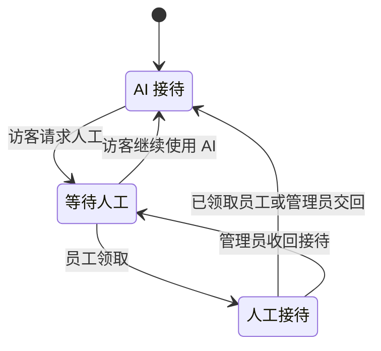

# 微信小程序智能体服务设计

> 2026-11-16 · v0.1 待评审。一个通用小程序，按租户和智能体实例发码，自有会话内支持 AI 和人工交接。[前期调研](../../research/wechat-mini-program-agent-service-research.md) · [开发计划](../../plans/plan-wechat-mini-program-agent-service.md)

## 1. 首版交付

已购买数字员工的客户在 AID 后台发布面向公众的服务。一个 AID 运营的微信小程序（一个正式 AppID）承载多个租户，每个租户的每个已发布实例有自己的码。最终用户扫码看到企业名称、Logo 和服务名，微信登录后可开始咨询。租户员工在 AID 后台接待。客户从提问、转人工到交回 AI 使用同一条会话记录。

| 使用方 | 首版能完成的操作 |
| --- | --- |
| 租户管理员 | 为本租户一个启用且具备对外发布权限的实例创建发布记录。填写服务名、欢迎语、服务时间，选对外知识范围和接待成员，设置用量限制，预览、发布、停用，下载微信原码和品牌 PNG 海报。 |
| 微信访客 | 扫码进入指定服务，微信登录、文字问答、查看本人在当前服务的历史、继续原会话或新建。点「转人工」，查看等待、已接待及交回 AI 的状态。离线前可以留言，回到小程序可继续查看。 |
| 人工接待成员 | 在 AID 后台查看自己有权接待的待领取会话和本人已领取会话，领取、查看对话、回复文字、交回 AI。租户管理员可收回或交回自己租户的会话，处理员工离线或被撤权的情况。 |

首版先验证售前公开知识问答和人工服务。拟将手机号回拨、头像昵称、图片语音、订阅消息、自动超时交回、分组排班、线下不同点位归因、跨渠道绑定和客户自有 AppID 放入后续版本。首版人工服务时间展示为租户配置，访客离开后的回访以小程序历史为准。首批建议选两个允许发布的租户，至少一个已有日常接待人员。两租户都参与隔离验收。

## 2. 发布、发码和进入

1. 租户管理员从数字员工实例进入「微信小程序发布」。创建草稿后预览服务页，展示租户品牌、智能体服务名、欢迎语、服务时间及平台运营方信息。选择当前租户已明确批准对外的资料。支持空知识范围，用于仅靠对外提示回答的实例。
2. 首版每个 `(tenant_id, instance_id)` 对应一条发布记录和一个稳定的随机 `entry_key`。平台按环境选择 AppID，服务端调用 `getUnlimitedQRCode`，输入固定小程序页面和不超过 32 字符的 `scene=entry_key`。租户、实例及配置由服务器查表。重复下载复用原码，Logo 或文案更新只重绘海报。码的目标不可改绑到另一个实例。微信原码保持原样，租户 Logo 放在海报和小程序页面上。 [微信发码接口](https://developers.weixin.qq.com/miniprogram/dev/server/API/qrcode-link/qr-code/api_getunlimitedqrcode.html)
3. 扫码页区分微信启动场景和页面查询参数中的业务入口码。冷启动、热启动和微信转发都按当前入口以服务端解析结果为准。转发路径只包含公开入口键。切换租户或实例时，销毁当前页的会话资源和在途请求引用，迟到响应按页面入口丢弃。直接从最近使用打开时，可进入本人最近访问的有效服务，无法恢复时显示扫码指引。
4. 发布状态为草稿、启用、停用。停用时停止新会话、发送与转接，已有会话的访客可重新认证并读取该服务的本人历史。旧原码显示停用。重新启用可恢复原码，平台级访问撤销和租户停用应阻断历史读取。AI 已受理的回合由 Runner 正常收尾和结算，未进入对话的迟到输出按接待权与发布版本处理。停用和重新启用都更新版本，服务恢复后旧在途结果不可补发。

平台控制首批可发布租户和实例，租户管理员控制所授权服务的发布。更新对外提示或知识授权时变更其发布配置版本，防止失效的内容权限继续用于公开输出。海报、服务名与租户信息变更独立于运行权限。

## 3. 身份、会话和页面

小程序发起 `wx.login`。AID 服务端按当前环境 AppID 调 `code2Session` 换取 OpenID，按 `AppID + tenant_id + OpenID` 映射外部访客，签发只用于该发布服务的短期 AID 凭据。微信会话密钥留在服务端。服务切换或凭据过期时再次校验。页面只提交公开入口键、消息和操作所需标识。服务端以可信发布记录和鉴权事实派生租户、实例与访客。OpenID、凭据和原始个人资料不出现在 URL、分享、公开日志及模型输入。首版使用默认头像和访客称呼，账号关联按微信身份处理。 [微信登录](https://developers.weixin.qq.com/miniprogram/dev/framework/open-ability/login.html)

访客进入后看到当前服务最近一条自己的会话。有历史时可继续，也可显式开新会话；首次发送或请求人工时创建会话。不同访客及不同发布服务的历史各自独立。小程序只提供自己的历史，没有跨租户列表。切回前台按会话消息位置补读，发送响应丢失时复用请求 ID。加载、待 AI 回复、等待人工、人工接待、停用和失败均有独立可见状态。回复同时以文字标识「AI 生成」或「人工客服」。

后台用现有账号认证与租户范围。只有名单内且当前仍有接待权限的员工可查看待领取会话。员工只处理本人领取的会话，租户管理员可以处置本租户会话和接待成员。员工移出名单、账号停用或会话已交回时，服务端在下一次操作直接拒绝旧坐席提交。审计记录操作人、时间、原因、状态前后和请求 ID。

## 4. 同一会话内切换接待

| 状态 | 客户发送文字后的行为 | 可执行的交接操作 |
| --- | --- | --- |
| AI 接待 | 写入用户消息，提交一次 Runner。同一会话已有本接待版本的在途回合时，新发送提示等待并保留草稿；原请求重试返回已登记的回合。 | 客户可随时点「转人工」，包括 AI 正在生成时。 |
| 等待人工 | 记录并展示客户留言，员工上线后可领取；页面提示服务时间。 | 有权接待的员工可领取，访客可点「继续让 AI 帮我」。 |
| 人工接待 | 记录客户消息，由当前领取人对外回复。 | 当前领取人或管理员主动交回 AI。管理员也可收回至等待队列。 |

首版由访客按钮发起转人工。AI 可以建议点击该按钮，模型回复本身不能变更状态。切换接待不会创建新的会话。员工发送时传入本次回复所看到的最后一条客户消息位置，服务端只将该位置及之前的消息标为已处理。员工查看后同时新到的客户消息仍为待处理。人工和 AI 对客户可见的消息共同进入后续上下文。

会话持久化当前接待状态、接待人、接待版本 `handoff_revision`、消息位置与已处理的客户消息位置。领取、交回和公开发言按同一会话行串行校验并写入。每次状态或接待人变化递增接待版本，关闭发布同时使该发布的在途公开权失效。两人抢领时只成功一人。AI 结束时校验任务原绑定的会话、接待版本、当前状态及权限配置，有任何变化则结算实际用量并抑制该条公开回复。已经提交到公开历史的回复保留。切到人工后可按旧任务 ID 请求停止该 Runner，人工接待无需等待停止完成。

交回 AI 后若有待处理客户消息，在同次交接时登记一次续答，范围截至交接时已收到的消息，执行使用固定输入与历史位置。没有待处理消息时，只显示「已交回 AI」，等待下一次提问。重复交回沿同一请求 ID 返回同一结果。旧 Runner 若仍占会话执行位，新登记的续答按现有 Runner 协调等待；若无法继续则展示失败和可重试动作。AI 回复失败时保留待处理位置。访客可显式重试或直接转人工，重试创建新的 AI 回合，复用已保存的待答消息，无需重复发一份正文。

## 5. 后端归属与持久事实

| 对象 | 关键数据和约束 | 写入方 |
| --- | --- | --- |
| 小程序发布 | 随机入口键、租户、实例、对外提示与知识范围、接待名单、状态、配置版本、配额；当前租户和实例唯一。 | 小程序渠道服务。 |
| 外部访客映射 | AppID、租户、经服务端验证的微信身份、内部访客 ID；按租户隔离。仅在微信 API 实际需要时留存外部身份原值，遵循项目加密规范。 | 小程序渠道服务。 |
| 会话及接待 | 通过 `channel_sessions` 记录独立的会话和渠道访客归属，扩展实例绑定和接待状态所需的事实。每点一次「新对话」生成新会话 ID，按仓库约定包含独立聊天标识。会话归属绑定发布记录和访客。 | 小程序渠道服务。 |
| 对外消息 | 沿用 `channel_messages`，按会话内单调位置同步。客户文字、人工文字、系统状态及 AI 最终文字按明确来源展示。使用既有消息存储与身份检查。 | 小程序渠道服务是该来源公开历史的唯一写入者。 |
| AI 待执行回合 | 会话、接待版本、发布权限版本、待答消息范围、模型历史上界、固定 Runner 请求 ID、Runner ID 和处理结果。与首条消息或交回动作同事务落库。 | 小程序渠道服务登记与投影，Runner 负责推理、执行事实、恢复和结算。 |

现有渠道会话方法默认为「相同平台聊天标识复用已有会话」。本渠道用自己生成的聊天标识表示每次新会话，避免回落到只按访客和智能体查一条。普通 Web、iframe 与小程序各走对应身份和来源，遵循仓库第三方渠道历史分离规范。 [渠道会话实现](../../../src/channels/session.py) · [数据库约定](../../../.claude/rules/database_dev.md)

拟增加内部来源 `wechat_mini_program`，继续用 `session.kind=channel`。Runner 只接受受信的渠道提交，从持久回合及现时授权核实固定实例与访客；执行接入显式处理外部访客，无须为访客造一个普通员工账号。用户消息已经落库，Runner 用本回合固定的历史水位读取，排除本回合输入消息及后来到达的消息，把当轮输入装配一次。历史只取本会话公开且已通过检查的内容。Runner 对该来源结算并产出持久终态，不直接追加渠道公开历史。 [Runner 授权](../../../src/services/agent_runner/authorization.py) · [Runner 终态](../../../src/services/agent_runner/finalizer.py) · [共同契约检查点](../../system/runner-desktop-runtime-integration-contract.md#微信小程序服务共同检查点)

用已有后台服务驱动已登记回合，处理重新启动和网关超时。调用 Runner 在会话事务外进行，避免转人工被远端调用拖住。提交重试查同一稳定请求键；状态读取与未发布终态按回合继续处理。按回合同一事务写公开回复、推进已处理客户位置并标记投影结果。旧接待版本或撤回权限导致的抑制同样持久记录。历史、审计和账单各由自己的权威数据读取，人工状态切换不改变 Runner 已发生的费用。

发送、转接、发布停用和 AI 结果投影采用统一的加锁次序，先核对发布权限和版本，再串行更改会话。AI 输出检查在事务外完成，提交时重新核对发布版本和接待版本。重复投影同一个 AI 回合至多新增一条公开回答。小程序按公开消息位置补读，未发布的 Runner 结果及内部进度仅供后台排查。

## 6. 接口和边界

| 调用者 | v1 接口草案 | 语义 |
| --- | --- | --- |
| 小程序 | `GET /api/mini-program/v1/entries/{entry_key}` · `POST /api/mini-program/v1/auth` | 获取公开服务信息、用微信 code 兑换绑定入口的短期凭据。 |
| 小程序 | `GET/POST /api/mini-program/v1/conversations` | 查询本人当前入口历史、按请求 ID 创建新会话。 |
| 小程序 | `GET/POST /api/mini-program/v1/conversations/{id}/messages` | 读取增量或发送文字。响应返回公开消息位置、接待状态与当前 AI 回合的公开状态。 |
| 小程序 | `POST /api/mini-program/v1/conversations/{id}/handoff` | 按当前状态允许「转人工」或「仍等待时继续使用 AI」。 |
| 小程序 | `POST /api/mini-program/v1/conversations/{id}/retry` | 为上一个失败且当前仍待处理的 AI 回复登记一次重试。 |
| 租户后台 | 发布列表、创建或更新、启停、生成及下载素材；工作台待领取列表、会话、领取、回复、交回、收回。 | 沿现有后台登录与租户范围，所有写入按身份鉴权，交接使用请求 ID 与接待版本。 |

客户端短请求发送后按会话状态轮询，前台活跃时追增量，有错误或进入后台时退避或停读。回前台从最后水位补读。服务端返回一致快照。在当前身份仍有权限的前提下，同一请求返回原结果，请求 ID 相同但内容变化则拒绝。失效会话与无权访问采用同一反馈，不暴露资源存在性。网络错误允许按原请求重试。

访客只能使用明确发布的提示、可公开知识和受控检索。项目内部业务数据、任意插件能力、设备和工作区权限不随实例对外发布。检索在服务端执行资源级授权，模型不能扩大检索范围。内容检查覆盖用户输入和 AI 输出。输入未通过时保留本地草稿并反馈，输出未通过时告知无法给出本轮回复，仍可转人工。只向客户端提供通过检查的公开文本。

使用既有租户积分和 Runner 用量回执，另外限制入口频率、单访客频率、文本长度及入口并发和日受理量。按稳定回合扣减受理额度，重复提交不重复占用。预算不足或超限时保留历史和授权人工接待。交回动作可成功提交，待答消息保留，并在该会话标明 AI 当前不可用，恢复后由访客明确发起下一轮或重试。入口停用与访问撤销按第 2 节处理。

## 7. 审核与运营边界

小程序显著展示运营方、实际服务企业、隐私和反馈入口；审核材料说明一个 AppID 为不同租户提供服务的实际形态。运营方准备适用类目、微信小程序备案材料、实际使用模型的资质及技术合作材料，并核实对应的生成式 AI 登记或备案及公示。对外展示 AI 标识，复制功能如启用则连同标识提供。试点服务范围与目标 AppID 的类目和申报场景一致。 [微信服务类目](https://developers.weixin.qq.com/miniprogram/product/material/) · [小程序隐私指引](https://developers.weixin.qq.com/miniprogram/dev/framework/user-privacy/) · [工信部备案通知](https://wap.miit.gov.cn/jgsj/xgj/wjfb/art/2023/art_dd783a581c9644a4aee10afa582811db.html) · [网信办登记与备案公告](https://www.cac.gov.cn/2026-09/14/c_1791136833136332.htm) · [AI 内容标识办法](https://www.cac.gov.cn/2025-03/14/c_1743654684782215.htm)

后台能观测发布、扫码、首条咨询、转人工、接起、交回及错误数量。试点使用这些数据比较首问转化、AI 首响、人工接起和每次有效咨询成本。隐私删除和保留周期按运营方确认的制度实现，提审前能走通用户请求入口和后台受理流程。正式环境使用实际域名白名单和同一审核候选版本。 [提审前验收清单](../../plans/plan-wechat-mini-program-agent-service.md#提审前验收清单)
