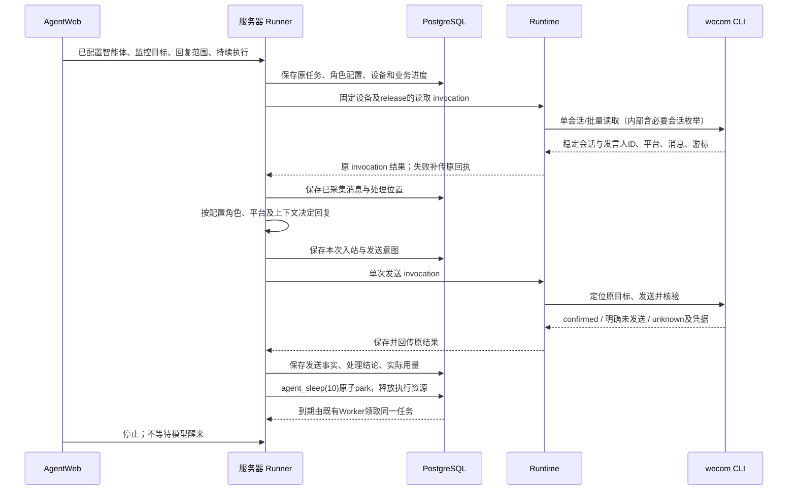

# wecom-cli：第一方企业微信操作 CLI / MCP Provider 设计

> 状态：✅ 已实现并持续维护（2026-10-09 按当前代码整合撰写）
>
> 上位规范：[第一方 CLI / MCP Provider 架构与开发规范](../../system/first-party-cli-mcp-provider-standard.md)
>
> 姊妹实现：[weixin-cli 设计](../weixin/weixin-cli-design.md)（操作模式与契约来源）
>
> 本文档是 wecom-cli 的唯一现行架构设计文档，整合自已删除的真机探测与方案设计
> （2026-08-29）、RPA 取代差距分析与实验设计（2026-09-28）两份过程文档及 README
> 里程碑记录（过程明细见 git 历史；工程内 `clients/wecom-cli/README.md` 保留详细
> 真机实测叙事）。

## 1. 定位

`wecom-cli` 是项目第三个第一方 CLI：独立、可分发的 Windows MCP Provider
（provider_id `ai.aidwork.wecom`，可执行 `aid-wecom`，stdio transport，`local_required`，
平台 `win32-x64`），操作已登录的企业微信 Windows 客户端（WXWork.exe，5.0.9 系实测）。

与旧 RPA 的关系：**取代 `clients/wecom-personal-rpa` 的 UI 执行职责**——约 5600 行 C#
工程中真正操作企微的只有 ~770 行 PowerShell；wecom-cli 以 TypeScript Provider + 精简
驱动承接全部 UI 能力，C# 壳计划瘦身为调用本 CLI 的协议壳（对接尚未落地，见 §10）。
RPA 已于 2026-09-29 标记废弃（6d48163e：README/STATUS 横幅 + 前端渠道入口移除 +
激活码管理越权收口）。服务端会话归档栈（`src/channels/wecom_personal_rpa/archive/`）
不属于本 CLI 职责。

## 2. 工程形态与命令面

- Node.js ≥22 + TypeScript（ESM）；依赖仅 `@modelcontextprotocol/sdk` + `zod`；
  `npm run build / typecheck`，`npm test` = build + node:test 递归（全 mock）。
- CLI 动词 14 个：`probe / search / select / send / send-image / send-file / unread /
  read-session / watch / add-customer / mcp / doctor / version / help`。
- MCP 工具 10 个（`src/mcp/toolDefs.ts` + `src/operations/registry.ts`，CLI 与 MCP 共用
  同一 operation）：

| tool | 作用 | 写语义 |
|------|------|--------|
| `wecom_probe` | 平台/交互会话/PowerShell/WXWork 进程/主窗口/登录态三态（online/need_login/offline，need_login 附二维码 PNG base64） | 只读 |
| `wecom_chat_search` | 搜索联系人/群，返回 best/items + 带坐标 target_ref | 只读 |
| `wecom_chat_select` | 点击搜索结果进会话 | 半写（清角标） |
| `wecom_read_session` | 读会话消息，双通道路由（§5） | 半写（清角标） |
| `wecom_watch_poll` | 新消息跟踪单轮，水位 diff 只返增量 | 半写 |
| `wecom_unread_list` | 未读会话快照 | 只读 |
| `wecom_message_send` | 文本 ≤2000 字（多行走剪贴板） | 写 |
| `wecom_send_image` | png/jpg/jpeg/bmp/gif ≤20MB | 写 |
| `wecom_send_file` | 任意扩展 ≤100MB，文件名去空白 ≥3 字符 | 写 |
| `wecom_add_customer` | 按手机号检索并发添加邀请（confirm 显式 true；M12 网络查找直达路线） | 写 |

- 智能分发（M11a）：send/send-image/send-file/read-session 支持 `target_ref`/
  `target_name` 二选一；驱动返回 `navigate_required=true` 时 TS 层（`src/operations/
  navigate.ts`）编排内部 chatSearch+chatSelect 后二次调用；`resolveTargetByName`
  走 Jev best 身份校验 → 唯一匹配回退 → 歧义 fail-closed（`TARGET_AMBIGUOUS`）。

## 3. 架构分层与操作契约

```text
CLI 动词 / MCP stdio ──> operations（10 个，统一 OperationResult，永不 reject）
                          │  effect ∈ none|applied|partial|unknown，20+ 稳定错误码
                          ▼
        platform（powershell 驱动执行器 / targetRef HMAC / watchState 水位 / serverProxy / namedMutex）
                          │  spawn powershell，stdout 末行 DRIVER_JSON: {ok,data|code,message}
                          ▼
        drivers/ps1（_common.ps1 底座 + 9 动作驱动，Win32 P/Invoke）+ drivers/py（RapidOCR）
```

- 驱动错误码白名单映射；默认超时 300s（read-session 600s）；业务失败 ok=false 且退出码 0。
- 并发控制：进程内单飞 + 跨进程命名管道互斥 `\\.\pipe\AidWorkAgent.AidWecom.<scope>`，
  占用返回 `BUSY` 结构化结果。
- `target_ref`：HMAC 签名短期句柄（5 分钟 TTL），绑定目标指纹；写动作不接受模糊裸名。
- manifest schema digest 按上位规范 sha256 序列化（`src/mcp/manifest.ts`）。

## 4. Win32 交互机制（真机裁定的事实）

- **一切交互只走 PostMessage**：企微 5.0.9 丢弃 SendInput/keybd_event 注入（键盘+鼠标，
  2026-08-30 复核），代码层禁用；组合键（Ctrl+F/Ctrl+A/Ctrl+V）经 AttachThreadInput
  attachstate 发送。
- **截图**：`PrintWindow(hwnd, hdc, 2)`（PW_RENDERFULLCONTENT）——前台/后台/被遮挡/
  最小化均出完整画面（9 点采样全黑/白回退 CopyFromScreen），CLI 可完全后台运行。
- **输入规则**：无修饰 ASCII 走 WM_KEYDOWN（带 scan code）；Shift 修饰字符/中文走
  WM_CHAR；两条路径不可混发（Qt 会双倍字符）；posted 修饰键无效（Qt 读真实键盘状态，
  Ctrl+V 落成字面 `v`）→ 多行文本/图片/文件经剪贴板粘贴（Clipboard.SetImage/
  SetFileDropList，覆盖不恢复）。
- **滚动**：PostMessage WM_MOUSEWHEEL（delta<<16）。
- **窗口拓扑**：主外壳 `WeWorkWindow` + 每功能页子 HWND（类名 `WXworkWindow - 企业微信-
  <页名>` 编码页名）；**2026-09-29 客户端更新后子窗口消失**，页面校验改 OCR 动态定位
  （导航项 OCR 找"通讯录"等）；弹窗 `SearchExternalsWnd`（添加客户 400x292）/
  `InputReasonWnd`（发送邀请）类名稳定。PostMessage 点击必须投递到拥有目标坐标的
  HWND（WindowFromPoint 判定），hwnd 动态变化每次重新解析。
- **感知与决策**：RapidOCR（仓库根 venv，未装 → `CONFIG_MISSING`）读文字；未读角标
  用红色像素 blob 检测 + 5x 放大 OCR；决策层 Jev（TypeSafe System One 类型化决策，
  `Invoke-WeComJev`，缺 key/失败逐级降级到规则链）。视觉模型坐标定位（weixin-cli 的
  KimiVision 链路）未引入本 CLI。
- **已知启发式弱点**：消息 side（左右）判定仍为启发式，代码注释自认不可靠（§10 遗留）。

## 5. read_session 双通道路由（M10）

`serverUrlConfigured(env)` 检查 `AID_WECOM_SERVER_URL`：

- **未配置 → 本地 OCR 通道**：驱动 `-ParseMode ocr`（channel="ocr"，免费）。
- **已配置 → 服务端模型通道**：驱动 `-ParseMode none` 只截图 → TS 读 page-*.png 转
  base64（反转旧→新，单图 ≤5MB）→ `parseSessionHistory` 上传
  `POST {AID_WECOM_SERVER_URL}/api/client/v1/session-history`（channel="model"，
  透传 model_usage/billing）。
- **失败分类**（`serverProxy.ts` ProxyError.kind）：`unavailable`（网络/超时/5xx/422/
  截图缺失超限）→ 二次调驱动 OCR 兜底并记 fallback_reason；`config`（401/缺 token）与
  `insufficient_credit`（402）→ 不降级直报。
- **watch 轮询内的 read-session 不走计费通道**（缺省 ocr，维持纯本地）。

服务端实现 `src/api/client_routes.py:603`：GLM-5.3-Flash 多模态并行分页
（asyncio.gather）+ 页间重叠去重合并；计费 `_session_history_credit_cost` =
`ceil(token 成本(元) × credit_multiplier × 100)/100`（Decimal 防浮点），不足最低值按
最低收（口径"成本×100 积分、最低 1 积分/次"），余额不足 402 阻断。

## 6. 服务端协作与鉴权

- 唯一服务端接口 `/api/client/v1/session-history`，`Authorization: Bearer
  <AID_WECOM_SERVER_TOKEN>`；超时 150s；单图 ≤5MB、1..10 张。
- 鉴权为 **M10c 直连长期静态 token**：服务端 `POST /api/saas/client-bindings/static`
  签发（token_type='static' 跳过过期检查）；无激活流程、无本地缓存（激活码链路与
  DPAPI server-binding.json 已移除）；401 判 config 直报不重试。
- Runtime 集成（M11b）：`clients/agent-tool-runtime` 的 productTrust 白名单含
  `ai.aidwork.wecom`，Host 将 `AID_WECOM_SERVER_URL/TOKEN` 注入 provider 进程环境
  （runtimeHost.ts）。

## 7. add-customer 路线（M12 重标定后现行）

旧通讯录路线因 2026-09-29 客户端更新失效（④添加按钮 CEF 渲染 + 注入过滤，PostMessage/
mouse_event 均无效）。现行**网络查找直达路线**（全程 PostMessage 零真实点击）：

Ctrl+F 聚焦搜索框 → 清残留 → WM_CHAR 输入手机号（回读 contains 校验）→ 搜索 overlay
出现「网络查找手机号/邮箱：<号>」行（同行拼接校验防点错）→ 点击该行（投 overlay
hwnd）→ `SearchExternalsWnd` 自动填号（校验 + 手输回退）→ Enter 检索 → 结果行
（微信名 + 添加）→ `InputReasonWnd` → 发送 → 终态「已发送申请」轮询。弹窗段 M1 代码
逐行保留。

防御要点：陈旧弹窗在关键点击前关闭并等消失（关不掉 fail-closed，防向旧号码误发，
CR P1 修复）；finally 清搜索框手机号残留（隐私）；OCR 调用 Process 直启（规避 MCP
stdio 白名单 CantActivateDocumentInPipeline）。

## 8. 消息读取与 watch 水位

- read_session：滚动截图 + OCR + 页间重叠去重（移植 weixin-cli 算法，企微气泡布局
  独立调校）；时间分割线整行锚定（前缀匹配会误吞真实消息，CR P1 修复）；消息文本
  归一化三侧一致（py/ps1/TS：去空白 + 全角转半角 + 小写折叠）。
- watch_poll：unread 快照 → 与本地 watchState 水位 diff → 候选会话进会话读增量；
  进会话即清角标（固有副作用），读取成功后 last_unread 归零（否则角标小于旧水位的
  新消息漏报，CR P1 修复）；首读无水位保守全推（设计行为）。

## 9. 测试与交付

- 21 个测试文件、209 个 node:test 用例（全 mock，不触真实企微窗口）：operations
  契约（30+18）、CLI 命令（17）、双通道路由与降级（12+9）、server-proxy 错误分类（12）、
  target_name 直达（12）、send-file/image（10+8）、targetRef（8）、manifest（6）等。
- 真机验证：M2-M12 各里程碑真机实测（README「关键实现事实」含 2026-09-04/09-28/
  09-29 三次客户端更新重标定记录）；M12 时 13 命令全部真机验证通过。
- 交付形态：Runtime 插件 Host 分发（productTrust 白名单 + 环境注入）。

## 10. 演进与遗留

里程碑：M1 probe+add-customer → M2 search+send → M3 unread/read/watch → M4 搜索重构
（attachstate+Jev+坐标句柄）→ M5 select → M6 send 智能分发 → M7 send-image →
M8 send-file → M9 read→read-session 改名+智能分发 → M10a/b/c 双通道+直连静态 token →
M11a/b target_name 直达 + Runtime 注册 → M12 add-customer 网络查找重写（13 命令全通关）
→ E5 probe 登录态二维码。

遗留（未做项，均为增强非阻塞）：

1. **常驻/远程 OCR 迁移**：weixin-cli 的 ocr_server.py 常驻进程方案未引入，仍每次
   拉起 python；
2. **协议壳对接**：wecom-personal-rpa 的 C# 壳未瘦身为调用本 CLI 的壳
   （wecom-ops.ps1 无 aid-wecom 引用）——RPA 废弃后的最终清退步骤；
3. 消息 side 判定仍为启发式（不可靠，待决策模型化）；
4. probe 的 need_login 分支待真机复验（开发机已登录未实测登出场景）；
5. `dist/` 编译产物时间戳落后 src（2026-09-28 后未重打包）；package.json description
   仍写 "M1 骨架"。


## 11. 群聊实验的输入定位修正（2026-10-23，实施中）

本机群聊实验确认本地库群定位、当前账号绑定、增量cursor及结构化提及可用。最初两类失败为中文群名搜索回读为空、Jev误把底部工具栏“快速会议”作为输入点；均effect=none且未按Enter。编辑区候选修正并通过独立测试/CR后，原CLI已在已开群、空搜索、账号绑定ref路径成功发送并核验多轮回复。完整长群名搜索实证为横向显示裁切导致OCR缺首字，2026-10-26已补齐发布后凭证、空读和剪贴板保护边界，通过当前源码真实双轮搜索及原文恢复验收；本结论不替代产品Runner长期联动验收。

修复必须从真实截图/日志验证焦点与编辑区候选，不以模型从OCR按钮中选出一个位置就证明它是输入框；保持标题/唯一目标、账号、用户草稿保护、发送前回读和发送后原本地记录/OCR核验。可使用既有受信Win32原语修正输入，不禁用外部决策凭据、放宽核验或新增第二套发送器。未确认的写效果必须暂停后续写，不能自动重发。方案与实际结果同步到[实验开发计划](../../plans/plan-wecom-cli-group-chat-experiment.md)。

实验编排与产品Runner分开记录：本次由开发助手判断是否回复，临时脚本串行调用原CLI、每约10秒读取原会话增量、按消息ID去重；首批历史仅上下文，排除脚本已核验发送的消息和系统消息（不按self方向一概跳过用户手动留言），结构化@本人必回应，普通群友闲聊不插话。第三方群聊内容作为回复数据，不获得改任务、发到别的群或访问其他资源的授权。用户明确停止后终止本实验及其子进程。实验不宣称已部署Runner、实现多天常驻或改动Runtime协议。


本批复审补充的清理边界：空搜索框直接跳过清理，不影响聊天草稿；无法确认内容及布局锚点时保守失败。非空只在真实内容锚点、唯一同行右邻+及原窗口几何共同确认已实证搜索布局时点击专属清空点并回读empty；OCR漏识×导致unknown也必须满足相同保护，不泛化未知状态。不同布局/DPI仍保守拒绝，不使用对当前不确定焦点的Ctrl+A/Delete。模型输入点只有在可靠搜索/编辑区锚点范围内才可选，消费答案时再核对；GetFocus等于Qt主窗口、快捷键投递成功或几何范围内点击过，都不能独自证明内部编辑焦点。

搜索全文校验保留原OCR精确规则；仅在OCR不等时使用Ctrl+A/C非破坏性复制兜底，不接受缺字/子串作为成功。复制结果需证明为本次企微写入、全文精确相等且不把正文写入新诊断日志；富格式在覆写前拒绝，预检/恢复剪贴板使用短锁内原子比较与替换保护外部新写入，系统写入失败时同锁仅尝试一次预分配原文补救。系统写入、恢复或关闭失败均中止并明确提示原剪贴板可能未恢复，不报成功。UIA不提供可用全文pattern。2026-10-26当前布局完整搜索及连续搜索已真实验收；群聊实验仍保持结束，不恢复监听。实际进度和证据以开发计划为准。

### 11.1 完整搜索与剪贴板恢复收尾（2026-10-26）

原生写锁内的sequence不是Close之后的发布凭证。写入nonce后以稳定seq→全文→精确本次hidden HWND→seq证明发布结果；无receipt时也只能按同样完整证据回收本次nonce，再由原CAS锁内复核，不能只凭owner或空值恢复。复制结果仍需企微PID、新seq、稳定全文及窗口几何证明。

OLE首个null/零格式读取可在同一seq下短暂缺失，故仅此条件下等待25ms重新取DataObject一次，不能复用旧对象或通用重试富格式/异常。空/零长复制样本不构成非空query凭证，只沿既有1500ms期限等待有效结果；期限结束或读取失败且原文未恢复时明确提示，不自动重输或盲写。当前确有可恢复nonce时不虚报原值丢失。

普通文本可能附带`EnterpriseDataProtectionId`。只有这一种额外格式、确有文本且[官方接口](https://learn.microsoft.com/en-us/windows/win32/devnotes/edpgetenterpriseidforclipboard-function)成功返回NULL时才作为个人文本处理；非NULL身份、失败/缺API及其他富格式仍拒绝，不读/记企业ID，不调用设置或清除保护API，返回缓冲按官方要求释放。此只读判断位于原有seq/CAS证明范围内，不缓存；真机原文及恢复后个人状态已另行核对，不把CAS成功当成任意格式保护往返证明。

最终独立策略/空读23项、三个PS入口及CR通过，当前原生CAS替换/回滚算法未改。强杀进程、系统写入失败、其他DPI/未标定布局或企业保护数据不在成功保证内；不引入持久剪贴板原文备份。历史补丁已吸收，不应再次应用，具体复现命令与剩余后续事项见原开发计划。

## 12. 持续监控端到端收敛（2026-10-27）

本节将配置智能体、个人微信/企业微信发言人识别、Runner中断恢复与Runtime/CLI接线合并审查；实施进度唯一登记在[原计划W10](../../plans/plan-wecom-cli-group-chat-experiment.md#w10-真机前综合收敛2026-10-27)。身份字段来源和解析规则仍以[本地库设计§13](wecom-cli-localdb-design.md#13-单聊与群聊的发言人平台识别2026-10-27)为准，不另写一套分类算法。

### 实施说明（2026-10-27）

本节最初为静态候选；用户后续已授权实现。当前源码、独立验证与未验收范围统一见[W10实施记录](../../plans/plan-wecom-cli-group-chat-experiment.md#w10-真机前综合收敛2026-10-27)，以其覆盖旧“本轮不实施”措辞。三工具方案已实现，旧内部执行保留。共同契约已登记2.11。

读取session最多2048字符、cursor最多16384字符、每批最多50条且结果16KiB。批量cursor冻结目标范围，省略sessions不扩大到全部；局部失败保留原水位，首批历史和之后新消息用不可变start_fence划界。未知身份另带精确原消息恢复cursor，不靠最近窗口重试。已ACK且效果已知、证据一致的本机普通记录才回收，unknown与未ACK证据保留；不承诺全盘无限运行零增长。

发送先检查当前目标，匹配则不导航；不匹配才内部搜索。正常搜索清理不发Esc；已登录但窗口在托盘时识别同一进程/账号并恢复原窗口，不提示重新登录。平台来源和未知边界见本地库§13，外部联系人不直接等于微信。

### 12.1 实施前审查基线与结论

- 代码基线为wecom工作树HEAD `349a10ab`及现有未提交P6/P7/W9。BOSS/Runtime恢复提交`dd634717`、`6871fdef`均已在HEAD祖先中；本地master另有`2dda0f1c`、`45e28eb2`，分别涉及微信客服呈现及独立生图容器，本轮未合并，不宣称拉取了远端最新引用。
- 参照BOSS的局部失败隔离、原调用内恢复、迟到回执与原会话续做经验，直接复用公共能力；不移植浏览器/CDP专用恢复到企微。参考[恢复计划](../../plans/plan-runner-local-tool-recovery-lockup-fix.md)、[最小修复交接](../../incidents/boss-agent2-issues-and-minimal-repair-handoff-20261023.md)、[共同契约2.10](../../system/runner-desktop-runtime-integration-contract.md)。
- 本轮是主控静态审查与方案收敛，没有故障注入、独立CR或真实设备业务验收。现有源码已有持久sleep、增量群读、发送对账及公共Runtime恢复，但不足以承诺“发布任意时刻中断后持续任务自动接着走”。下列代码缺口需先收尾，已有测试结果不覆盖它们。

### 12.2 从AgentWeb进入后的目标流程



用户的“直到我停止”直接形成continuous意图；只有目标/持续性确实不清楚才澄清一次。安装配对、原设备和已授予的任务范围沿现有契约使用，不追加逐条发送审批。智能体由服务器使用所选profile/实例的提示词、模型与工具，Runtime只执行确定性工具，不在本机再建一个智能体。

步骤中的业务进度至少包含：每个会话采集cursor、已处理位置、最近必要上下文及尚未处理入站、发送pending和已确认出站。采集cursor可以前移，但必须在同一次checkpoint中保存对应待处理内容；不能取到cursor就把消息视为已回复。各目标独立游标，单任务多群与多会话任务不消费共享watch水位。批次大小与checkpoint容量沿现有上限约束，不建立无限消息数组。

### 12.3 静态发现与最小修正

以下均为代码确认的行为或缺口；影响范围为推导，尚非本轮实机复现。

| 编号 | 源码证据与卡点 | 最小处理 |
|------|----------------|----------|
| R1 | `execution_repository.reap_expired`把运行中失租任务置interrupted；`recovery_repository.next_candidates`要求resume_control_id；timer仅自动接回armed等待或尚未开始动作的activation | 发布发生在模型/读写期间时，未必有自动接续入口。给已授权continuous任务补服务器发起的中断接续，复用Worker领取、RecoveryCoordinator和原checkpoint，不伪造用户control，不从任务开头重跑 |
| R2 | `runtime_manifest.configuration_fingerprint`哈希整个prompts目录及全局模型/agent配置，`recovery.prepare`严格比较 | 无关提示词或无关模型配置更新也可能阻止原任务。指纹收窄为该任务实际使用的语义依赖，保留真实profile、工具契约及授权变化检查；兼容发布不因Git提交号不同而拒绝 |
| R3 | `worker._acquire_timers`把SourceUnavailable和RunnerError交给`timers.hold`，后者写sleep_blocked并清wake_at | 确定的暂时源故障保留原等待、自动退避重试；配置不兼容/失权才转明确待操作状态，不把所有恢复错误固化为手动继续 |
| R4 | `overlay_flow._known`、`durable_flow.finish_original`对unknown转整轮核验；`LocalRecoveryProof`见unknown返回False | 对已固定release承诺的纯DB只读操作，按原cursor安全重新读取或先接纳原结果；不能把读失败当未知外发冻结。仅UI“只读”可能带模型收费，不能不分通道盲重试 |
| R5 | `wecom_send_status`能读原发送凭据，但未将confirmed自动接回原发送ToolFact；前一发送unknown已让Engine等核验 | 在原WeCom调用恢复分支补只读对账，确认后关闭该次pending并续做；未知只保留该发送/会话待核对，不机械停止独立目标。不得把查询成功当发送成功 |
| R6 | 云端`WecomReadSessionInput`无native已有的channel/cursor/limit，unread无focus/channel；只有group-poll显式保完整JSON | 收敛为单会话读/批量读两个Agent读取入口，内部复用原DB查询并补齐增量/分页，确保消息、身份及cursor不被通用文字截断。DB监控不退慢UI，暂时错误退避，不重建基线 |
| R7 | `wecom_task_device`仅首次group-poll固定，绑定后所有文本发送强制group_cursor且拒绝ref；现约束无法表示单聊与群并存 | 保留原设备绑定，新增监控单聊所需的原账号/会话定位；发送范围按实际目标核对，不让“曾监控群”成为后续单聊永久拒绝原因。媒体本轮仍不实现，但不得把未实现范围描述成普遍安全要求 |
| R8 | group-cursor发送前仍会走`resolveTargetByName`搜索；contact ref仅5分钟；read-session续读仍按名字重新resolve | 已有稳定会话定位时按ID与当前账号复用，名称仅展示；ref过期可在原已确认目标刷新，不能要求用户反复搜索。真正多目标歧义才澄清，不能为一个已确认ID重复选人 |
| R9 | 群有sender_id/name、单聊归一丢sender_id；均无平台；现有unread仅提供待回复线索，不能枚举所有微信单聊 | 落地P8平台分类；会话枚举、批量读与待回复候选合成一个业务工具，覆盖已读及新单聊；不另公开session-list。不能以外部关系替代微信，也不能声称未读角标覆盖所有客户 |
| R10 | `PollLoop.run`先await启动outbox重投，再启动心跳/claim；单条有5次上限，整个积压批次无工作量上限 | 给启动补投整批预算，心跳和主循环能及时运行；仍用原outbox增量补投，不增加一个恢复服务，也不重执行工具 |
| R11 | continuous_history已有闭合历史归档及事实裁剪；Runtime journal只追加，gave_up outbox保留，CLI发送凭据/图像产物暂无对应长期回收闭环 | 复用现有记录增加终态清理与保留策略；pending/unknown及未ACK证据受保护，已闭合普通产物可清理。不要以checkpoint有界宣称磁盘和业务历史也不增长 |
| R12 | `local_verification.verify_local`与`recovery_observation.invocation_scope`的原调用Provider范围只接BOSS；结束等待形成的设备hold是公共机制 | WeCom结束等待后可能有hold却没有适用的设备核验出口。补通已有受管资源核对/停止入口的WeCom范围，不新建解锁服务，不用修改原发送为成功来“解锁” |

另一个已确认的支路限制：`serverProxy.ts`的旧截图模型读取仍依赖单独的AID_WECOM_SERVER_URL/TOKEN，Runtime对BOSS已有配对身份注入不等于WeCom也已接入。本轮明确DB监控/DB发送核验不依赖这组额外凭据，不让遗留模型支路成为主链前置。首批不扩建截图模型能力；以后若确需接入，复用Runtime配对身份及相应合法服务入口，不能要求用户再配ClientBinding token，也不能借用BOSS专用端点。

### 12.4 恢复必须沿原事实继续

**服务器重启/发布**：sleep已提交时沿原timer恢复；sleep尚未提交、正在读取或已返回但未消费结果时，由R1接续原执行树。先收原invocation/模型与用量事实，再决定补做哪个未完成步骤。原Worker失租后不能继续派发；新Worker在同一数据库领取点取得执行权。已完成生成/扣费/发送不因换Worker重做。没有响应的模型尝试沿既有收据与待结算机制处理，必要新物理模型尝试使用新事实，不能复用已消费调用ID或伪造零消耗。

**Runtime断网/重开**：公共started/progress重试、独立续租、v1/v2原结果outbox与迟到回执接纳已经存在。恢复只补传原payload，服务器观察到原终态再继续。断网期间不启动重复发送；恢复轮询不因为一个旧未知“读取”永久占住整台电脑。真正仍活动的UI写操作继续走原串行执行，不强行并行抢桌面。

**发送unknown**：第一步等待/核对原结果；有receipt时沿已接入的send-status只读对账。confirmed才将原入站置已处理；查无唯一记录仍unknown，不据“暂未查到”自动再发。原调用连receipt都未回传时，先等原outbox或读取现有本机journal/回执定位事实；不能靠重新发送获取新凭据。无法确定时向用户说明该目标的具体待核对项，其余独立会话可继续。若同一目标的下一条回复依赖前次发送，先保留待处理，避免重复答复。

**恢复证据与动作权限分开**：对账记录挂在既有原调用/阶段资源，按原账号、会话、设备校验一次事实关联；它可以帮助关闭该次pending，不赋予换人发送或热换已接受release的权利。终态confirmed通过既有恢复事务推进原ToolFact/用量与处理位置，不新造第二个发送账本。原历史unknown事实保留，补上可观察的核对结论，不篡改事故历史。

具体接续落点：WeCom适配器将未知发送记入原checkpoint的目标pending，向Engine返回该次真实未知结果，避免直接落到通用整轮核验；恢复评估同时读取这一原调用事实。原对账工具作为既有恢复分支执行，不能要求已被挂住的模型先醒来调用它。正常取消优先协作式停止原调用；需要受管资源核验时扩展R12现有入口，停止证明只说明原执行不再活动、可解除对应资源hold，不说明客户是否收到消息。既有其他活动任务不能被顺带终止，电脑不需重启，用户不需重新配对。

**局部故障**：DB快照不稳定、短时BUSY、连接抖动按既有退避恢复；草稿不空时保留草稿，只暂停该目标写，继续读取/其他目标并给一次操作提示；窗口最小化/临时遮挡可在原窗口一次恢复后重新定位，不用旧坐标盲发。真实退出登录、换企业/账号、锁屏停止输入；登录/解锁后自动复查同一原身份，恢复后继续，不强制创建新任务。身份确已改变或权限撤销需用户决定，不自动换号。

**配置与版本**：新调用仍固定原release/digest，合法旧发行根保持可识别，不随意绕过验证。缺新能力在开始时给一次明确升级/接续提示；兼容变化正常恢复。确实更换任务角色或不兼容工具语义时，提供原会话合法接续为新版的单次操作，保留原进度和pending，不能让用户反复“继续”命中同一hash拒绝。旧全局hash缺少依赖明细时，不凭空声明兼容；实施时列出可识别旧基线与一次性接续路径。

**停止**：停止请求优先于到期/自动恢复/重试，服务端立即禁新派发，本机停止新输入并收尾原结果；保留可能已发送事实，不能把用户停止解释成允许忽略unknown证据。网络断开时如实显示本机停止确认仍待回传；不承诺已发生写动作可以撤回。Web关闭/SSE断开仅失去观察者，不取消任务。

### 12.5 工具与状态的收敛选择

本节按用户后续“三个方法”的决议替代此前增加公开session-list/conversation_cursor的候选，不再把群poll、枚举、未读及对账分别交给模型编排。**Agent业务工具仅三项**；内部函数/诊断和旧已接受调用的兼容执行不等于新Agent工具。

| Agent工具 | 最小输入 | 主要结果 |
|-----------|----------|----------|
| wecom_read_session | session: string；可选cursor、limit | 一个单聊或群的messages、稳定session标识、下次cursor、has_more |
| wecom_message_send | session: string、text: string | 原调用标识、发送状态、实际定位/核验结果；失败原因及恢复提示 |
| wecom_read_sessions | 可选sessions: string[]、cursor、limit | 批量会话聊天记录、pending_sessions待回复候选、下次cursor、has_more、局部failed |

`session`优先使用读取结果返回的稳定会话标识，首次也允许完整会话名，由内部解析。它是定位信息，不是额外授权票据；在当前账号内核实，不要求模型拼target_ref、group_cursor或conversation_cursor。`cursor`仅是增量进度，和目标定位分开；模型原样回传，Runner按原任务持久化。batch的limit约束整个返回批次，避免“每会话N条×全部会话”放大输出；未返回消息不推进水位。未指定sessions时读取当前任务允许范围内的本机已同步会话；指定时只读这些目标，不先强制全表扫描。新发现会话单独建立进度，不重置已有会话。

1. **平台**：统一`sender_platform=wechat|wecom|unknown`，按稳定sender_id批量解析。保留企微同事上下文；“只回复微信”只约束当前任务的回复触发，@处理也服从用户范围。unknown不让整批失败，按现有checkpoint记录待处理缺口，不建身份服务。
2. **读取**：三个业务入口内部复用read-session、group-poll、history和会话查询；不以三个工具为由把底层正确算法全部重写。补齐DB增量与完整分页；首次历史供上下文，是否补回旧待回复项服从用户本次任务，不能因开启监听自动回放。采集cursor只在结果和待处理内容已持久保存后使用，各任务不消费共享watch水位。
3. **待回复**：batch同时完成枚举、聊天读取与候选整理，不增加独立公开session-list或unread前置调用。pending_sessions引用同批session和消息ID，避免重复正文；未读角标不参与是否已服务的判据。“从未回复过”不是唯一条件，老客户的新入站也要处理；首批旧消息与新入站分别标明。CLI按客户发言/后续出站等DB事实提供候选，Runner以原checkpoint的已处理消息ID补充过滤，不要求CLI访问云端checkpoint或另建已处理账本。群聊不能因为最后一个人是同事或本人就认定所有客户问题已解决。候选表示需要判断，语义上是否已解答仍由智能体结合上下文决定；明确不需回复的消息也记录已处理，避免每轮重复出现。
4. **发送快路径**：先解析已确认目标、核对当前账号和当前会话；当前会话匹配且输入框为空时直接输入发送，只有不匹配才内部search/select，切换后复核再发。已发送后的核验失败进入只读对账，不再从搜索/发送开始重做。短期ref内部刷新，已确认会话改名按稳定ID更新名称，不让模型重选人；确实有多个未能唯一定位的目标才澄清。首次按完整名称发送时，Runner内部用同一个read工具的resolve_only阶段持久保存canonical，再派main发送；已有稳定ID不增加解析。该阶段只查元数据，不读正文/推进游标，不让超大历史消息阻挡发送，也不暴露第四工具。unknown无回执会话字段时仍按原canonical防重；新Worker验证原定位证明并复用原main，不按名称/ID不同绕过。
5. **任务范围**：复用checkpoint与wecom_task_device，已实施v2原设备绑定，覆盖单聊和群的现代调用，v1旧群调用兼容；绑定本身不等于完整目标授权集合，范围仍由原任务和批量cursor保存。原设备在首次监控读取时固定，后续各目标在原设备；具体目标集合按用户任务确定，“全部微信单聊”允许自动纳入新发现且已可靠识别的微信单聊，指定目标任务不自动扩大。无需为每条消息签一份许可或将任务授权复制到CLI新账本。
6. **调度**：继续使用PG、现有Worker、agent_sleep和Runtime串行队列/桌面锁；sleep不持设备锁。多会话五任务与一任务五目标均按现有invocation队列共享执行，BUSY且明确未派发只退避。排空一页积压后轮转其他目标，避免一个热群饿死其他群；不建CLI内部第二条队列，不建每群常驻进程。五个目标串行读取可能已超过10秒，首次实现如实测量，不据单目标实验宣称多目标同样时延，也不为此先重写锁体系。
7. **时延与费用**：10秒是空闲轮询间隔，不能宣称10秒内生成并完成UI发送；不叠加Codex自动化唤醒或分钟级助手轮询。一次任务轮可批量读目标，统一决策；测量入站可见→采集→模型→排队→发送→确认各段。空轮模型开销与实际积分如实展示，不另加任务积分上限；现有余额/真实计费规则保留。先测瓶颈，不预建本地模型循环或新快通道。

### 12.6 实施契约与有限验收

本节已实施增量：三个Agent业务工具及其参数/分页、P8发言人字段、私有监控binding v2、continuous中断恢复来源与任务依赖指纹。此前公开session-list、conversation_cursor扩张方案由§12.5取代。共同契约2.11已登记唯一写入者、生产/消费及旧版本兼容；Device claim/permit、OperationResult、outbox与收费接口保持，私有恢复语义不扩大原授权。

状态增长的承诺限于活动checkpoint/读取批次有界、已闭合普通本机产物有回收路径。业务历史与实际用量允许按现有保留规则增长；尚未核清的异常证据不能为达“有界”而删除，但也不能把整批正文反复塞入checkpoint。记录其数量和字节、只保留必要索引/凭据及可追溯历史；不承诺无限期保存所有证据且占用永远不增长。

验证按六个业务场景集中进行，不把表中每个分支扩成完整排列组合：

| 场景 | 要证明的业务结果 |
|------|------------------|
| V1 配置角色与混合身份 | Web选定售前智能体实际生成回复；混合群及单聊识别微信/内部企微/外部企微，企微上下文保留；unknown仅局部待处理 |
| V2 多目标正常持续 | 五会话任务/单任务五目标共享Runtime；已读消息和新微信单聊可发现，分页积压可排空且不饿死其他目标，idle不反复搜索 |
| V3 发布中断恢复 | 在sleep、DB读取、发送回执未ACK三处分别重启隔离API/Worker，含一次无关prompt修改；自动续做同一任务、不重放外发或重复计费 |
| V4 本机与局部故障 | 断网/Runtime重开后补原结果；最小化能恢复、草稿保留、锁屏/退出需操作时明确提示，恢复原身份后可接续 |
| V5 未知发送对账 | 客户端已记录但回执延迟时自动确认并续做；真正unknown保留原pending，独立目标可工作，不自动重发，不因结束等待封死整机 |
| V6 控制与长期观察 | 关Web仍运行；暂停/停止压过唤醒；跨日记录实际积分、checkpoint大小及journal/产物增长与清理，不拿消息裁剪冒充全盘有界 |

先在隔离环境开发/独立测试与CR，完成对应真缺口后即制作固定版本Runtime+CLI组合包进入用户授权的真机验收，不再叠加与这些场景无关的门禁矩阵。V6跨日观察随真实试用持续，不作为首次真机启动前必须等待一天的条件。本轮已实施代码，独立TEST及CR通过，具体范围见W10；不提交部署、不启动监听或向客户发送。

### 12.7 三工具的错误、恢复与兼容边界（用户补充收敛）

实施前源码事实（历史基线）：Runtime受信WeCom表有8项，search/select已未单独接入，但probe、群poll、unread、对账及媒体仍分散在工具面。`navigate.runStageWithNavigation`已有“当前会话正确则直接执行”分支；`messageSend`的普通target_name及group_cursor路径却先调用resolveTargetByName，提前搜索。P7外部微信DB定位路径已跳过这一搜索。现已补通统一入口快路径，不另造搜索引擎；Runtime新增batch为9项，但旧CLI按真实协商保留8项。

当前工作树的weixin-cli `Open-WeixinChat`仍先打开搜索框并定位，不能将本树视作用户提到的新版本已验收证明；本设计直接按用户要求确定“当前匹配直发、否则搜索”的行为，不因此修改无关Weixin代码。

- **错误可判断**：复用OperationResult的success/code/message/effect及既有invocation标识，在data诊断中说明失败阶段、原始原因和可用恢复动作。搜索没找到、尚未输入、输入后未按发送、按发送后未确认必须区分；不要统一包装成“发送失败请重试”。不另造重复的顶层错误协议或大量新错误枚举。
- **恢复内聚**：搜索/选择/目标刷新/当前会话判断、发送核验和send-status由CLI与Runner原调用适配器负责。正常发送尽量在当前调用内完成确认；超时后由原任务恢复分支继续只读核对。Agent无需先probe再search/select，也不需要在被挂起后自己调用第4个对账工具。
- **不掩盖未知**：工具对外至少明确“确定未发送”“客户端已确认记录”“可能已发送，待核对”。沿现有effect/核验数据表达，不把客户端记录说成送达/已读；unknown不得自动重发。可以自动恢复的未发送错误内部有限重试，真正草稿/登录/账号不符给具体操作提示，已识别的其他会话继续处理。
- **批量局部失败**：一个会话读失败在failed中返回会话、原因和恢复提示，其他成功内容正常交给Agent；该会话cursor不推进，不伪报“无新消息”。整体DB不可用才返回整体读取失败并沿原任务退避；不退UI慢扫冒充DB批量读取。
- **兼容范围**：新任务的Agent工具目录、配置入口及示例统一为三项。旧已接受invocation仍按原release与旧工具执行，隐藏工具不等于删除旧恢复实现。底层探测、send-status等继续由既有受信内部通道调用，不因从Agent目录隐藏就绕过其身份/原发送校验。首批聚焦文本监控与回复，媒体不为凑三项而塞进本轮发送schema。
- **验证不扩圈**：V1～V6保持；在原场景增加“当前目标不调用搜索”“目标不符才search/select”“batch部分失败不丢其他消息”“已读/老客户新问题不漏、群同事发言不误清待办”断言即可，不另起第七套验收或把每个内部步骤暴露为新工具。
