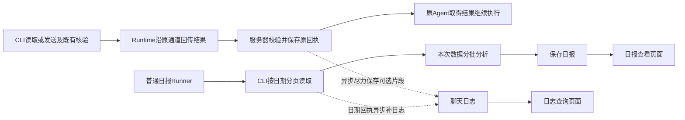

# 企业微信会话旁路日志、查询与按日日报设计

> 2026-11-03 设计定稿，独立复核通过：按用户逐条确认，覆盖自动记录、读发事件、午夜前100条、多会话日报、元数据前端、持续保留、内部总结模板和原定时任务链接通知。评审结论见[本轮计划](../../plans/plan-wecom-conversation-operations.md)。本轮附件只定协议和展示元数据，Agent只依据文本回复；附件原件链路及第九条Runner恢复优化另见[后续实施计划](../../plans/plan-wecom-conversation-followups.md)，不属于本轮实施和验收。产品代码已按定稿原地重构（L1～L4 完成、L5 独立测试进行中，进度见计划「开发进度」区），未提交/未部署/未恢复监听。沿用[三工具](wecom-cli-design.md)、[现有 Runner](../../system/agent-runner-durable-sleep-design.md)及[共同契约](../../system/runner-desktop-runtime-integration-contract.md)。

## 1. 定位与不变量

聊天记录是供人查看和追溯的**旁路日志**。监控、回复、发送对账、任务恢复均不依赖这三张业务表。服务器收到成功读取或已确认成功的发送结果后，异步保存已取得的原消息，Agent不参与日志动作；每日直接按日期读取客户机记录、分析并去重补日志。Agent始终通过Runtime＋CLI获取聊天，不查询业务消息表。平时允许异步保存缺口，由后续读取和日报补充。

- 需要每日总结的会话、Agent已成功回复的会话自动纳入记录范围，保存会话内所有参与者的消息；用户拒绝日报不影响聊天记录。不提供手动开启/关闭记录流程；原`is_followed`等列可兼容保留，不再承担人工开关门禁。
- 日志写入失败不改变原工具的成功、消息结果、发送结论或监控游标，不主动中断 Runner。Runner 自己的权威存储、权限和计费错误仍按原机制处理。
- 日报模型输入来自**本次 CLI 读取结果**，不从 `bs_wecom_messages`、日志水位或监控任务游标重建。
- 不新增采集守护进程、消息队列、日志重试队列、通用业务执行框架或第四个模型可见 WeCom 工具。
- 本轮附件只保存协议元数据，不获取原件、生成缩略图或实现服务器内容传输；Agent明确知道暂不支持读取附件，依据可读文本回复，必要时请用户补充文字。
- 当前仅更新文档；不实施代码、提交、安装、部署或启动监听。

## 2. 代码事实与待开发能力

| 当前事实 | 本轮取舍 |
|---|---|
| `wecom_flow.run` 当前在Agent工具返回前调用 `archive_read_result`，失败会抛 `CheckpointFailure` | 删除该业务依赖；旁路写入移到服务器原结果已接受后的异步回调 |
| Runtime已有受信结果上报入口和幂等终态存储；目前没有本方案的后台日志回调 | **待开发**局部WeCom结果回调，原ACK/Agent结果不等待日志 |
| CLI本地库发送核验已读取发送前基线后的同会话记录；`SendCheck`仅返回命中ID/来源和统计，未返回聊天批次 | **待开发**同一核验快照的有界可选片段，不为日志额外读库/操作UI |
| 原三工具已有账号/会话定位、增量游标、消息类型、身份和附件索引，历史代码中已有附件读取尝试 | 复用文本和元信息；本轮不扩展/验收原件链路，不删除既有公开协议或破坏旧BOSS |
| `ReadInput` / `SessionReadArgs` 尚无日期参数；底层 `_query_history` 有时间过滤，但只取最近 N 条、没有完整续页 | **待开发**日期过滤与稳定分页，不能直接把底层 history 当作完整日读取 |
| 普通 Worker 进入`RuntimeExecution`的模型驱动循环，无本方案日期补读/日报固定适配 | **待开发**局部日期读取函数与业务分支：首次只读补录不调模型、日报再调原模型端口；不能只改提示词宣称顺序已保证 |
| 现有企微任务提交会绑定原Runtime，`tasks._submission`目前固定`profile_id=main` | 本轮日报继承所选智能体模型配置；合适计划的复用范围沿原设备/账号，不在同一Runner里跨设备切换 |
| 原定时任务已有终态通知、规则路由和投递机制，当前模板没有日报日期链接 | 只加性补充本次日报链接与结果摘要，沿原终态事件投递，不另建日报发送任务 |
| 三表、查询页面、附件链、原字段与出站来源标注已有未提交代码 | 复用有效部分；旧测试通过不代表新旁路方案已交付 |

## 3. 旁路记录

### 3.1 事件触发与异步故障隔离

**触发点是服务器已接受的成功读取、发送成功或对账确认结果，Agent不调用保存命令。** CLI执行原操作，Runtime沿已有结果通路上传；服务器照常校验身份/claim、持久化原结果及处理原计费，Agent照常取得结果。随后由服务器的局部WeCom回调对记录范围内的会话异步写聊天日志。普通读取保存已经返回的消息，发送保存核验片段；不为每次结果额外拉取全量。CLI不直连业务库、不新增日志HTTP接口、不另配服务器地址或凭据。

“成功”沿用现有业务确认规则，HTTP ACK本身不等于发送成功；unknown仍沿原只读对账。原未知发送后来被现有对账确认时，可由同一回调处理本次已读片段，原unknown事实不因记日志被改写。界面核验成功但没有可靠DB片段时，原发送保持成功，日志片段可以缺省。

首次纳入范围时服务器安排一次普通只读任务，复用下述局部业务适配的日期读取函数异步补读：北京时间当天零点至本次读取时点的全部消息，加上零点之前最近100条。背景消息保留原时间，不计入当天数量或当天发生事项。补读不调用总结模型，读取结果仍由原上报回调保存；不在HTTP日志写入回调里等待整日分页。后续成功读取，包括Agent不回复的读取，均顺手保存；日报前重新按日期读完整并补齐。首次补读和保存不由Agent调度、不阻塞原回复；提交或执行失败留待后续日期读取补充。

服务器只根据已接受的原调用/结果取得用户、租户、设备与会话，异步处理使用持久化结果，不以重新上报请求里的自由身份覆盖原归属。未来v1/v2回执各沿原受理语义接入实际WeCom所用路径；不为本功能重写BOSS/Device入口。

保存已取得消息复用现有轻量后台机制（例如HTTP后台回调），按短批次事务UPSERT，沿现有连接池及超时配置；首次补读和日报复用同一局部日期读取函数、现有普通Runner和工具端口。无需新增事件总线、消息队列、outbox、事件表、专属worker或扫描补账服务。后台提交失败、写入失败或进程退出丢失这次处理均可接受；不得因此撤销/推迟原ACK或阻断Agent。

只隔离日志自己的普通异常，记录脱敏错误与可取得的最近保存时间；不吞原授权、取消、计费及权威checkpoint错误。不占Runner checkpoint锁、不建phase或完成marker。已保存时间不代表该时点之前连续无缺口，异步保存失败不得伪装成全量同步成功。

**允许临时缺口**：片段没有覆盖、进程退出和异步失败都可能少记。日后按日期分页实际读到的原消息去重补库；不承诺零丢失，不因日志缺失让Agent重新回复。日报生成与日志补齐分别表述：本次CLI数据读完可生成报告，只有日志写入确实成功才显示本批已保存；补库失败不冒充已补齐，也不阻断本次分析。

### 3.1.1 发送核验片段契约（待开发）

复用 `verifySendReceipt` 已取得的同一次核验快照：发送前记录基线，发送后查询同账号/同会话的新记录，原方向/正文/时间及唯一命中规则保持。原命中出站消息和该窗口内其他人的消息都可能在这批中；基线前已到达的客户问题、窗口之外/随后同步的消息不保证包含，不称为完整问答或会话全量。

在现有发送结果 `data` 内加性返回可选 `observed_chat`：

- `session`：本次核验的原稳定会话；`source_generation`：核验源代次。
- `messages`：沿普通聊天读取的归一消息结构，保留原ID、姓名、微信/企微身份、方向、时间、类型、正文/附件索引；不下载附件原件。核验专用的匹配投影与普通消息解析分别复用原逻辑，不再造第三种日志消息格式。
- `confirmed_message_id`：仅在原DB核验精确命中时提供，用于将对应本人原消息标注Agent代发；不能把片段中其它self消息一起认领。
- `truncated`：为满足现有整个结果大小限制而未带回全部已读记录时为true。整份片段始终仅为局部观察，不附会推进监控进度的cursor。

这只是原结果的可选数据扩展，不增加Agent工具、单独事件协议或CLI→服务器直连接口。只带核验已经读到的数据；日志用途不额外快照、查询、搜索、切会话，也不为带更多聊天拉长原核验轮询。正常读过的客户问题若不在片段，不要求服务器强制追溯一套因果关联，交给按日读取补齐。

原成功判定、核验字段和错误结论优先保留。片段按完整编码后的结果预算装入，优先本次确认的出站记录和邻近记录；装不下的记录省略并注明局部缺口，不硬截正文伪装完整。可选片段组装失败或放不下可整体省略，不能把已确认发送变成失败/unknown，更不能重入发送。旧CLI没有此字段时原功能不变，后台无片段可跳过。

服务器异步写入只消费标准原消息；成功回执及原消息ID可作来源标注，不用发送草稿伪造原聊天行。重复事件/ACK重投靠既有原消息唯一键合并即可，不新增exactly-once事件台账。这份片段不推进监控cursor，也不表示所有问题已经处理。

### 3.2 内容、去重与来源

保留现有原消息唯一键 `(tenant_id, conversation_id, source_generation, source_message_id)`，同文同秒但不同 ID 的记录不合并。重读允许补齐已确认字段，未知值不覆盖已确认值。来源代次沿现有结果或原 cursor 解析，不能为了落库伪造原消息身份。

保留原 ID、可读姓名及来源、微信/企微/未知身份、self/peer/timeline、原时间和类型、正文格式、系统/解析标记。缺姓名/头像/身份明细只影响显示，不封住整批；头像不单独研究。

Agent 代发只用现有精确发送回执作**可选事实标注**；无法确认时显示“本人，来源未确认”，不猜真人操作。对账可以补来源标注，不能推进聊天读取进度；标注失败不改变已确认的发送结果。

删除日志的 `handling` 状态机、“已回复必须验证出站”及对应写入入口。是否已处理/待跟进属于日报分析，附原消息证据；日志不承担工单状态。保留 `send_origin` / 可选原发送引用用于展示本人来源。

### 3.3 自动范围与本轮补录

记录范围来自需要日报或已确认Agent回复的原会话身份，保存可读名称与纳入原因；名称变化不创建重复会话。范围由服务器从既有任务配置/已接受结果登记，不要求Agent再调用关注、保存或配置业务库的命令。普通任意读取不把无关会话自动纳入记录。

补录沿现有Runtime派发和三工具读取，日期读取结果走同一服务器回调；没有自动回复候选，不改变监控cursor。没有现有任务读取、也没有日报执行时，不承诺持续刷新。页面进入只查已保存数据，不创建监控/补读任务。删除业务模块自建的持续采集关联和生命周期规则。

### 3.4 保留规则

聊天记录和日报持续保留，本轮不自动过期删除。前端最近1000条上限不裁剪数据库。代理结束、用户拒绝日报或取消日报计划均保留历史；沿用项目已有租户数据删除规则，不增加保留期设置、清理任务或归档系统。

## 4. CLI 按日期分页读取（待开发）

### 4.1 唯一入口与参数

在原`wecom_read_session` / CLI `read-session`加性扩展`date: YYYY-MM-DD`、`timezone: IANA时区`（缺省Asia/Shanghai）与`include_context?: boolean`，沿原Runtime派发、结果上报和资源传输。不新增工具；首版不向批量读取增加日期模式，一个日报任务可逐会话执行。

- 不传日期：现有增量读取含义、原 cursor 和字段保持原样。
- 首次日期读取：`session + date + timezone? + include_context? + limit?`；续页传原cursor，日期/时区/背景参数省略时继承原cursor，显式提供时与原范围一致。
- 日期模式与 `attachment` / `resolve_only` 分开使用；本轮只消费附件元信息，不进入附件原件读取。
- `include_context`首次缺省false；true固定带该日期零点前最近100条，与当日消息合并按原时间共同分页，每页总数默认100条，预算不足可更少并续页。首录和日报使用true；原时间是否早于日期窗口即区分背景，不新增背景状态或另一个读取工具。
- `date/timezone`在入口统一解析为`[start_utc,end_utc)`，按原`send_time`过滤。整个选定范围（含请求的背景）无记录才返回空消息、`has_more=false`；当天无消息仍可返回背景并分页，背景不计当天事项。

### 4.2 分页与完整性

在既有只读快照、身份解析与消息归一化之上增加日期查询；不复制一份解密/身份探测栈。结果按 `(send_time, message_id)` 正序 keyset 分页，同秒以原 ID 续页，不用 OFFSET，也不反复取“最近 N 条”。首轮固定本次可见的最大原消息 ID及同一首轮快照的 `snapshot_at`，后续页/恢复保持这两个值，避免当天新消息让任务无限追赶；晚同步记录由下次读取纳入。

复用既有opaque cursor机制，日期cursor绑定账号、来源代次、原会话、UTC日期范围、include_context及实际背景起点、本次源消息上界、首轮snapshot_at和页尾键。续页省略include_context继承原值，不能改回缺省false。旧cursor缺日期模式时沿原增量规则；调用方不拼接cursor，不另造服务端分页会话表。

日期结果沿用 `session/messages/cursor/has_more/source_generation` 与消息原字段，补小型 `read_window`（`start_utc/end_utc/snapshot_at`）及内容不可用说明。`snapshot_at` 是首轮快照时点，随日期cursor与既有恢复事实固定，不取末页完成、模型完成或报告保存时间。日历史标为历史用途，`new_messages` / `pending_sessions` 不产生自动回复候选；不把其它增量任务的恢复候选混入本次日期范围。

“完整”仅指本轮客户机已经同步、属于该日期范围的可读取记录。无合法时间或未解析正文要给计数/原ID及说明，不伪称无人聊天；附件只读索引，不下载全部文件/表情。某条正文确实超过既有结果支持范围时，返回带原ID、类型、时间及不可读原因的占位记录，作为本页实际返回项推进该条keyset并继续其它记录；不沿旧批读的failed+retry无限重读同条。报告注明内容缺口，不为任意大单条另建续传框架。仅因整页预算已满而本页尚未返回的正常消息不得推进。

### 4.3 输出大小与模型消费

复用 CLI 当前结果大小限制，根据**实际编码后的整页大小**减少本页消息数；下一页只越过本页实际返回的消息。完整有界页到云端后使用现有 `_no_truncate` / 资源机制，不能再被 Engine 保头尾剪掉中间消息。禁止用“每条只留800字”代替正确分页。

日报适配逐页/分组分析，保留每组消息证据和小型中间结论，再合成报告；不用一次把全天正文塞进模型。仅在完整内容本身不支持时保留明确缺口；不限制模型 `max_tokens` 来假装处理了大输入。分组结论和输入引用沿原 Runner 进度/产物保存，不另建日报输入表。

### 4.4 客户端兼容

当前三工具尚无日期能力，不能在旧插件上默默把首次增量当日全量。沿既有参数schema/插件能力信息与明确错误识别支持情况；缺日期能力只影响新的按日补充/日报入口，说明需支持此参数的 WeCom 插件。旧 Runtime 0.0.29＋BOSS 0.3.27 的原工具、任务恢复、结果上报和计费保持；不提高全局客户端最低版本，不新建能力探测服务。

## 5. 日报固定流程（局部接点待开发）

### 5.1 受理与执行

用户点击生成或原Scheduler创建任务，均沿现有普通Runner。需要日报的会话自动纳入记录。Agent代理会话时引导用户建立日报，首次确定时间和范围；明确拒绝则不安排，不反复询问。默认复用同一用户、同一智能体、同一来源设备/账号的合适日报计划，新增代理会话沿已授权范围并入；不同执行时间或总结要求确有需要再拆计划。

一个计划沿现有任务绑定使用一个Runtime账号，支持该来源的多个会话，不按群创建计划。不同来源设备/账号使用各自合适计划，受理时说明归属并复用或建立对应计划；不在同一Runner中静默切换来源，不为此增加跨设备子任务聚合层。

**一个日报计划管理多个会话**：计划保存会话清单，触发后逐个读取、分析、保存各会话报告；一个会话失败继续其他会话，页面注明缺失会话，不当作空日。每个会话每天一份结果，独立日报页面按日期统一分块展示。早上定时执行通常总结前一自然日；临时“总结今天”读到本次首轮快照，注明截至时间。

稳定请求意图只含会话清单、业务日期、时区、原来源设备及配置智能体身份；不把实时cursor拼进受理文本。一次操作的网络重投沿原`client_request_id`，新的显式重算使用新操作键。

**新增范围仅为企微会话的局部业务适配**：在服务器端`RuntimeExecution`的普通受理/执行入口提供小型业务接点，日期读取函数由首次只读补录和日报复用；补录不进入模型总结步骤。受信业务描述由服务器构造，普通任务不启用；不新增execution_mode、Runner类型或调度队列。接点复用`LocalToolAdapter._run_local_required_tool`等既有工具端口与原模型调用/计费、设备绑定、取消及资源能力，不在Skill子进程直连模型、派发设备或自己搭后台循环。

固定顺序由这个局部适配保证：

1. 以本次请求的会话/日期/时区开启独立日期读取，从头遍历本次范围；不使用监控 cursor、日志 `last_read_invocation_id` 或云端库存判断已读。
2. 每页实际读取结果直接进入本次分析输入；日期回执在服务器按同一异步回调补日志，日报适配不重复写库或等待日志保存。日志失败不剥掉输入，不中止分析。
3. 页面读取结束后，模型只负责分组理解、合成报告；程序知道页是否排空，不让模型通过 begin/save 命令证明是否读过。
4. 程序按会话+业务日期 UPSERT 日报。报告保存失败如实显示，不能说已经保存；取消或整次读取失败不以旧日志生成新报告。

该接点目前不存在，实施时先完成一条“现有Runner→真实工具端口→模型端口→程序保存”的隔离贯通，验证归属和计费沿原机制。不得为了补这个接点发明通用工作流框架，也不能退回“仅提示词排序＋业务库proof校验”的旧方案。

### 5.2 状态与报告

运行/暂停/失败/取消直接查询 Runner；日志/日报模块不自行恢复任务或写 controls。读取完成事实、分组产物、模型用量与恢复继续沿原 Runner invocation/checkpoint/资源；不再写 `_wecom_conversation_archived`、`generation_started_at` 或调用 `begin/fail/save-daily-summary` 来驱动生命周期。

每次日报消费自己的日期分页进度。现有Runner机制照用，不新增发布恢复、离线重连、断点续跑能力；第九条优化已单列后续计划。日志允许有缺口，不承担任务恢复存储。既有旧客户端任务恢复不得被本轮改动破坏。

成功空日可保存“本轮未读到该日记录”；空日按日期窗口内判断，即使返回了前100条背景也不能当作当日消息。整次读取失败保留上次成功报告并展示原范围与本次Runner错误；个别不支持内容可生成明确的部分报告。原图片/文件未展开不能假装已理解。

报告保存分块内容、业务日期/时区、本次CLI读取范围/截止时间、生成时间、可选来源Runner引用。重复生成以较新的首轮`read_window.snapshot_at`更新当天报告（同快照时点按本次生成时间更新），避免旧数据晚完成覆盖新数据；同会话同日展示最新一份，即使来自不同计划也沿此规则，不新增多报告版本表或生成锁。原错误与任务状态来自Runner，日报表保留成功结果即可。

“已处理/待跟进/需人工/热点”是带消息证据的分析，不是发送已送达证明；仅收到回复不能认定问题已解决，无明确结果标待确认。不依赖业务消息表或上一日报，本次输入全部来自本次CLI。附件未展开时只依据文本和元数据，不假装看过图片或文件内容。

### 5.3 生成配置与内容结构

对客回复沿用户配置的代理智能体；日报使用固定的内部总结模板，复用所选智能体模型配置和需要的已有业务资料，不套用对客寒暄/服务范围拒答话术，不另建日报智能体。保留原模型端口和实际用量计费，任务提交透传所选身份，不能被旧`profile_id=main`硬编码覆盖。特殊关注要求写在现有日报计划配置里，同计划多个会话适用。

报告分为当日概览、咨询与问题分类、已处理事项、待人工跟进、值得关注；使用原`summary` JSONB保存分块与来源会话/原消息引用，前端按日期聚合这些块，不额外生成第二份跨会话总报告或增加汇总表。内容能放入上下文时直接总结，超过时才分组分析后合成。日报执行只读取、分析和保存。

### 5.4 复用定时任务通知

日报保存后，原计划本次执行的终态通知携带简短说明及对应日期日报页面链接；一个计划多个会话仍只有一条终态通知，存在未完成会话如实标注。全部失败沿原失败通知，不宣称生成了新日报；通知失败不撤销已保存报告。

沿现有通知规则、接收人、投递和登录权限。当前终态模板尚无日报链接，实施仅在原通知参数/渲染和解析接点加性补充服务端构造的日报日期路径与结果摘要，普通任务缺省保持原行为；不将任意模型输出当作通知跳转地址。无需CLI发群消息、单独发送计划、通知事件类型或第二套投递重试机制。

## 6. 三表和前端的最小边界

| 表 | 当前活动数据 | 停止承担的职责 |
|---|---|---|
| `bs_wecom_conversations` | 用户/租户、来源账号/会话/名称、设备、时区、自动纳入原因、最近日志成功时间与可见错误 | 不关联/接管采集Runner，不保存供业务恢复的cursor指针，不提供人工记录开关 |
| `bs_wecom_messages` | 原消息唯一键、完整已取得正文/类型/身份/时间、附件索引、可选Agent代发事实 | 不保存处理状态机，不当作日报和监控的权威输入 |
| `bs_wecom_daily_summaries` | 会话+日期唯一键、成功报告、读取范围与截止时间、生成时间、可选Runner来源 | 不维护第二套生成状态、刷新证明或输入水位协议 |

保留现有表与有效查询代码。既有未用列可先保留，停止其业务读写和门禁作用；不为字段整洁 DROP/重建业务库或清理用户记录。新加的日志错误/报告范围元数据放现有 JSONB（coverage等），不增加新业务表。

### 6.1 会话记录页面

同一页面左侧会话列表、右侧所选会话聊天时间线，进入定位最下面的最新消息；向上滚动每批默认加载100条，最多查看最近1000条。该限制只用于前端浏览，不限制数据库保存或CLI全天日报读取。展示姓名、微信/企微/机器人身份、本人/Agent来源，系统事件独立呈现。来源账号/设备放详情帮助区分同名会话。

图片/文件本轮仅展示对应消息的元数据与类型占位，不提供下载、原件预览、缩略图生成或点击放大入口。查看已存消息无需Runtime在线。页面不含关注/取消记录、持续采集管理或工单状态编辑；进入页面不启动任务。只显示真实的读取/保存时间及错误，不把最近写入时间称为“此前全部已同步”。

### 6.2 日报工作台页面

独立页面顶部切换日期，下方按当日概览、咨询与问题分类、已处理事项、待人工跟进、值得关注分块；分类依据当天实际内容生成，注明来源会话与消息引用。引用在最近1000条内可定位；超出本轮浏览范围时显示来源标识和范围提示，不暗中另建无限历史浏览。保留生成/重算，覆盖范围与内容缺口可见。前端状态取原Runner，日期使用业务时区/纯日期计算，异步结果绑定当前选择。

### 6.3 附件元信息协议（本轮仅定义与展示）

复用现有`attachment_ref`及普通消息附件结构：定位信息为`device_id/account/session/source_generation/message_id`；`meta`含`kind/status/name/mime_type/size_bytes/width/height`中实际可取得的字段。名称/大小未知就省略，不为补字段额外读原件。多附件若源协议已有附件ID则复用，待原件阶段确有需要再扩展，不本轮发明第二套资源协议。

本轮不提供文件字节、客户机路径、Base64、临时下载地址或新资源接口。面向Agent的说明和附件请求错误应明确“暂不支持读取附件内容，请依据会话文本回复；必要时请用户用文字补充”，不能假装已理解附件，也不能因此拒绝整次文本服务。只对本轮新会话业务入口收敛说明和预期，不移除旧客户端已交付的公开附件协议。原件获取、临时/永久资源关联及前端预览均在后续计划实施，不能声称本轮已打通。

## 7. 代码保留与删除清单

唯一实施路线为在现有工作区按本设计原地重构：复用有效数据与展示代码，先删除失效控制协议，再接通新流程。下表中的旧函数名用于指导删除，不是待保留的另一套方案；本功能未交付的内部业务协议不添加兼容层。具体执行约束见[计划第1节](../../plans/plan-wecom-conversation-operations.md#1-授权与工作边界)。

| 代码区域 | 保留/改造 | 删除耦合 |
|---|---|---|
| `src/wecom_conversation/adapters.py` | 来源/姓名/身份/时间/附件索引映射、原消息去重输入 | 仅为完成证明服务的目标范围计算移除；日期读取身份继续沿原工具 |
| `archive.py` | 纯批量UPSERT、记录范围筛选、可选出站来源补齐，由服务器异步回调调用 | `ArchiveStorageFailure(CheckpointFailure)`、完成marker、Runner锁/phase依赖、业务游标证明 |
| `service.py` | 配置/日志/报告CRUD、租户隔离、时间查询、索引读取 | `associate/pure/continuous_collection_runner`系列、自动cancel/恢复、`_refresh_proof`、generation begin/fail/save协议、handling状态机、业务恢复cursor查询 |
| `tasks.py` / `api.py` | 普通一次补录、同来源多会话共用日报计划与受理、所选智能体配置、原Runner错误映射、稳定幂等意图 | 自建持续采集生命周期、`_resume_runner`、displaced清理、动态cursor受理文本及固定main覆盖；本轮不接入附件原件API |
| `wecom_flow.py` | 原读/发/对账逻辑 | 删除Agent工具流程里的同步归档依赖，日志回调移至服务器受理原结果之后；不改unknown恢复规则 |
| `src/local_tools/api.py` / 原结果存储入口 | 原认证、原结果/计费/ACK幂等；仅追加WeCom结果已接受后的轻量异步回调 | 不让日志纳入原结果事务、ACK等待或业务成功条件 |
| `messageSend.ts` / `sendVerification.ts` / 原Python查询 | 原基线/发送/核验；复用已读快照返回可选observed_chat | 不为日志额外读取或重发，不强制所有成功都有片段 |
| 服务器端 Runner runtime | 原工具/模型端口；受信业务描述启用小型日期适配，补录只读、日报再总结 | 不修改普通任务语义，不为日志引入新恢复/计费路径 |
| 原Scheduler / notifications | 原计划终态通知、路由和投递；只加性支持日报日期链接及简短结果 | 不新增日报发送计划、事件类型、投递队列或CLI群发逻辑 |
| 业务 Skill | 原三工具使用、日报引导与说明、附件暂不支持的文本降级提示 | begin/fail/save、set-handling及模型查询/保存业务聊天记录的命令；不让脚本绕过Runner直连模型 |
| CLI / MCP / Runtime参数投影 | 原三工具、原字段/身份、附件元信息；加性日期模式和可选发送核验片段贯通，Runtime原样转发结果 | 不新增第四工具/独立UI抓历史路径/全局版本门禁，不开发原件读取传输 |
| Web/API | 会话列表与时间线同页、最近1000条滚动加载、Markdown/系统事件/附件元数据、独立日报工作台 | 专用持续采集控制、日志处理状态编辑、第二套生成状态显示，本轮不接入附件预览 |
| 三表DDL及测试 | 原ID/唯一键/隔离/字段一致性、旁路不阻塞、日期读取/报告闭环 | 不再保留只证明旧marker/采集接管/处理门禁的活动测试；历史证据不冒充新验收 |

## 8. 后置范围与验收原则

本轮实施仅见[当前计划](../../plans/plan-wecom-conversation-operations.md)。用户明确暂缓的第九条、附件原件链路及既有后置交互统一另列[后续实施计划](../../plans/plan-wecom-conversation-followups.md)，不在本轮安排阶段或完成标准。头像不单独开发。

验收按真实入口和需求：读取/成功发送结果由服务器触发异步日志、Agent不调用保存或查询bs消息；自动范围和当天零点前100条背景正确；重复结果去重、日志失败不影响业务；单/群与系统/通知/附件元信息事实保留；本次CLI数据独立生成日报，同来源多会话共用计划；每页默认100条、日期分页排空、前端最近1000条向上加载；内部模板/所选配置及原通知日期链接正确，记录持续保留；报告无静默截断；Agent明确附件暂不支持并继续文本服务；旧Runtime＋BOSS功能保持。后续计划的原件和新恢复能力不计入验收。
