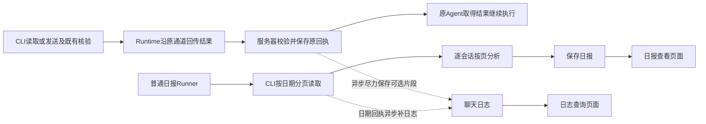

# 企业微信会话旁路日志、查询与按日日报设计

> 2026-11-04 在 2026-11-03 的旁路日志、日期读取和逐会话日报实现上，逐项确认每日总结工作台、独立会话纳入、专属定时配置与执行记录的新设计；2026-11-05 补充逐会话日报内容精简与卡片排版。开发进度见[每日总结计划](../../plans/plan-wecom-daily-summary-workbench.md)，原实现进度见[旁路日志计划](../../plans/plan-wecom-conversation-operations.md)。附件原件与 Runner 后续优化仍见[后续实施计划](../../plans/plan-wecom-conversation-followups.md)。共用 Runtime/设备边界遵循[共同契约](../../system/runner-desktop-runtime-integration-contract.md)。阶段状态以计划文档为准。

## 1. 定位与不变量

聊天记录是供人查看和追溯的**旁路日志**。监控、回复、发送对账、任务恢复均不依赖这三张业务表。服务器收到成功读取或已确认成功的发送结果后，异步保存已取得的原消息，Agent不参与日志动作；每日直接按日期读取客户机记录、分析并去重补日志。Agent始终通过Runtime＋CLI获取聊天，不查询业务消息表。平时允许异步保存缺口，由后续读取和日报补充。

- Agent 接手监控后成功定位到稳定会话标识时，以及用户在每日总结页面手动添加时，会话进入每日总结范围；即使会话没有消息、Agent 尚未回复或后来停止监控，也继续可见。日常读取/成功发送的旁路日志照旧保存；纳入范围本身不触发补录或总结。
- 日志写入失败不改变原工具的成功、消息结果、发送结论或监控游标，不主动中断 Runner。Runner 自己的权威存储、权限和计费错误仍按原机制处理。
- 日报模型输入来自**本次 CLI 读取结果**，不从 `bs_wecom_messages`、日志水位或监控任务游标重建。
- 不新增采集守护进程、消息队列、日志重试队列或通用业务执行框架；会话选择器所需的本地会话目录能力是页面专用只读能力，不扩大 Agent 可自主调用的业务工具面。
- 本轮附件只保存协议元数据，不获取原件、生成缩略图或实现服务器内容传输；Agent明确知道暂不支持读取附件，依据可读文本回复，必要时请用户补充文字。
- 每日总结仅在手动点击或专属定时计划到期时按日读取并生成；一次执行一个 Runner，逐会话读取、分析、保存。

## 2. 当前代码事实与本次改造

| 已核对的当前事实 | 本次改造 |
|---|---|
| 服务器已在原工具成功结果受理后异步写旁路日志；CLI 已有日期分页读取；Runner 逐会话读取、分析、保存。 | 保持现有旁路和日期读取，不重建执行链路。 |
| `WecomConversationDaily.vue` 仍显示计划选择及“生成/重算该日”“总结今天（截至现在）”；手动 API 实际可不带计划执行。 | 工作台改为今日/昨日/选择日期、手动范围和“更新对话总结”；历史日期只读，手动入口不依赖定时配置。 |
| Agent Skill 的 `setup-daily-report` 可创建多个计划；成功回复才主要触发自动登记，首次登记会提交一次性补录任务。 | 从 Agent 对话移除日报计划创建；成功定位监控目标即登记，页面也可独立添加；取消首次自动补录。 |
| 批量读取的已知会话集合包括本地会话库里的空会话，但现有对外结果不能直接提供完整单聊/群聊目录；当前没有可靠头像 URL。 | 补页面专用只读目录能力，支持搜索与分页、稳定 ID、名称/类型；同名项按需取最近 3 条预览，无消息则展示类型与短 ID。真实头像 URL 可取得才显示。 |
| `scheduled_tasks` 已以 `[wecom-conversation:daily]` 标记企微日报，但通用任务列表和活跃配额仍包括它。 | 在定时任务后端设可扩展的专属计划标记排除列表；通用列表、统计、激活数和编辑入口统一排除，企微页专用接口管理一个计划。 |
| 手动 API 限 50 个会话 ID；按日期的报告查询最多返回 500 个会话；Runner 的逐会话结果仅在整次末尾写 checkpoint。 | 去掉会话数的旧固定截断，页面分页；一次执行一个 Runner，目标清单与逐会话状态增量持久化，成功报告逐个可见。 |
| 报告表按会话+业务日期唯一，按读取快照新鲜度避免旧执行晚完成覆盖新报告。 | 保持该规则；手动与定时执行互不打断，各自保留执行 ID 与日志。 |

## 3. 旁路记录

### 3.1 事件触发与异步故障隔离

**触发点是服务器已接受的成功读取、发送成功或对账确认结果，Agent不调用保存命令。** CLI执行原操作，Runtime沿已有结果通路上传；服务器照常校验身份/claim、持久化原结果及处理原计费，Agent照常取得结果。随后由服务器的局部WeCom回调对记录范围内的会话异步写聊天日志。普通读取保存已经返回的消息，发送保存核验片段；不为每次结果额外拉取全量。CLI不直连业务库、不新增日志HTTP接口、不另配服务器地址或凭据。

“成功”沿用现有业务确认规则，HTTP ACK本身不等于发送成功；unknown仍沿原只读对账。原未知发送后来被现有对账确认时，可由同一回调处理本次已读片段，原unknown事实不因记日志被改写。界面核验成功但没有可靠DB片段时，原发送保持成功，日志片段可以缺省。

首次纳入范围只保存会话身份、来源设备/账号和纳入原因，不创建一次性补录任务。后续成功读取（包括 Agent 不回复的读取）与已确认发送仍顺手保存已取得的原消息；手动点击或定时到期时，日报按目标日期读取完整范围并去重补齐本次读到的日志。日期读取可带当天零点前最近 100 条背景；背景保留原时间，不计当天事项。未执行过读取或总结时，不承诺已有完整聊天日志。

服务器只根据已接受的原调用/结果取得用户、租户、设备与会话，异步处理使用持久化结果，不以重新上报请求里的自由身份覆盖原归属。未来v1/v2回执各沿原受理语义接入实际WeCom所用路径；不为本功能重写BOSS/Device入口。

保存已取得消息复用现有轻量后台机制（例如HTTP后台回调），按短批次事务UPSERT，沿现有连接池及超时配置；日报复用既有日期读取函数、普通Runner和工具端口。无需新增事件总线、消息队列、outbox、事件表、专属worker或扫描补账服务。后台提交失败、写入失败或进程退出丢失这次处理均可接受；不得因此撤销/推迟原ACK或阻断Agent。

只隔离日志自己的普通异常，记录脱敏错误与可取得的最近保存时间；不吞原授权、取消、计费及权威checkpoint错误。不占Runner checkpoint锁、不建phase或完成marker。已保存时间不代表该时点之前连续无缺口，异步保存失败不得伪装成全量同步成功。

**允许临时缺口**：片段没有覆盖、进程退出和异步失败都可能少记。日后按日期分页实际读到的原消息去重补库；不承诺零丢失，不因日志缺失让Agent重新回复。日报生成与日志补齐分别表述：本次CLI数据读完可生成报告，只有日志写入确实成功才显示本批已保存；补库失败不冒充已补齐，也不阻断本次分析。

### 3.1.1 发送核验片段契约（现有能力）

复用 `verifySendReceipt` 已取得的同一次核验快照：发送前记录基线，发送后查询同账号/同会话的新记录，原方向/正文/时间及唯一命中规则保持。原命中出站消息和该窗口内其他人的消息都可能在这批中；基线前已到达的客户问题、窗口之外/随后同步的消息不保证包含，不称为完整问答或会话全量。

在现有发送结果 `data` 内加性返回可选 `observed_chat`：

- `session`：本次核验的原稳定会话；`source_generation`：核验源代次。
- `messages`：沿普通聊天读取的归一消息结构，保留原ID、姓名、微信/企微身份、方向、时间、类型、正文/附件索引；不下载附件原件。核验专用的匹配投影与普通消息解析分别复用原逻辑，不再造第三种日志消息格式。
- `confirmed_message_id`：仅在原DB核验精确命中时提供，用于将对应本人原消息标注Agent代发；不能把片段中其它self消息一起认领。
- `truncated`：为满足现有整个结果大小限制而未带回全部已读记录时为true。整份片段始终仅为局部观察，不附会推进监控进度的cursor。

这只是原结果的可选数据扩展，不增加Agent工具、单独事件协议或CLI→服务器直连接口。只带核验已经读到的数据；日志用途不额外快照、查询、搜索、切会话，也不为带更多聊天拉长原核验轮询。正常读过的客户问题若不在片段，不要求服务器强制追溯一套因果关联，交给按日读取补齐。

原成功判定、核验字段和错误结论优先保留。片段按完整编码后的结果预算装入，优先本次确认的出站记录和邻近记录；装不下的记录省略并注明局部缺口，不硬截正文伪装完整。可选片段组装失败或放不下可整体省略，不能把已确认发送变成失败/unknown，更不能重入发送。旧CLI没有此字段时原功能不变，后台无片段可跳过。

服务器异步写入只消费标准原消息；成功回执及原消息ID可作来源标注，不用发送草稿伪造原聊天行。重复事件/ACK重投靠既有原消息唯一键合并即可，不新增exactly-once事件台账。这份片段不推进监控cursor，也不表示所有问题已经处理。

### 3.2 内容、去重与来源

保留现有原消息唯一键 `(tenant_id, conversation_id, source_generation, source_message_id)`，同文同秒但不同 ID 的记录不合并。重读允许补齐已确认字段，未知值不覆盖已确认值。来源代次沿现有结果或原 cursor 解析，不能为了落库伪造原消息身份。

保留原 ID、可读姓名及来源、微信/企微/未知身份、self/peer/timeline、原时间和类型、正文格式、系统/解析标记。缺姓名/头像/身份明细只影响显示，不封住整批；头像不单独研究。

Agent 代发只用现有精确发送回执作**可选事实标注**；无法确认时显示“本人，来源未确认”，不猜真人操作。对账可以补来源标注，不能推进聊天读取进度；标注失败不改变已确认的发送结果。

删除日志的 `handling` 状态机、“已回复必须验证出站”及对应写入入口。事项进展与待跟进属于日报分析，附原消息证据；日志不承担工单状态。保留 `send_origin` / 可选原发送引用用于展示本人来源。

### 3.3 会话纳入与读取边界

Agent 接手监控并通过原只读工具成功定位稳定会话 ID 后，服务器依据已接受的调用结果登记该会话，不等待首条消息或成功回复；不能仅凭 Agent 的文字承诺或可重名的名称登记。单读空会话已有稳定定位结果；显式多目标批读须加性返回成功定位的有界稳定目标元数据，包含无消息目标，不能只看有消息的 `sessions`。未显式指定目标的全账号批读扫描不把所有观察到的会话自动纳入；仅登记 Agent 明确接手的目标。用户还可从每日总结页独立添加一个或多个当前企微账号的本地会话，即使从未与 Agent 对话、会话还没有消息。登记按租户、用户、来源账号和稳定会话 ID 幂等；保存可读名称、来源设备及纳入原因。名称改变不重复创建，停止监控不自动移除；登记不授权自动回复。

页面进入只查已登记数据，打开添加弹窗才通过原 Runner→Runtime→CLI 设备通道读取当前账号的本地会话目录。目录按关键词和游标分页，包含会话库中已存在但没有消息的单聊和群聊；仅在同名项需要辨认且无可靠头像 URL 时按需取最近 3 条消息预览，不把预览当成持续采集。目录缺能力时提示安装最新版 Runtime 和 CLI；本功能尚未上线，不设计旧企微客户端迁移。目录或登记的租户/用户、当前账号、选定设备均须验证，不按名称猜稳定 ID；来源账号改变或设备不符时停止本次总结并显示原因，不静默迁移。

登记本身不补录或总结。已有 Agent 读取/发送继续旁路记日志；手动或定时日报从 CLI 重新按日期读取，日期结果沿同一服务器回调补日志，不改变监控 cursor、不产生自动回复候选。没有读取或日报执行时不承诺持续刷新；不恢复自建持续采集生命周期。

### 3.4 保留规则

聊天记录和日报持续保留，本轮不自动过期删除。前端最近1000条上限不裁剪数据库。代理结束、未配置或暂停日报计划均保留历史；沿用项目已有租户数据删除规则，不增加保留期设置、清理任务或归档系统。

### 3.5 添加会话的本地目录契约

新增页面专用只读企微会话目录能力，经已选设备的原 Runner 本地工具派发、Runtime 和 CLI 执行；CLI 对当前已核实账号的本地已同步会话库查询，不扫描云端或操作会话 UI。列表请求含关键词、分页游标和有界页大小；结果含账号身份、稳定 `ws1.` 会话标识、可读名称、单聊/群聊类型、可确定的平台、同名提示及下一页游标。无消息会话也在目录中。头像只传真实可信 URL（若源数据没有则省略），不根据名称或成员拼造。需要同名辨认时，仅对相应稳定 ID 按需读取最近 3 条有界消息预览；无消息时返回空预览。预览不纳入总结范围、不推进 Agent 监控 cursor、不自动登记会话。

该能力不进入 Agent 模型可见的工具集合；Agent 监控目标自动纳入只消费 Agent 原读取结果，目录和预览调用不触发自动纳入。服务端专用接口验证登录租户/用户、当前选定设备与结果账号一致性；登记接口核验稳定会话标识与当前账号/设备归属，幂等写原会话表，拒绝跨账号/设备混合和名称作为身份。关键词、游标、预览长度及响应大小应有明确界限；本地库不可用、账号变更、缺命令分别返回可读错误。实施前按共同契约登记工具 schema、能力协商、唯一写入者和生产/消费验证；不改 Device wire、绑定语义、旧 BOSS 能力或独立建调度通道。

D1 实施边界：目录工具列表请求每次 1–50 项，实际单页最多 30 项并返回续页游标；名称最多 64 字，按需预览最多 3 条且正文每条最多 256 字，结构化结果不超过 64 KiB。批量添加可超过单次工具的 50 目标上限，服务端分批只读核验当前账号和选定设备，全部通过后在一个事务中登记。缺目录能力只影响添加入口并立即提示升级，不要求旧 Runtime＋BOSS 客户端升级。

D4 页面提交目录选择时附带可选的预期设备 ID 与来源代次。服务端在现有权限与当前设备检查之外比较这两个预期值，拒绝弹窗打开后设备或本地库已变化的选择；未带预期值的既有调用仍按原语义处理。预期值只用于发现过期选择，不作授权或指定执行设备。

## 4. CLI 按日期分页读取（现有能力）

### 4.1 唯一入口与参数

在原`wecom_read_session` / CLI `read-session`加性扩展`date: YYYY-MM-DD`、`timezone: IANA时区`（缺省Asia/Shanghai）与`include_context?: boolean`，沿原Runtime派发、结果上报和资源传输。不新增工具；首版不向批量读取增加日期模式，一个日报任务可逐会话执行。

- 不传日期：现有增量读取含义、原 cursor 和字段保持原样。
- 首次日期读取：`session + date + timezone? + include_context? + limit?`；续页传原cursor，日期/时区/背景参数省略时继承原cursor，显式提供时与原范围一致。
- 日期模式与 `attachment` / `resolve_only` 分开使用；本轮只消费附件元信息，不进入附件原件读取。
- `include_context`首次缺省false；true固定带该日期零点前最近100条，与当日消息合并按原时间共同分页，每页总数默认100条，预算不足可更少并续页。日报使用true；原时间是否早于日期窗口即区分背景，不新增背景状态或另一个读取工具。
- `date/timezone`在入口统一解析为`[start_utc,end_utc)`，按原`send_time`过滤。整个选定范围（含请求的背景）无记录才返回空消息、`has_more=false`；当天无消息仍可返回背景并分页，背景不计当天事项。

### 4.2 分页与完整性

在既有只读快照、身份解析与消息归一化之上增加日期查询；不复制一份解密/身份探测栈。结果按 `(send_time, message_id)` 正序 keyset 分页，同秒以原 ID 续页，不用 OFFSET，也不反复取“最近 N 条”。首轮固定本次可见的最大原消息 ID及同一首轮快照的 `snapshot_at`，后续页/恢复保持这两个值，避免当天新消息让任务无限追赶；晚同步记录由下次读取纳入。

复用既有opaque cursor机制，日期cursor绑定账号、来源代次、原会话、UTC日期范围、include_context及实际背景起点、本次源消息上界、首轮snapshot_at和页尾键。续页省略include_context继承原值，不能改回缺省false。旧cursor缺日期模式时沿原增量规则；调用方不拼接cursor，不另造服务端分页会话表。

日期结果沿用 `session/messages/cursor/has_more/source_generation` 与消息原字段，补小型 `read_window`（`start_utc/end_utc/snapshot_at`）及内容不可用说明。`snapshot_at` 是首轮快照时点，随日期cursor与既有恢复事实固定，不取末页完成、模型完成或报告保存时间。日历史标为历史用途，`new_messages` / `pending_sessions` 不产生自动回复候选；不把其它增量任务的恢复候选混入本次日期范围。

“完整”仅指本轮客户机已经同步、属于该日期范围的可读取记录。无合法时间或未解析正文要给计数/原ID及说明，不伪称无人聊天；附件只读索引，不下载全部文件/表情。某条正文确实超过既有结果支持范围时，返回带原ID、类型、时间及不可读原因的占位记录，作为本页实际返回项推进该条keyset并继续其它记录；不沿旧批读的failed+retry无限重读同条。报告注明内容缺口，不为任意大单条另建续传框架。仅因整页预算已满而本页尚未返回的正常消息不得推进。

### 4.3 输出大小与模型消费

复用 CLI 当前结果大小限制，根据**实际编码后的整页大小**减少本页消息数；下一页只越过本页实际返回的消息。完整有界页到云端后使用现有 `_no_truncate` / 资源机制，不能再被 Engine 保头尾剪掉中间消息。禁止用“每条只留800字”代替正确分页。

日报适配逐页/分组分析，保留每组消息证据和小型中间结论，再合成报告；不用一次把全天正文塞进模型。仅在完整内容本身不支持时保留明确缺口；不限制模型 `max_tokens` 来假装处理了大输入。分组结论和输入引用沿原 Runner 进度/产物保存，不另建日报输入表。

### 4.4 客户端兼容

已交付 Runtime 主要承担 BOSS 直聘；企微 CLI 尚未上线，企微功能正式交付时使用配套 Runtime 与 CLI。会话目录命令缺失时仅在添加弹窗提示安装最新版 Runtime 和 CLI；缺少日期能力时日报明确失败，不把增量读取冒充日全量。服务端增量仍须保持已交付旧 Runtime＋BOSS 原工具、恢复、结果上报及计费可用，不提高全局客户端最低版本。

## 5. 每日总结执行与专属计划

### 5.1 受理与执行

手动点击“更新对话总结”不要求先建立计划，只总结今日页面当前勾选的已登记会话；默认全选，全部取消选择时按钮不可用。手动提交不得因会话行已有 `daily_plan_task_id` 而隐式继承计划的模型、instance 或特殊关注要求，统一使用默认主智能体配置。昨日及更早日期只读。定时计划也复用普通 Scheduler→Runner，但只在每日总结页创建、编辑、暂停/恢复；Agent Skill 不再创建或改写企微日报计划。每用户只允许一个企微日报计划，绑定创建时的来源设备与企微账号；页面默认使用该用户当前选定的 Runtime 设备，不显示设备选择器，提交后以固定绑定执行，不静默转移。

计划可选择“全部已加入会话”（动态范围，之后新加或 Agent 接手的会话自动纳入）或明确勾选一组会话；手动选择与计划选择相互独立。无可总结会话或计划选择为空时不启动执行，说明当前没有可总结的会话并引导添加。计划总结目标日默认“昨天”，每天北京时间 02:00 执行，时间可修改；选择“今天”时改为每 1–24 个整数小时执行，保存后满一个周期首次到期。昨天只支持每日固定时间，今天支持整数小时间隔；不提供周/月频率或模型/智能体/特殊关注配置。

手动与定时一次触发各创建一个 Runner 执行 ID。受信描述在提交时冻结本次业务日期、会话 ID 清单、来源账号/设备及默认主智能体模型配置；定时“全部会话”在 Scheduler 接受本次 Runner 前展开当时已登记的集合，排队后也只消费该快照，不再查询可变的计划关联集合。每个 Runner 逐会话读取当天 CLI 日期页、独立调用模型、立即保存该会话的一份报告；长会话只在该会话内部按页分组和合成。不存在一次把多个会话交给模型要求输出数组的批处理，也不按 50 个会话创建多个 Runner。一个会话普通业务失败记录原因后继续其他会话；进入循环前及每次本地回执后核验固定账号/设备，来源账号不一致等身份错误不能被逐会话异常处理吞掉，立即停止整轮，其余会话标记未执行。

稳定请求意图只含会话清单、业务日期、时区和固定设备/账号；不把实时 cursor 拼进受理文本。网络重投沿原`client_request_id` 幂等；新的显式点击产生新请求 ID。手动和定时即使处理同一天也互不打断、各留执行记录；报告 UPSERT 以读取快照新鲜度防旧结果晚完成覆盖新结果。

服务器端沿现有 `RuntimeExecution` 企微局部业务接点与 `LocalToolAdapter._run_local_required_tool` 派发，复用原模型调用/计费、设备绑定、取消和资源机制；普通任务不启用该接点。不新增 Runner 类型、调度队列或 Skill 直连模型流程。

固定顺序由这个局部适配保证：

1. 以本次请求的会话/日期/时区开启独立日期读取，从头遍历本次范围；不使用监控 cursor、日志 `last_read_invocation_id` 或云端库存判断已读。
2. 每页实际读取结果直接进入本次分析输入；日期回执在服务器按同一异步回调补日志，日报适配不重复写库或等待日志保存。日志失败不剥掉输入，不中止分析。
3. 该会话日期页排空后，模型只负责此会话的理解与报告；程序知道页是否排空，不让模型通过 begin/save 命令证明是否读过。
4. 程序按会话+业务日期 UPSERT 日报。报告保存失败如实显示，不能说已经保存；取消或整次读取失败不以旧日志生成新报告。

现有接点已完成基础贯通；本轮仅修改目标来源、范围、配置、逐会话执行事实和页面消费，继续验证原工具、模型与计费归属。

### 5.2 状态与报告

运行/暂停/失败/取消直接查询 Runner；日志/日报模块不自行恢复任务或写 controls。每次已受理的手动或定时触发均有独立 `runner_id`，计划 `task_id` 只标识配置。受理时在可信 Runner 请求事实中持久保存触发方式、业务日期、目标会话 ID 快照及接受时间；每个会话开始/完成/失败时增量保存阶段、时间、错误码和必要的脱敏原因。执行记录查询须合并受理事实、Runner 状态/错误与逐会话 checkpoint，不仅依赖最终 `wecom_daily_result`；排队期取消或首个 checkpoint 前失败也能显示该次目标及全局原因，目标标记未执行。已开始但中断的会话单独标识；不把取消、账号错误或存储故障伪装成“无消息”。详细服务端日志与执行 ID、会话 ID 和错误码关联。继续复用 Runner invocation/checkpoint/资源与已有执行历史，不新增日报失败业务表。

每次日报消费自己的日期分页进度。现有Runner机制照用，不新增发布恢复、离线重连、断点续跑能力；第九条优化已单列后续计划。日志允许有缺口，不承担任务恢复存储。既有旧客户端任务恢复不得被本轮改动破坏。

成功空日保存“当日无消息”，不调用总结模型；空日按日期窗口内判断，即使返回了前100条背景也不能当作当日消息。某会话读取、模型或保存失败时保留该会话上次成功报告，同时展示最近一次失败的阶段、时间、用户可读原因/错误码与执行 ID；模型完成原因表明截断或结构化结果不完整时不得保存为成功报告，现有“非 JSON 原文截成 overview 后当成功”的回退须移除。个别原消息内容不可读取时可以生成明确标注缺口的部分报告；原图片/文件未展开不能假装已理解。

报告保存分块内容、业务日期/时区、本次CLI读取范围/截止时间、生成时间和来源 Runner 引用；每个会话成功保存后页面即可刷新该卡片，进入下一会话前保存对应执行事实。若报告落库后 checkpoint 写入失败，可按当前报告的来源 Runner ID 对账；若该行又被并发的新快照覆盖而无法证明旧执行结果，就标“结果待核对／执行事实保存失败”，不能猜成未执行或已完成。重复生成以较新的首轮`read_window.snapshot_at`更新当天报告（同快照时点按本次生成时间更新），避免旧数据晚完成覆盖新数据；若较旧快照的写入未应用，执行项明确标“已有更新报告，本次未覆盖”，不计为本次已保存或失败。同会话同日只展示最新一份成功报告，不新增多报告版本表或生成锁。执行记录保留每次尝试的成功、失败、未覆盖和未执行事实，不能让旧成功报告遮住最新一次失败。页面“查看执行记录”可按执行 ID 查看目标范围及逐会话结果，并复制一行最小诊断信息（时间、执行 ID、会话 ID、错误码），不暴露堆栈、消息正文或凭据。

概览、待跟进、异常均只依据本次读取的消息分析，不作为发送已送达或外部业务状态的证明；仅收到回复不能认定问题已解决。不依赖业务消息表或上一日报，本次输入全部来自本次 CLI。附件未展开时只依据文本和元数据，不假装看过图片或文件内容。

### 5.3 生成配置与内容结构

对客回复仍沿用户配置的代理智能体；每日总结使用固定内部总结模板与用户默认主智能体模型配置，不套用对客寒暄/服务范围拒答话术，不另建日报智能体。手动和定时均使用同一配置；页面不提供模型、智能体、提示词或特殊关注要求选项。保留原模型端口和实际用量计费；`max_tokens` 仅按完整输出需求设置，不作为费用预算手段。

报告分为当日概览、待跟进、异常三块；使用原 `summary` JSONB 保存分块及原消息引用，不增加业务表、跨会话合并报告或可勾选的待办状态。概览按当天实际消息组织，不依据会话名称预设主题；按时间顺序将每件相对独立的实质事情作为数组中的一项，每项一句，同一人连续推进的同一件事合并，不统计咨询次数或重复列优惠细则。页面为概览和待跟进自动显示 `1. 2. 3.` 序号，模型不在文字里手写序号；事项数量由内容决定。待跟进只写本账号或团队确需继续处理的具体下一步，不把群友间未回复的交流自动列为待办；异常只写已发生且需关注的问题，没有就不展示。概览说进展、待跟进说下一步，避免同一事实跨块复述。只依据本会话可见记录，不能把“群内未见下单”推断为订单未完成；只有寒暄、普通系统通知等无实质内容时概览仅一项“当日无实质内容”。证据消息 ID 保留，说明只在读取缺口确实影响理解时出现。内容能放入上下文时直接总结，超过时才分组分析后合成。日报执行只读取、分析和保存。

### 5.4 复用定时任务通知

定时执行终态沿原计划通知携带简短说明及对应日期每日总结页面链接；一个计划多个会话仍只有一条终态通知，存在未完成会话如实标注。全部失败沿原失败通知，不宣称生成了新报告；通知失败不撤销已保存报告。手动执行只在页面展示进度/结果，不另发定时任务通知。

沿现有通知规则、接收人、投递和登录权限。现有终态通知已可携带服务端构造的日报日期路径与结果摘要，本轮校验新单计划和逐会话结果下的链接及缺失说明；不将任意模型输出当作通知跳转地址。无需CLI发群消息、单独发送计划、通知事件类型或第二套投递重试机制。

### 5.5 专属计划与通用任务配额

后端定时任务模块维护可扩展的“专属计划标记排除列表”，当前只有 `[wecom-conversation:daily]`。匹配任务定义首部标记，由通用任务列表、统计、激活数检查（创建和恢复）、Agent 定时任务工具及保留前缀校验共同使用；后续专属场景只扩展同一列表，不在前端复制一份规则。通用创建/任务定义更新不得把任何保留标记写进 task_prompt，只有企微专用受信入口可写该标记，防止普通任务伪装成不计配额的专属计划或进入企微执行分支。被排除计划仍由原 Scheduler 派发、原 Runner 执行与计费，不占普通任务计划的激活名额。企微计划创建/恢复不受普通任务名额约束，仍受本业务“每用户只允许一个计划”的约束。

通用任务 API 与 Agent 工具按已知 task_id 命中专属计划时，应统一拒绝通用查看及变更（包括通知规则、编辑、暂停/恢复、手动触发、删除），并提示到所属业务页面；标记不可被通用编辑改掉。企微页通过专用接口管理配置，服务端校验租户/用户归属、标记、账号/设备绑定和会话范围。页面/通用列表隐藏不是权限门禁，后端必须执行相同约束。

## 6. 三表和前端的最小边界

| 表 | 当前活动数据 | 停止承担的职责 |
|---|---|---|
| `bs_wecom_conversations` | 用户/租户、来源账号/会话/名称、设备、时区、自动纳入原因、最近日志成功时间与可见错误 | 不关联/接管采集Runner，不保存供业务恢复的cursor指针，不提供人工记录开关 |
| `bs_wecom_messages` | 原消息唯一键、完整已取得正文/类型/身份/时间、附件索引、可选Agent代发事实 | 不保存处理状态机，不当作日报和监控的权威输入 |
| `bs_wecom_daily_summaries` | 会话+日期唯一键、成功报告、读取范围与截止时间、生成时间、可选Runner来源 | 不维护第二套生成状态、刷新证明或输入水位协议 |

保留现有表与有效查询代码。既有未用列可先保留，停止其业务读写和门禁作用；不为字段整洁 DROP/重建业务库或清理用户记录。新加的日志错误/报告范围元数据放现有 JSONB（coverage等），不增加新业务表。

### 6.1 会话记录页面

同一页面左侧会话列表、右侧所选会话聊天时间线，进入定位最下面的最新消息；向上滚动每批默认加载100条，最多查看最近1000条。该限制只用于前端浏览，不限制数据库保存或CLI全天日报读取。展示姓名、微信/企微/机器人身份、本人/Agent来源，系统事件独立呈现。来源账号/设备放详情帮助区分同名会话。

图片/文件本轮仅展示对应消息的元数据与类型占位，不提供下载、原件预览、缩略图生成或点击放大入口。查看已存消息无需Runtime在线。页面不含关注/取消记录、持续采集管理或工单状态编辑；进入页面不启动任务。只显示真实的读取/保存时间及错误，不把最近写入时间称为“此前全部已同步”。

### 6.2 每日总结工作台页面

沿现有企业后台组件与语义样式调整本页，不增加竖向日期列表。顶部横排“今日｜昨日｜选择日期”，默认今日；选择日期打开日期选择器。今日可手动更新，昨日及更早日期只展示已保存结果和执行记录，不提供补算按钮。页级操作区显示日期、最近成功总结/最新执行状态，右侧为“定时执行配置”和主按钮“更新对话总结”；删除旧“生成/重算该日”“总结今天（截至现在）”及计划下拉框。

主内容先显示“本次总结的会话”，标题右侧是带明确文字的“＋ 添加会话”；会话勾选默认全选，用户可按本次需要取消部分选中。手动选择只影响本次点击，不改定时范围。页面按页加载全部已加入会话及选定日的报告，不沿用旧 500 条会话截断；无会话时提示“暂无企业微信会话。点击‘添加会话’选择会话，或让智能体接手监控后自动加入。”，主按钮禁用，添加入口可用。全部取消勾选时禁用手动提交并说明需至少选一个。

工作台用按会话 ID 稳定分页的日报响应同时取得会话范围和当日报告；无报告会话仍在响应中。全部分页读完后才开放本次全选提交及定时自选范围，避免按会话更新时间排序的 OFFSET 列表在 Agent 写入期间重排而漏选目标。

添加弹窗显示当前选定设备与账号状态，可按名称搜索、分页、多选；已加入项标明状态。可选空会话。可靠头像 URL 若由现有数据真实取得则显示；否则仅同名候选按需展示最近 3 条消息预览，仍无消息时展示单聊/群聊类型和短稳定 ID。提交后将所选稳定会话身份幂等保存至现有会话表，刷新已加入列表；不靠名称判重，不触发总结。

“定时执行配置”打开本页抽屉：启用/暂停、总结日期（昨天/今天）、相应的每天时间或 1–24 小时间隔、自动总结的会话（动态全部/自选）、下次预计执行时间及保存操作。默认昨天、北京时间每天 02:00；手动操作不依赖该配置。抽屉不提供通用任务的提示词、模型、周/月频率等选项，计划不出现在侧栏“任务计划”组。

下方每个会话一张该日独立总结卡，空日显示“当日无消息”；不生成跨会话合并报告。卡片将较大的会话名与状态置于标题区，消息数、生成/读取时间放在次要信息行；正文按当日概览、待跟进、异常三个区域清晰分隔。新版概览与待跟进均为自动编号的纯文本列表，异常保持原提示样式；不提供待跟进状态更新。证据消息 ID 保留并可定位到对应会话记录；超出最近 1000 条浏览范围时如实说明。旧版已保存报告的字符串概览及原字段继续可读，今日重新生成后采用新版三块结构和编号；只读历史日期不丢失旧内容。手动运行期间逐会话刷新卡片与完成/失败/未执行状态。最新失败原因与仍保留的旧成功报告明确分开；阶段、时间和执行 ID 在卡片的诊断详情中可展开，“查看执行记录”按每次执行展开详情并提供最小诊断信息复制。日期采用业务时区纯日期计算，异步返回绑定当前日期/会话选择，避免切换后串页。

### 6.2.1 后续任务：群聊平台标签与逐消息发言人

添加会话弹窗中的群聊只有会话类型，没有单一的“对方平台”；不展示会话级 `peer_platform`，尤其不将 CLI 返回的 `unknown` 原样显示在群聊短 ID 后。群聊仍显示名称、类型、短稳定 ID 和现有同名预览。单聊的平台信息保持原有语义。

CLI 返回的群聊内容必须让每条消息都带 `sender_platform`：可靠识别为微信用户时为 `wechat`；企微身份有证据时为 `wecom`；资料不足时保留 `unknown`，不伪造身份。会话记录页面只给 `wechat` 发言人显示「微信用户」标记，其余按普通发言显示，不再逐条标「企微」或显示原始 `unknown`。底层三态继续传到归档、日报输入和 Agent，未显示标记不等于可把 `unknown` 当成已证实的企微身份。已有解析规则和可信范围见[本地库设计 §13](wecom-cli-localdb-design.md#13-单聊与群聊的发言人平台识别2026-10-27)。

### 6.3 附件元信息协议（本轮仅定义与展示）

复用现有`attachment_ref`及普通消息附件结构：定位信息为`device_id/account/session/source_generation/message_id`；`meta`含`kind/status/name/mime_type/size_bytes/width/height`中实际可取得的字段。名称/大小未知就省略，不为补字段额外读原件。多附件若源协议已有附件ID则复用，待原件阶段确有需要再扩展，不本轮发明第二套资源协议。

本轮不提供文件字节、客户机路径、Base64、临时下载地址或新资源接口。面向Agent的说明和附件请求错误应明确“暂不支持读取附件内容，请依据会话文本回复；必要时请用户用文字补充”，不能假装已理解附件，也不能因此拒绝整次文本服务。只对本轮新会话业务入口收敛说明和预期，不移除旧客户端已交付的公开附件协议。原件获取、临时/永久资源关联及前端预览均在后续计划实施，不能声称本轮已打通。

## 7. 代码保留与删除清单

原旁路日志和日期读取实现保持；本轮在既有代码上收敛会话纳入、页面与专属计划。具体阶段、独立验证和共同契约检查见[每日总结计划](../../plans/plan-wecom-daily-summary-workbench.md)；旧实现过程仍由[原计划](../../plans/plan-wecom-conversation-operations.md)记录。企微功能尚未上线，不为原 Agent 建计划/首录补录协议另做迁移层。

| 代码区域 | 保留/改造 | 删除耦合 |
|---|---|---|
| `src/wecom_conversation/adapters.py` | 来源/姓名/身份/时间/附件索引映射、原消息去重输入 | 仅为完成证明服务的目标范围计算移除；日期读取身份继续沿原工具 |
| `archive.py` | 纯批量UPSERT、记录范围筛选、可选出站来源补齐，由服务器异步回调调用 | `ArchiveStorageFailure(CheckpointFailure)`、完成marker、Runner锁/phase依赖、业务游标证明 |
| `service.py` / `api.py` | 租户隔离的会话登记、分页报告查询、无计划手动提交、单计划配置和每次执行详情 | 旧手动 50 ID、日期页 500 会话固定截断，以及与多计划配置绑定的前端入口 |
| `src/db/models.py` 的 Web 会话列表 | 手动日报使用现有 `wecom_conversation_ops` 内部会话标记；普通聊天侧栏的计数与分页均排除该标记，既有记录同样隐藏，日报执行详情仍由专用入口读取 | 不靠会话标题过滤，也不删除执行会话或报告 |
| `plans.py` / `logsink.py` | 已接受读结果自动纳入 Agent 监控目标，保留成功读取/发送的旁路日志、稳定幂等意图 | Agent 建计划、首次纳入自动补录任务、多计划匹配与特殊关注要求 |
| `wecom_flow.py` | 原读/发/对账逻辑 | 删除Agent工具流程里的同步归档依赖，日志回调移至服务器受理原结果之后；不改unknown恢复规则 |
| `src/local_tools/api.py` / 原结果存储入口 | 原认证、原结果/计费/ACK幂等；仅追加WeCom结果已接受后的轻量异步回调 | 不让日志纳入原结果事务、ACK等待或业务成功条件 |
| `messageSend.ts` / `sendVerification.ts` / 原Python查询 | 原基线/发送/核验；复用已读快照返回可选observed_chat | 不为日志额外读取或重发，不强制所有成功都有片段 |
| 服务器端 Runner runtime | 原工具/模型端口、固定设备、逐会话日报；开始时保存目标快照，每个会话增量记录结果 | 不批量混合多个会话进一次模型调用，不新增执行队列或失败表 |
| 原 Scheduler / notifications | 一个专属企微计划仍沿原到期派发、终态通知与日期深链 | 通用任务列表/活跃配额排除专属标记；手动执行不发定时通知 |
| 业务 Skill | 原企微读/发纪律与附件文本降级说明 | 删除 `setup-daily-report` 引导和脚本建计划入口；Agent 不管理日报配置 |
| CLI / MCP / Runtime | 日期读取及原结果通路保持；新增页面专用只读会话目录能力，包含无消息会话 | 不让浏览器直连 CLI，不给 Agent 扩大自主工具权限，不开发附件原件传输 |
| Web/API | 沿现有后台组件重做每日总结日期横条、添加会话、独立定时抽屉、逐会话卡片及执行记录 | 移除旧计划下拉和两个生成按钮，不让通用任务视图编辑专属计划 |
| 三张业务表及 Runner 事实 | 保留原唯一键、租户/用户隔离、报告新鲜度与执行历史 | 不新增日报业务表；旧测试结论不冒充本轮验收 |

## 8. 后置范围与验收原则

本次开发仅见[每日总结工作台计划](../../plans/plan-wecom-daily-summary-workbench.md)。附件原件链路与 Runner 其他后置交互仍见[后续实施计划](../../plans/plan-wecom-conversation-followups.md)，不作为本次验收前置；头像仅在已有真实 URL 可取得时使用，不单独开发抓取。跨会话综合报告、跨设备/跨账号同次执行、周/月计划、专用采集服务均不在首版。

验收覆盖：今日默认及日期横条、历史只读、无计划手动更新、页面独立添加空会话/同名辨认、Agent 定位后自动纳入且停止监控后保留、无首次补录、一个可暂停的专属计划与昨天 02:00/今天 1–24 小时规则、动态全选/自选范围、通用任务列表与配额排除、每次执行 ID 与逐会话即时结果、失败/未执行和最小诊断信息、来源账号不符整次停止、手动无通知/定时原通知链接、并发执行互不打断及报告新鲜度。按受影响范围验证 Runner→Runtime→CLI 真实调用与旧 BOSS 客户端兼容；无消息不调用模型，模型截断/结构不完整不冒充成功。
