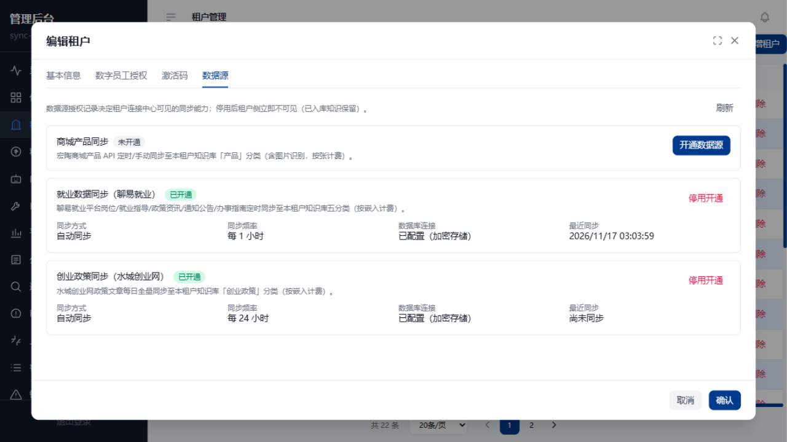
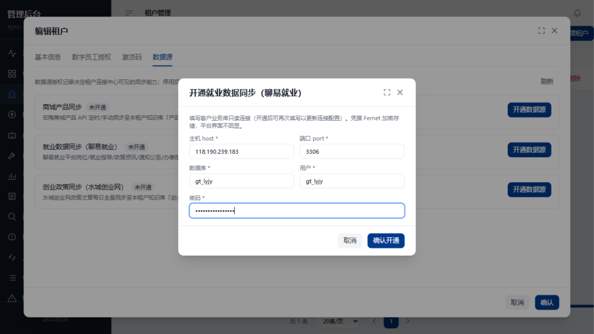
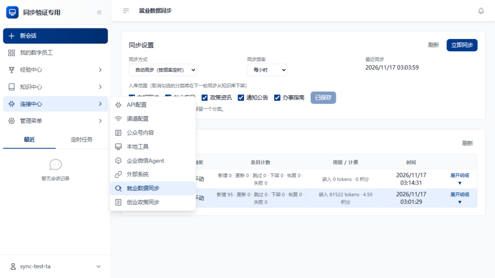
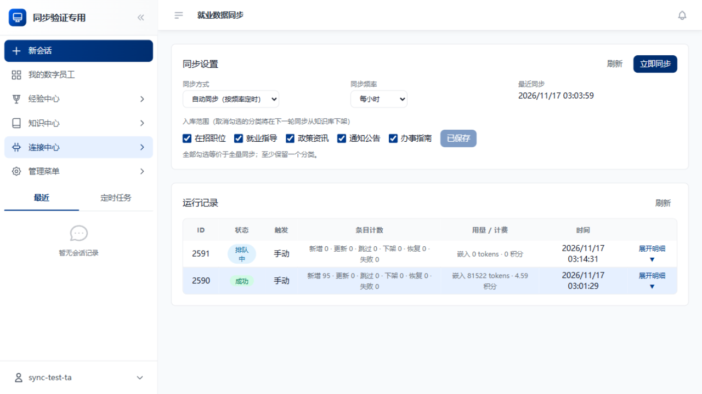
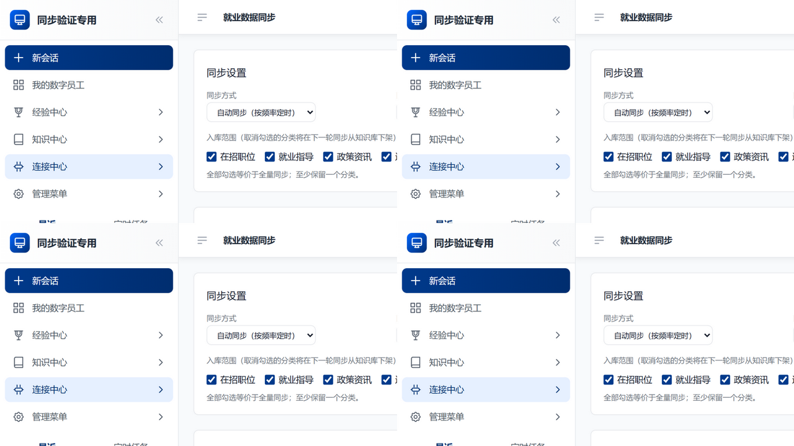
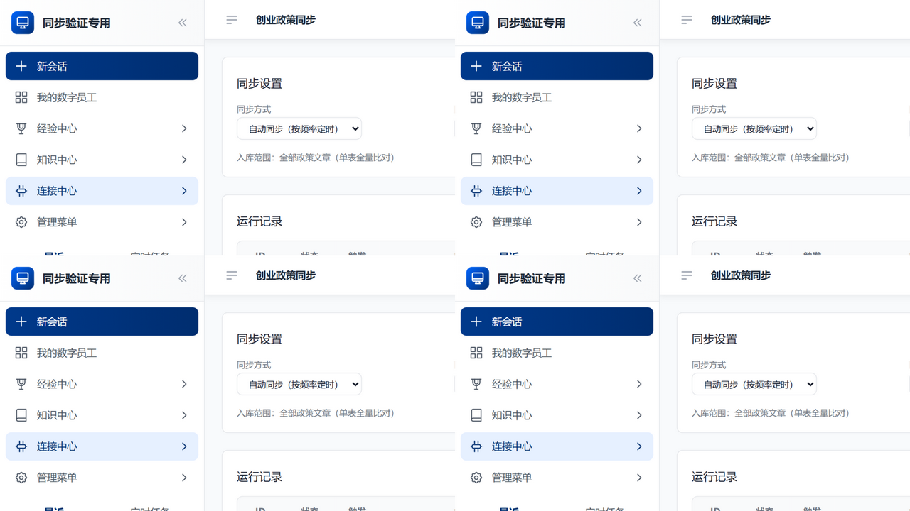
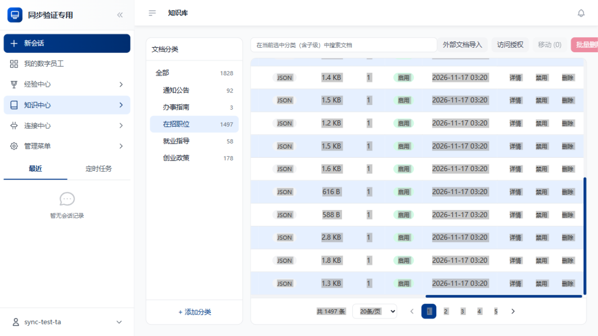

# 就业/创业数据源同步使用教程（管理员手册）

> - 适用版本：`lyjy_employment`（就业数据同步·聊易就业）与 `sccy_policy`（创业政策同步·水城创业网）两个数据源模块
> - 读者：**平台管理员**（负责开通数据源）与**租户管理员**（负责日常同步管理）
> - 截图取自本地真机验证环境（2026-11-17），正式环境界面一致
> - 计费口径：同步入库按嵌入 tokens 折算积分（运行记录中可见），图片解析不涉及

---

## 1. 功能概述

| 数据源 | 同步内容 | 知识库分类 | 默认频率 |
|---|---|---|---|
| 就业数据同步（聊易就业） | 客户业务库中的岗位、就业指导文章、政策资讯、通知公告、办事指南 | 在招职位 / 就业指导 / 政策资讯 / 通知公告 / 办事指南（五分类） | 每 1 小时 |
| 创业政策同步（水城创业网） | 客户业务库中的政策/资讯文章 | 创业政策（一分类） | 每 24 小时 |

同步为**拉取式**：平台定时读取客户业务库（只读账号），把可公开咨询的内容写入本租户知识库；源侧下架/删除的内容会在下一轮同步中同步下架。知识最终由就业咨询智能体检索引用（微信/官网等渠道的问答）。

**菜单门控**：「就业数据同步」「创业政策同步」两个菜单**只对已开通对应数据源的租户显示**——平台管理员未开通时，租户侧完全不可见。

---

## 2. 平台管理员：开通数据源（Portal）

### 2.1 进入路径

管理后台（`/portal`）→ 左侧「租户管理」→ 找到目标租户 → 点该行「**编辑**」→ 弹窗内切到「**数据源**」页签。

页签内有三个数据源卡（商城产品同步为宏陶既有能力，本教程不涉及）：

- 未开通的卡片显示「未开通」+「开通数据源」按钮；
- 已开通的卡片显示「已开通」徽标 + 同步方式 / 同步频率 / 数据库连接 / 最近同步四项状态，按钮变为「停用开通」。

### 2.2 开通：填写客户业务库只读连接

点「开通数据源」弹出连接配置表单：

| 字段 | 说明 |
|---|---|
| 主机 host / 端口 port | 客户业务库 MySQL 地址 |
| 数据库 | 聊易就业填 `gt_lyjy`；水城创业网填对应库名 |
| 用户 / 密码 | **只读账号**（仅需 SELECT 权限；平台会做列白名单过滤，隐私字段不进管线） |

要点：

- 凭据 **Fernet 加密存储**，平台任何界面**不回显**（开通后只显示"已配置（加密存储）"）；
- 开通后可再次点开通按钮**重新填写以更新连接配置**（如客户换库/换密码）；
- 开通即建授权记录：租户侧连接中心立即可见，默认频率就业 1 小时、创业政策 24 小时，可由租户管理员调整。

### 2.3 停用

卡片上「停用开通」= 删除授权记录：租户侧菜单**立即消失**、定时同步不再执行；已入库的知识保留（可在知识库手动管理）。重新开通按默认配置重建，需重新录入连接配置。

---

## 3. 租户管理员：同步管理（租户工作台）

### 3.1 入口：连接中心子菜单

登录租户工作台（`/t/<租户代码>` 或租户入口链接）→ 左侧栏「**连接中心**」→ 鼠标悬停展开子菜单 → 点「**就业数据同步**」或「**创业政策同步**」：

> 子菜单只显示已开通的数据源。看不到这两个菜单 = 平台管理员尚未为本租户开通，请联系平台管理员。

### 3.2 同步设置

进入「就业数据同步」页（创业政策同步页结构相同，无"入库范围"）：

| 设置项 | 说明 |
|---|---|
| 同步方式 | 「自动同步（按频率定时）」/「仅手动同步」（关掉定时，只认「立即同步」按钮） |
| 同步频率 | 每小时 / 每 6 小时 / 每 12 小时 / 每天 / 每 2 天 / 每周 |
| 最近同步 | 上一次成功同步的时间 |
| 入库范围 | 五个分类复选框（在招职位 / 就业指导 / 政策资讯 / 通知公告 / 办事指南）。**取消勾选的分类将在下一轮同步从知识库下架**；全部勾选等价于全量同步；至少保留一个分类。改动即时保存（按钮显示"已保存"） |
| 立即同步 | 手动触发一轮同步（加入队列，无需等定时） |

### 3.3 运行记录

页面下方「运行记录」表展示每次同步的结果（就业侧实测示例：首轮严格语义下仅入库客户平台上可见的内容；放宽验证轮全量入库 1555 条岗位/文章，另 3 条因正文含身份证号被隐私拦截）：

- **状态**：排队中 / 运行中 / 成功 / **部分失败** / 失败；
- **条目计数**：新增 · 更新 · 跳过 · 下架 · 恢复 · 失败（各分类合计）；
- **用量 / 计费**：本次消耗的嵌入 tokens 与积分（下图为创业政策同步首轮全量：440 条 · 54.9 万 tokens · 29.87 积分）：

- 「展开明细 ▼」可看每条内容的逐条动作（含被拦截条目的原因）。

判断同步是否正常：状态「成功」即全部入库；「部分失败」= 大部分成功、少数条目被拒绝（常见原因见 FAQ），点开明细看具体原因；内容是否入库到「知识中心」对应分类下查看：

### 3.4 典型操作

- **想尽快看到最新岗位**：点「立即同步」。
- **某类内容不想让智能体推荐**：取消勾选对应分类，下一轮自动下架。
- **换同步节奏**：改频率下拉即可，保存后下一轮按新频率执行。
- **源内容更新/删除会怎样**：客户平台侧更新或删除的内容，最迟下一轮同步自动更新/下架，无需人工处理。

---

## 4. 常见问题（FAQ）

**Q：租户侧看不到「就业数据同步」菜单？**
平台管理员未开通或已停用该数据源（见 §2），开通后菜单立即出现。

**Q：开通时连接测试失败？**
核对 host/port 是否对租户开放了白名单、账号是否只读且密码正确；修正后可在 portal 重新填写连接配置更新。

**Q：运行记录显示成功，但知识库里没有某类内容？**
该类内容在客户平台侧可能均为未审核/已下架状态（同步只拉取客户平台上对外可见的内容）；也可能入库范围未勾选该分类。

**Q：同步会修改客户业务库吗？**
不会。全程只读，平台不在客户库建表、不写任何数据。

**Q：同步费用怎么算？**
按每次同步实际新增/更新内容的嵌入 tokens 折算积分，逐次记录在「运行记录」的用量/计费列；内容未变化的重跑不产生费用。

**Q：为什么会出现「部分失败」？展开明细里有 pii_rejected？**
这是**隐私防线的预期行为**：某条内容的正文里出现了手机号/身份证号等个人敏感信息格式（例如岗位描述里留了经办人身份证号），渲染器会拒绝把该条内容写进知识库，条目状态记为 `pii_rejected`。被拒绝的内容不会泄漏到知识库；如确认该内容确应公开，请在客户平台上修正该条内容后下一轮自动重试。

**Q：知识库里的文档格式为什么是 JSON？**
同步来源为数据库记录（无实体文件），文档正文以结构化字段区渲染，`file_type` 标记为 json；点击操作列「详情」可查看完整内容与溯源信息（源表、源主键、同步时间）。
