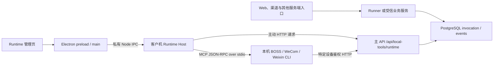

# Master 源码实录：Runtime 与服务端、插件如何通信

核对日期 2026-11-11。基线为从 `origin` 拉取的 `master` 提交 `574aed3ccbdce6ae35b1b5008e1087dab33de820`。本地 `master` 当时为 `32f477d8`，两者在本文涉及的 Runtime、插件、设备 API 和 Runner 本地工具源码上相同。初次核读和契约测试使用 `d8a150aa4`，之后远端只合入事故归档文档，相关源码和测试完全一致。现场版本、部署配置、实际安装包、登录状态和真实副作用需分别核验。路径链接用于导航，复核基线代码可用 `git show 574aed3c:<仓库相对路径>`。

- 本篇覆盖入口、配对、能力、普通调用、取消、断线与恢复。
- [插件通信与管理](runtime-master-plugin-communication-20261111.md)覆盖离线安装、MCP 进程、工具名单、发现、回执、运行资源与插件直连服务端。
- [端侧会话任务与企微服务端编排](runtime-master-session-communication-20261111.md)覆盖独立领取通道、v2 写许可、冻结正文和企微后台调用。
- 相关规范与历史交付见[共同集成契约](../system/runner-desktop-runtime-integration-contract.md)、[插件宿主架构](../system/runtime-plugin-host-architecture-design.md)、[开发计划](../plans/plan-runtime-plugin-host.md)和[打包手册](../ops/runtime-boss-release-guide.md)。本文以实际调用点和 SQL 为准。

## 1. 入口与传输边界

| 组成 | 源码入口与职责 |
| --- | --- |
| Runtime 产品壳 | Electron 工程 `clients/agent-desktop`，`package.json` 为 0.0.39。Main 监管独立 Node 子进程，管理页经 preload 使用私有管理通道。见[监管](../../clients/agent-desktop/electron/runtimeSupervisor.ts)。 |
| Runtime CLI 与受管子进程 | `agent-tool-runtime` 包版本 0.2.28，Node ≥22，`aid-runtime` 入口 `dist/src/cli.js`。CLI 与 Electron 子进程进入 `openRuntimeHost`，由 `LegacyExecution` 组合平台、存储、Provider、HTTP 客户端与执行循环。见[CLI](../../clients/agent-tool-runtime/src/cli.ts)、[Host 组合](../../clients/agent-tool-runtime/src/runtimeHost.ts)。 |
| 共享 Node 核心 | `@aid/local-tool-host-core` 包版本 0.2.25。Runtime 目录中多份同名 TS 文件只是重导出，`legacy/` 里的代码实际处理 HTTP、轮询、执行、MCP、日志和回执。`RUNTIME_VERSION` 常量定义在共享 core 的 `legacy/config.ts`，从自身相邻的 package 文件解析，源码布局下对应 core 版本。心跳字段、Host 状态与产品安装器版本应分别读取。见[运行配置](../../clients/shared/local-tool-host-core/src/legacy/config.ts)、[core 包](../../clients/shared/local-tool-host-core/package.json)。 |
| 服务端 | 主 API 注册设备路由和端侧会话任务路由。普通 Runner 负责模型、任务 checkpoint、控制与业务结果消费。Runtime 设备端有 HTTP 客户端、Provider 执行器及可选会话任务引擎。普通 invocation 通过轮询领取，事件通过进度请求回传。见[主 API](../../src/main.py)、[Device API](../../src/local_tools/api.py)、[Runner 本地工具适配](../../src/services/agent_runner/runtime/local_tools.py)。 |

## 2. 设备身份与连接注册

Web 侧使用用户登录与 middleware 解析的租户。接口在 `/api/local-tools` 下，`POST /pairing-tickets` 签发普通码，`POST /devices/{id}/replacement-ticket` 签发指向本人设备的替换码，`GET /devices` 投影设备、在线与选定状态，`POST /devices/{id}/select` 单选 active 设备，`DELETE /devices/{id}` 撤销设备并清除 selected。配对码 300 秒有效，服务端存摘要，签发时使该用户尚未使用的旧码失效。列表仅给用户界面基础设备摘要，`capabilities_json` 留在服务端。

设备端 `POST /runtime/pair` 使用票据或协议 3 原请求身份。其他设备接口使用 `Authorization: Bearer <device token>`，服务端计算 SHA-256 后查 active 设备，设备行提供 tenant/user/device 身份。普通心跳返回 `selected` 和 `server_time`。本地配置的默认 home 为 `%APPDATA%/aidwork-tool-runtime`，可由组合层或 `AIDWORK_RUNTIME_HOME` 覆盖。独立 Runtime 产品由 Main 选择代际 home。当前设备地址/ID/名称写 `config.json`，设备凭据写当前 Windows 用户可解的 DPAPI `credentials.bin`。机器指纹由 Windows MachineGuid（缺失用固定占位）与 hostname 哈希生成，配对请求上传摘要，服务端存储时再次哈希。

| 路径 | 事务、响应丢失与身份替换 |
| --- | --- |
| 协议 1／省略版本 | 服务端生成 token，锁票据后在同一事务消费并创建新设备。兼容 CLI/Host 旧配对入口，收到响应后本地将 config 与加密 token 写入 `pairing.pending.json` 再恢复正式文件。票据已消费而响应丢失时，旧协议无法靠相同码重新取回原 token。 |
| 协议 2 | 旧替换链接受指定旧设备的替换码并返回 `replacement_pending`。客户端先在隔离 DPAPI 注册记录中保存新凭据、用心跳验证，处理原执行资源，安装后调 `/runtime/replacement/complete`；服务端只接受新设备 Bearer，从数据库查替换关系并撤销指定旧设备，并发替换以旧行的胜者记录裁决。另有 `/runtime/activate` 供受信迁移选定请求自身。旧注册的 `requested` 结果不明时提示重新取码，已保存的新设备继续验证或清理。 |
| 协议 3，独立 Runtime 的 clean registration | Main 停旧执行并选一个空代际 home。先 DPAPI 持久化 `clean-registration.bin`（注册 UUID、客户端生成的 token、服务地址、冻结请求字段和进度），配对码只随首次请求发送。新注册附 `pairing_protocol:3`，同地址且能解密时可附原设备 token。服务端锁注册请求和票据，核原意图/摘要后一次提交消费票据、建新设备、选中它，存在有效同主体旧设备或显式替换目标时同时撤销该目标。不同账号或无效的旧凭据被忽略。首次请求已经提交时，可用相同注册 ID、token 和意图无票据取回原设备。未曾提交且无配对码会要求重新取码。 |
| 协议 3 的本地完成 | 校验回包明确接受协议 3 且回显原 token/有效 UUID 后保存 `paired`，写入新 home 的 DPAPI 凭据与 config，推进 `installed`，恢复登录时启动偏好，归档已完成注册记录。连接类暂态故障由 Main 约 10 秒重试，明确更换服务器可创建新的连接意图。新连接只安装配置和凭据。变更完成后 Main 尽力清理自己管理且只含可替换配置/插件的旧 home，有任务证据、未 ACK 回执、过程账本或其他未识别内容时保留。 |

旧 Host 的替换门会检查未完成配对事务、待对账标记、outbox、journal 与 session completion proof。独立产品 clean generation 另走新 home 路径。诊断心跳可验证服务和设备凭据，插件是否安装、业务 App 是否登录、原操作是否已停属于不同事实。见[配对服务](../../src/local_tools/pairing.py)、[设备事务](../../src/local_tools/repository.py#L292)、[旧配对持久化](../../clients/agent-tool-runtime/src/pairingStore.ts)、[协议 2 注册](../../clients/agent-tool-runtime/src/connectionRegistration.ts)、[协议 3 注册](../../clients/agent-tool-runtime/src/cleanRegistration.ts)、[Main 连接切换](../../clients/agent-desktop/electron/runtimeCleanConnection.ts)。

安装迁移与运行中切换连接是两条路径。Main 的安装指针 `current.json` v2 复用已初始化的用户 home。需要初始化新安装代时，先停旧进程，再优先验证已保存的协议 2 注册身份，其次读取旧配对配置或受保护的 previous identity。验证用设备心跳。插件只把通过新版信任和平台校验的存档重新导入新 store，并保留 enabled，旧展开目录和未完管理操作留原位置。原任务 journal、outbox 和会话事件仍绑定原 home。见[安装代际与迁移](../../clients/agent-desktop/electron/runtimeInstallation.ts)。

## 3. 心跳、能力与服务端派发

1. Host 加载现有 Provider 入口后组装 `PollLoop`。标准 `heartbeatLoop` 与 `claimLoop` 并行。心跳默认间隔 5 秒，携带 `runtime_version`、`capabilities`、`manifest_digest`。服务端更新 `last_seen_at` 与版本/能力记录，过去 30 秒内见到的设备判在线。心跳成功触发原回执补投，未选中只给 Runtime 提示，领取查询仍以调用行固定的 `device_id` 为准。Host 没有现存 Provider 入口且未配置有效 skill handler 时继续心跳，标准 claim 暂停。
2. 能力体包括 `providers`、旧字段 `provider_id`、`protocol_version:2`、按 Provider 的 `provider_manifests`、`capabilities` 字符串，旧脚本路径可加 `skills`。BOSS 优先，其余按键排序。Runtime 会检查本机入口是否存在，WeCom 部分新能力需实际 MCP 探测后才进入心跳。全局 `manifest_digest` 和每 Provider 摘要用途不同，Provider 摘要输入是 provider ID、排序后的工具名、执行目标，不含签名发布包字节。详见[插件通信 §4](runtime-master-plugin-communication-20261111.md#4-能力发现与兼容)。
3. Runner 的 `LocalToolAdapter` 从可信 ExecutionContext 注入租户、用户、会话和进度队列（256 条，满时丢旧进度），调用云端工具 proxy。云端由注册表、智能体配置、设备能力和业务投影控制模型可见工具；显式配置的原工具与自动新增能力候选沿各自分支。Proxy 校验公开参数，普通初次选同租户/用户 selected + active + 在线 + 具能力设备，收费工具做余额预检。
4. 普通 proxy 经 `LocalInvocationService.enqueue` 插入 `local_tool_invocations`。持久 Runner 由 `RunnerLocalLifecycle` 按原 tool call / branch / ordinal 识别阶段，将原 invocation 与 checkpoint 中 `resources.local_invocations` 在同一事务绑定。已有原调用以原身份观察和恢复。企微普通业务还有根任务设备 pin；受信日报或监控入口可指定固定设备，仍核归属、在线和相应能力。切换网页 selected 只影响依赖它的新派发。
5. 服务端 proxy 约每 0.5 秒查调用行与 `local_tool_events` 的增量 seq，发出进度并等终态。旧非持久路径按工具配置的超时调用 cancel 并返回等待超时。持久路径保留存量 deadline 的验证分支，新无 deadline 路径观察 invocation 续租，已领停续由清扫器收敛，尚未领的 queued 继续等领取或显式取消。用户侧 Runner 等待、设备在线和单次动作的租约各自独立。

源码见[PollLoop](../../clients/shared/local-tool-host-core/src/legacy/pollLoop.ts)、[能力构造](../../clients/shared/local-tool-host-core/src/legacy/config.ts)、[设备规则](../../src/local_tools/device_policy.py)、[云端工具目录](../../src/local_tools/catalog.py)、[工具装配](../../src/services/agent_runner/runtime/tool_catalog.py)、[Proxy](../../src/local_tools/proxy_tool.py#L213)、[原调用绑定](../../src/services/agent_runner/local_invocations.py)、[企微设备绑定](../../src/services/agent_runner/wecom_device_binding.py)。

## 4. 标准 Device API 与线上的字段

下表省略共同前缀 `/api/local-tools/runtime`。 `I` 表示云端 invocation ID，`C` 表示首次领取下发的 claim token，示例仅使用字段名。业务动作参数由具体云端工具和插件 schema 决定。

| 方法和路径 | 请求、响应与持久影响 |
| --- | --- |
| `POST /heartbeat` | 设备 Bearer + 版本、能力、摘要。返回 `success,selected,server_time`，更新设备在线和能力。连接诊断也使用该路由，诊断请求省略能力字段。 |
| `POST /claim?wait=20` | 设备 Bearer，JSON 空对象。服务端将 wait 限在 0～30 秒，每 0.5 秒尝试；无任务是 200 `{success:true,invocation:null}`。有任务返回顶层 `invocation_id,tool_name,arguments,claim_token,lease_expires_at,provider`。 |
| `POST /invocations/I/started` | `{claim_token:C}`；claimed → running，已 running 的同一 claim 返回原状态。Runtime 等到 ACK 才进入执行；明确拒绝直接结束本地尝试。 |
| `POST /invocations/I/progress` | `{claim_token:C,stage?,current?,total?,message?}`。服务端截 message 到 500 字符，接受 claimed/running/cancel_requested。写入下一 seq，续租到数据库当前时刻后 60 秒，返回 `{success,seq,cancel}`。 |
| `POST /invocations/I/result` | 旧/v1 回执 `{claim_token:C,success,code?,message?,effect?,data?,retryable?}`。响应 `{success,state,effect}`，同 claim 重复交付按原行幂等。 |
| `POST /invocations/I/write-authorize` | v2 受控写，带 `C,request_id,target_version?,payload_hash?`（`C` 的字段名为 `claim_token`）。响应 `permit_id,permit_token,deadline_at`。 |
| `POST /invocations/I/operation-result` | v2 回执还带 `request_id,effect,phase?,safe_to_retry?,evidence_ref?,permit_id?,permit_token?` 和兼容成功/错误字段。响应 `state,effect,run_state,late`；服务端核定动作与 run 状态。 |
| `GET /invocations/I/payload`、`GET /invocations/I/assets/{asset_id}` | 设备鉴权的冻结正文和资产读取。服务端核设备/调用及受权域、目标状态和冻结引用；正文由名称会话桥消费，资产用于专属场景。两者在[会话任务篇](runtime-master-session-communication-20261111.md)详述。 |
| `POST /boss/visual-diagnose`、`POST /wecom/calibrate`、`POST /resume/evaluate` | 特定业务的设备鉴权辅助请求，与 claim/ACK 分开。调用方、输入和计费见[插件通信 §7](runtime-master-plugin-communication-20261111.md#7-插件直接调用服务端)。 |

标准 claim 先收敛过期租约，再取同设备、同租户、queued、standard lane（旧 NULL 视作 standard）的行。显式 provider 需在设备能力里，旧 provider=NULL 行可按旧兼容领取并从设备能力回退 provider。SQL 对受信恢复任务优先，其余按创建时间，使用 `FOR UPDATE SKIP LOCKED`，同事务写 `state=claimed`、claim hash、60 秒租约与领取时间。入队、claim、started 会复验有效设备和未决物理操作；受信恢复观察与原发送对账有专门窄范围例外。领取成功后 API 还核服务端 Provider 白名单，非法工具回失败。claim 请求每次取新 token，响应丢失时设备没有那次明文 claim，等待租约回收，原行没有自动重新排队。

`ApiClient` 普通 JSON POST 默认 15 秒超时，claim 请求超时为 wait + 15 秒。POST 禁止重定向，合并主动中止和请求超时 signal。DNS/TLS/其他网络错误分别归类，401 设备错误结束轮询，其他失败留 HTTP 状态、可读原因、服务端 code 和可解析的 `Retry-After`。心跳与领取失败独立指数退避 1～30 秒，恢复后重置。接口 schema、实际 POST 和服务端事务见[请求模型](../../src/local_tools/models.py)、[HTTP 客户端](../../clients/shared/local-tool-host-core/src/legacy/apiClient.ts)、[Device API](../../src/local_tools/api.py#L252)、[claim SQL](../../src/local_tools/repository.py#L978)。

`started` 和 `progress` 在 API 层验设备 Bearer，仓储用 tenant + invocation + claim hash 找调用，再核调用行的设备仍 active。两个仓储方法未接收请求设备 ID 作显式相等比较。两者按行状态接受调用，进度 SQL 未单独以 `lease_expires_at > NOW()` 过滤。过期行由 claim 等调用的清扫器收敛，`write-authorize` 事务另外直接校验租约。终态回执则显式核对原设备。见[设备路由](../../src/local_tools/api.py#L420)、[仓储 started/progress](../../src/local_tools/repository.py#L1111)、[写许可事务](../../src/local_tools/permits.py)。

## 5. 本机执行、租约与取消

1. 标准循环同一时间等待一个 `runInvocation` 结束。执行器根据 claim 的 `provider` 选 manager，缺字段时本机默认 BOSS。先检查已安装入口/进程内 handler、受信工具清单、v2 能力。参数中的数字 `protocol_version=2` 或工具名后缀 `_v2` 判为 v2。缺能力直接回受控失败。
2. `started` 发生在交互桌面检查前。对网络错误及可重试的 408/429/500/502/503/504 用原 ID 和 claim 重试，遵守 `Retry-After`；已知授权/身份拒绝禁止开始。写集合中的动作检查 Windows 交互桌面，锁屏或不可交互回 `DESKTOP_NOT_INTERACTIVE`、`effect=none`。
3. 所有调用共用桌面资源锁，锁键来自本机资源域；等待期间也启动 `ProgressForwarder`。有变化的 MCP 语义进度立即入发送队列，默认约每 2 秒补一次续租。相同语义去重，约 60 秒无新业务进展记告警。续租消息明确带无新进展时长。进锁后 flush 既有进度再检查取消；等待超时回 `DESKTOP_RESOURCE_BUSY`，与旧 BOSS 会触发弹层恢复的 `BUSY` 分开。v2 写动作在锁内还有会话复核、许可、journal 和最终有效期校验。
4. 云端取消 queued 直接写 `cancelled/none`。claimed/running 变 `cancel_requested`，Runtime 从 progress ACK 收到 cancel 后协作式 abort。progress 的 401/403/404/409 被当作执行权丢失并中止。进度暂态网络故障允许本地继续执行，接下来可能观察到失权，也可能先完成并留下回执。设备在线心跳从来不会替代 invocation 的 progress 续租。
5. 管理停止执行走 `stopClaiming`、会话引擎 shutdown、排空已经接受的标准调用，排空期间保留心跳。随后等待 Provider 闲置并回收进程。已接单的终态发送会等待原回执交付，网络长时间不可用时 Main 的正常退出/升级可报告排空超时。撤销或异常停止可走 `shutdown` 的协作 abort。显式 clean replacement 另走 Main 的 `exitForReplacement`，Windows 下结束自己启动的子进程树并等待退出；这项退出事实不裁定旧动作结果。

见[执行器与进度转发](../../clients/shared/local-tool-host-core/src/legacy/invocationRunner.ts)、[桌面锁](../../clients/shared/local-tool-host-core/src/legacy/desktopLock.ts)、[Host 停机顺序](../../clients/agent-tool-runtime/src/runtimeHost.ts#L363)、[进度与取消 SQL](../../src/local_tools/repository.py#L1160)。

## 6. 回执、迟到事实与恢复

| 场景 | 当前代码行为 |
| --- | --- |
| Provider 有有效回执 | Runtime 显式构造原 wire 字段，业务 `data` 可加插件 `run_id`。v1 保持缺省 effect 与 `partial` 语义；v2 把 effect 收敛为 `none/applied/unknown`，phase 收敛为 `prepared/may_have_started/submitted/verified/unknown`。写动作已经可能开始而崩溃/无可信回执，按未知效果保护。 |
| 本地先保存再发 | v1 写 `result-outbox/legacy-v1/<I>.json`，v2 写 `result-outbox/<I>.json`。临时文件 fsync 后 rename，记录原 payload 和端点。该目录是可补传的本机 JSON，含原回执提交字段，勿作为通用日志导出。v2 journal 单独保存许可 ID、payload hash、请求/调用标识和动作阶段，journal 不含 token。outbox 写失败只直发原结果一次并记无重启保障。 |
| HTTP ACK 或传输失败 | 原请求按 home/outbox 与 invocation ID 单飞补送。2xx 后删除条目；v2 先写原 ACK 证据，写证据失败保留条目。网络及暂态 HTTP 退避并保留原 payload；确定性拒绝标记 `gave_up` 保留，设备撤销保留待核对。成功心跳后后台单飞扫描，单轮最多 8 条、每条试一次，跳过当前活跃调用、未到 `next_attempt_at` 或已放弃项。补投的是回执。 |
| v1 落库与计费 | `write_result` 行锁核对原 claim 和回执所属设备。success→succeeded，失败且 `EXECUTION_UNKNOWN`→unknown，其余失败→failed；另保留 effect。首次成功按工具价格落使用台账、扣余额、写 `credit_cost`；免费写 0，扣账异常仍保存回执，cost 留空供补账。已终态重复提交走原记录。WeCom 成功的旁路登记是持久接受后的尽力异步回调，和 ACK/计费分开。 |
| 租约停续 | claimed/running/cancel_requested 到期后收敛为 `unknown/unknown`。若此前无结果，合法原回执可另存 `result_json._late_result`，保留原 state/effect 和原完成时间，可信成功可记账。服务端 `observed_invocation` 用可验证迟到结果形成消费视图，并保留原未知审计。无足够证据的写调用不会因重连或换选定设备重放。 |
| 原机状态核对 | Runner 持久恢复重取原 phase、设备、参数和调用 ID。需要验证时可创建绑定原任务和原调用的 `runtime_recovery_observe`；版本 2 是观察，版本 3 可请求停止受管资源。BOSS 通过 `boss_recovery_probe` 读取原 target 或记录 target 不可用；WeCom 页面字段为 not_applicable。停止证明来自受管 Provider pool/进程边界，页面读成功与旧操作已停分别核验。 |
| 新动作准入 | 云端 `assert_device_operations_settled` 读取显式结束等待（`detached_local_wait`）的持久占用，核原设备或同租户/用户下相同机器指纹，未知历史本身不会普遍阻断设备。原 ACK、可信停止证明或受信的原发送只读对账各有归属校验。已闭合且效果已知的 v2 journal 满 7 天后按证据清理。 |

一条 BOSS 普通调用可按 `tool call → phase binding → invocation_id → claim/started → [runtime-perf] / [boss-mcp] → progress seq → /result → result_json / credit_cost` 对照。断线时分别看设备 `last_seen_at`、该调用 `lease_expires_at`、本机 outbox 和云端 `_late_result`；仅凭界面显示在线无法定位调用是否已结束。

见[outbox](../../clients/shared/local-tool-host-core/src/legacy/resultOutbox.ts)、[journal](../../clients/shared/local-tool-host-core/src/legacy/journal.ts)、[结案证明](../../clients/shared/local-tool-host-core/src/legacy/completionProof.ts)、[回执事务](../../src/local_tools/repository.py#L1235)、[Runner 恢复](../../src/services/agent_runner/local_recovery.py)、[云端观察验收](../../src/local_tools/recovery_observation.py)、[Host 观察实现](../../clients/agent-tool-runtime/src/recoveryObservation.ts)。

## 7. 对照测试入口

本次逐项比对了 Device API 的 20 个路由（含 Web 设备管理）与端侧会话任务的 7 个设备路由、BOSS/WeCom 的 Host 受信工具及写集合。离线运行 `python contracts/runtime-host/v1/scripts/check.py`（11 个 schema、85 个 fixture，7 个测试通过）与 `node --test contracts/runtime-host/v1/tests/consumer.test.mjs`（15 个通过）。验证覆盖 Host 契约与消费 fixture。以下其余测试是复核入口，本轮没有执行真机业务、安装升级或线上联调。

| 核对内容 | 对照用例 |
| --- | --- |
| 旧协议与干净注册、替换 | [设备替换事务](../../tests/unit/local_tools/test_device_replacement.py)、[Runtime 注册](../../clients/agent-tool-runtime/tests/cleanRegistration.test.ts) |
| 断线、回执重投、结案证据 | [传输恢复](../../clients/shared/local-tool-host-core/tests/transport-recovery.test.mjs)、[心跳补投](../../clients/shared/local-tool-host-core/tests/outbox-poll-recovery.test.mjs)、[journal 保留](../../clients/shared/local-tool-host-core/tests/completed-journal-retention.test.mjs) |
| 插件包验签、存储、MCP 结果 | [插件包](../../clients/shared/local-tool-host-core/tests/pluginPackage.test.mjs)、[插件存储](../../clients/shared/local-tool-host-core/tests/pluginStore.test.mjs)、[Provider 结果](../../clients/shared/local-tool-host-core/tests/providerResult.test.mjs) |
| 微信会话、许可与旧客户端隔离 | [设备协议](../../tests/unit/session_tasks/test_device_protocol.py)、[会话执行](../../tests/unit/session_tasks/test_c3_execution.py)、[Runtime v2 写路径](../../clients/agent-tool-runtime/tests/v2WritePath.test.ts)、[名称桥](../../clients/agent-tool-runtime/tests/name-bridge.test.ts) |
| WeCom 原发送与辅助 API | [对账](../../tests/unit/local_tools/test_wecom_send_status.py)、[标定](../../tests/unit/local_tools/test_wecom_calibration_api.py)、[受信 Runner 来源](../../tests/unit/services/agent_runner/test_wecom_proxy_source.py) |
