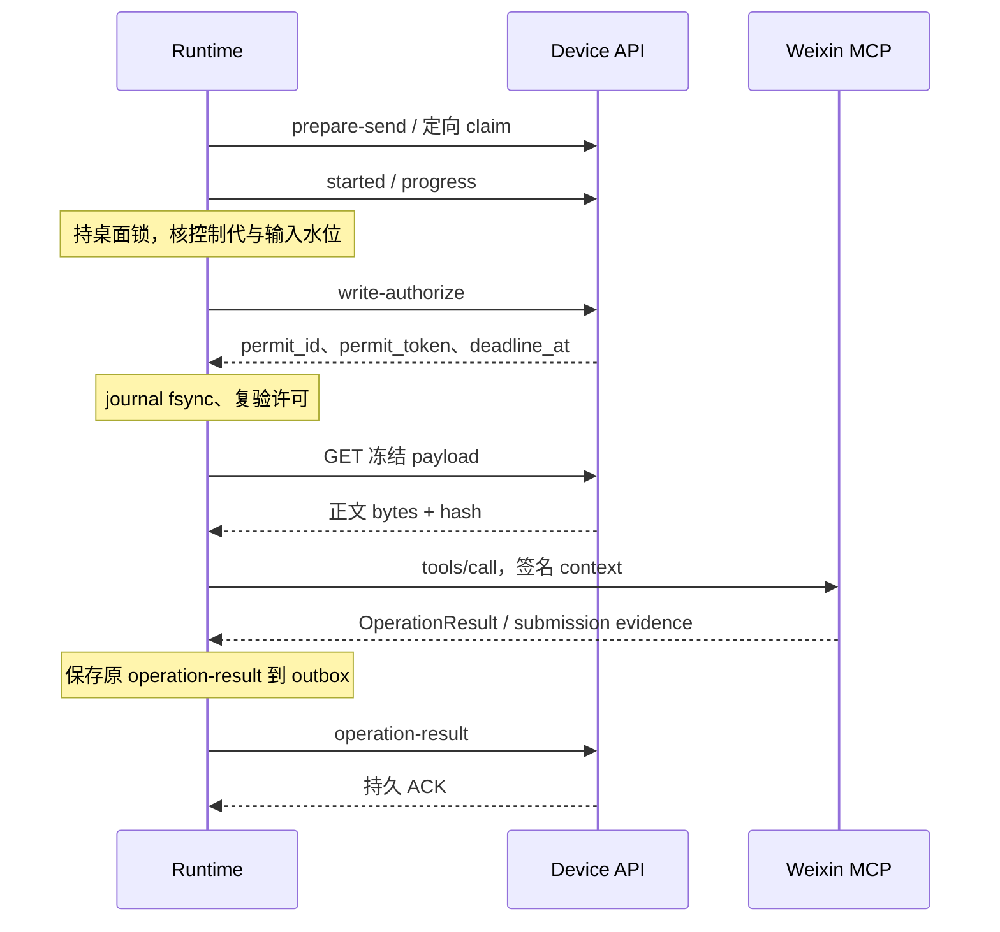

# Master 源码实录：端侧会话任务、v2 写许可与企微后台

源码基线为 2026-11-11 拉取的 `origin/master` `574aed3ccbdce6ae35b1b5008e1087dab33de820`。[总览与普通 Device API](runtime-master-communication-20261111.md) · [插件通信与管理](runtime-master-plugin-communication-20261111.md)

## 1. 实际运行的几条路径

| 入口 | 负责推进任务的一端 | 设备执行通道 |
| --- | --- | --- |
| 普通 Web/渠道 Runner 的 BOSS、企微等工具 | 云端 Runner 解释模型调用、控制与恢复；设备执行单次 invocation | `standard`，普通 claim，BOSS/WeCom 沿 v1 `/result`。 |
| 微信端侧会话任务 | Runtime 可选引擎观察会话、持久化消息批次、发起并轮询云端决策。服务端负责任务状态、模型、决策、预算、执行授权与结算 | `session_task`，按 assignment 和 invocation 定向领取，受控 v2 写。 |
| 企微代理监控、配置和首次发送 | 服务端后台按固定账号、设备、目标调度，普通回答提交受信 Runner | `standard`，调用原 WeCom 工具与 v1 回执。 |
| BOSS 专属会话场景 | 云端有 `boss.chat_reply.v1` 的描述器、适配器、绑定及许可/频控/回执结算路径 | 云端定义 `boss_send_to_v2` 与 `session_task`；当前共享 core 与 BOSS CLI 均无对应 v2 tool，Runtime 的 session observer 也固定调 Weixin。BOSS 已有的普通 `boss_send_to` 走上面的标准通道。 |

端侧会话任务服务器热读 `session_tasks.enabled` 和租户允许范围，缺配置默认关闭。服务端核 `session_task_v1`、`session_observer_v1` 及场景发送能力。设备侧 `config.sessionTasks === true` 才启引擎并取得独立实例保护，微信的 `config.providers.weixin.v2Send === true` 才使 Host 使用 v2 manifest；两个开关各自判定。基础 session 能力串随 Weixin 入口上报，心跳见能力不等于本地引擎已启动。协议 3 写入的初始 config 只有 server/device_id/name。源码实现需与实际租户和设备配置一起核对。

见[Host 开关](../../clients/agent-tool-runtime/src/runtimeHost.ts#L254)、[服务器开关](../../src/session_tasks/config.py)、[端侧任务能力](../../src/session_tasks/constants.py)、[BOSS 场景适配器](../../src/boss_conversation/adapters.py)、[本机 Provider 受信集](../../clients/shared/local-tool-host-core/src/legacy/providers.ts)。

## 2. 端侧会话任务 Device API

下表使用设备 Bearer，路径前缀为 `/api/local-tools/runtime/session-tasks`。成功回包一般为 `{success:true,data:...}`，Runtime 会拆壳。 `A` 为 assignment ID，`D` 为 decision ID，`I` 为本地动作 invocation ID。

| 请求 | 输入、输出与关键校验 |
| --- | --- |
| `POST /claim` | 请求 `runtime_instance_id`。按设备和租户遍历 active 候选，核通用与场景能力、绑定等，已有有效 assignment 的候选跳过；过期代可被新代 supersede，fence 递增。空为 HTTP 204。有任务返回 assignment、task、spec/spec_revision、fence、control_epoch、server_control_seq、lease_seconds、会话绑定/账号身份版本、input_version_base、fresh_baseline；服务端也带 scenario_key。 |
| `POST /A/renew` | `fence,control_epoch`。当前 assignment 和设备归属受核，返回 `lease_seconds,control`，含 status、control_epoch、server_control_seq、completion_reason、blocked_reason。Runtime 默认每 20 秒续 assignment，默认租约 60 秒。 |
| `POST /A/events` | `fence,records:[{local_seq,event_id,type,payload}]`，默认最多 100 条/256 KiB UTF-8 JSON 记录。新事件需紧接连续 ACK 水位，同租户同 event ID 同摘要幂等，冲突或缺号 409。写事件、物化消息/批次、推进 ACK 同事务。返回 `ack_seq,control,historical?`。旧 assignment 仍按原设备与 fence 补交事实，历史批次不进入新决策。 |
| `POST /A/decisions` | `fence,batch_id,decision_kind,input_version,control_epoch,spec_revision`，202 返回 `decision_id,status`。复验当前代、输入版本、已接纳批次与任务状态。服务端决策 worker 处理推理和冻结动作；开场白可以用独立的合成 opening 批次。 |
| `GET /A/decisions/D` | 返回决策 `decision_id,status,decision_kind,batch_id,input_version,action` 等，`action` 有 reply/wait/handoff/done，未冻结时 null。Runtime 轮询这一行判断下一阶段。 |
| `POST /A/decisions/D/prepare-send` | `fence`。已 ready 的 reply/opening 经业务校验后幂等物化 occurrence/run/delivery/attempt/invocation，唯一执行关联与底座 dedupe key 收敛到原 ID。过期或失配回 `invocation_id:null` 与决策状态，工作时段关闭回 409。 |
| `POST /A/invocations/I/claim` | `fence`。核当前 assignment、租约、任务、同设备、业务引用和 `session_task` lane，再按指定 I 取 queued 行，复用 60 秒调用租约。非 queued 或任务非 active 时返回 `invocation:null,state`，成功返回标准 claim 字段。普通 claim 排除这个 lane。 |

assignment 的 lease 约束会话任务控制代；单次发送领取还有 invocation lease；写入还有 permit deadline。控制由 `renew` / `events` 返回的 epoch/seq 推进，本机拒用旧响应重新打开门。端侧可观察运行状态为 ready、observing、decision_pending、send_ready、executing、waiting_peer、waiting_schedule、sync_pending、blocked。服务端的 draft/active/paused/human_required/blocked/completed/stopped 由任务表维护。

见[设备路由](../../src/session_tasks/api.py#L427)、[任务事务](../../src/session_tasks/service.py#L574)、[决策与定向领取](../../src/session_tasks/decisions.py#L1819)、[Runtime HTTP 消费](../../clients/shared/local-tool-host-core/src/legacy/apiClient.ts#L438)。

## 3. 观察、同步与崩溃接续

1. Runtime 引擎启动扫描旧 assignment，再循环 claim（默认约 2 秒）、renew、同步待发事件、补交历史、保留期检查和调度一个就绪动作。对不同任务做就绪队列调度，默认最多两个在途决策，锁屏/观察错误等由相应动作反馈。所有观察与写动作仍经共享桌面锁。
2. `NameSessionBridge.observe` 直接调用 `weixin_session_observe`，MCP 输入带会话绑定 ID、绑定版本、账号身份版本、可选目标名及旧 watermark，超时 75 秒。结果需 observation_id、覆盖类型（complete_window/gap/unavailable）和有序消息。身份不一致使任务 blocked；gap/unavailable 保留水位并退避，连续 3 次 gap 记录诊断，后续仍可恢复原水位。名称模式用本机 OCR/对齐，桥缓存成功观察的 frame；provider 重启、指纹无法对齐等会显式报 gap。
3. 首次完整窗口只建历史基线，锚到最新消息。之后把新消息聚合成批次，默认静默 2 秒或最长等 10 秒。先追加 batch 并 fsync，再推进水位与进入决策队列。普通决策等该 batch 的 local_seq 被服务器 ACK 才能提交。允许开场白时使用独立合成批次；新入站可使旧开场决策作废，人工恢复的 fresh baseline 不重新安排开场白。
4. 本机 `session-tasks/<A>/events.jsonl` 是追加日志兼同步 outbox，payload 用当前用户 DPAPI 加密，连续 local_seq 和稳定 event ID 用于重投。 `meta.json` 用来核身份、任务规格和控制代，`.acked` 记已确认序号。运行时先持久化元数据再激活；恢复时优先接续有效原代或对账旧代，原冻结发送沿原 invocation 观察。无法确认的损坏/断层会阻断相关接续，完整记录仍可补交，历史事实不推进新代执行权。服务端加密保存消息/事件正文，证据引用以不透明标识流转。
5. 默认磁盘水位 256 MiB，80% 告警，达到上限停止新增观察持久化和发送，保留同步与清理。清理只覆盖符合可信结案的终态日志和保留期条件（默认 7 天），未 ACK、未知或无法归属的证据保留。另有单次动作 journal 与 result outbox，不能用会话事件 ACK 代替 invocation 的终态 ACK。

见[会话引擎](../../clients/agent-tool-runtime/src/sessionTasks/engine.ts)、[名称桥](../../clients/agent-tool-runtime/src/sessionTasks/nameBridge.ts)、[本机日志](../../clients/agent-tool-runtime/src/sessionTasks/sessionStore.ts)、[保留策略](../../clients/agent-tool-runtime/src/sessionTasks/retention.ts)、[微信操作 handler](../../clients/weixin-cli/src/operations/nameOperations.ts)。

## 4. v2 写许可、冻结载荷与微信发送

1. Runtime 进桌面锁后，等待既有进度 ACK，核取消/失权。会话写复核本地任务 gate、assignment deadline、冻结 input_version 和是否有正在聚合的新批次。旧绑定模式在同锁内再观察、检查身份/覆盖/新增消息；名称模式由实际发送时的新截图做唯一标题和输入区域校验。
2. `write-authorize` 校验设备、原 invocation 与 claim、running、租约、冻结 request/target/hash、v2/业务类型、任务状态和控制请求、授权 revision/epoch、run/delivery/attempt。场景 adapter 同事务复核目标与配额，活跃许可同 delivery 至多一个。写 `local_tool_operation_permits`、保留额度、推进 delivery 与 invocation 的 `may_have_started`，许可只返回一次明文；服务端 deadline 为许可 TTL（120 秒）、调用 deadline 与 claim lease 的最小约束。
3. Runtime 根据服务端剩余墙钟时间和本地 90 秒上限派生单调截止。journal 追加 `may_have_started` 后 fsync，复验许可，再进入插件。拿不到许可、前置写盘失败或许可过期，执行器以无动作失败上报。v2 通用路径附 permit handle；名称会话桥改传签名后的本地 `{context,signature}`。
4. `GET /invocations/I/payload` 校验设备 Bearer、tenant、原设备、桌面自动化 v2、已领取且未终态、冻结 payload_ref 与场景/任务/revision；当前 GET 没有 claim token 校验。服务端经受信 adapter 按冻结引用读取并核 `payload_hash`，回 `X-Payload-Hash`、Content-Type 与 nosniff。Runtime 固定本服务地址、禁止重定向，流式读取至多 2000 字节，重算 SHA-256、严格 UTF-8、正文非空且至多 500 字符，无控制字符或换行分隔符。
5. 名称桥核 `receipt_mode=submission`、`receipt_context=weixin_name`、目标版本与原 frame，使用启动期桥密钥对 JSON context 做 HMAC-SHA256。context 含原 request/invocation/permit ID、截止时间、绑定和账号版本、目标名、预期 frame、正文及 hash。正文与签名走 stdio。CLI 常量时间验签、严格 schema、有效期、正文 hash 与本进程观察 frame，再从本机桌面截图确认目标和输入框。发送前以 request ID 保存排他执行标记，执行一次输入和提交，记录 `weixin-submission:<request_id>:1`。该路径可确认本机提交，送达状态仍未核验。效果无法证明时保留原请求记录和 unknown。
6. v2 `operation-result` 核原 claim、设备、request、attempt/delivery 和 permit 绑定。 `applied + submitted/verified` 需场景接受的 evidence_ref，证据注册绑定同一操作和 payload，跨操作复用拒绝。缺证据或不一致收敛为 unknown。 `none + prepared` 等确定未执行可释放额度，其余保守结算已预留额度，许可单次消费。绑定一致但许可已过期仍可交回原动作结果；attempt 已终态的回执追加迟到审计/证据并回 ACK，原业务判定和额度不重算。只读回执或旧 v1 的积分台账是另一条路径。

素材 `GET /invocations/I/assets/{asset_id}` 由微信营销受信 adapter 解析，核 invocation 设备/租户、领取状态、场景与该 revision 确实引用图片，回字节、`X-Asset-Hash` 和 MIME；哈希不符或缺文件审计。当前 Runtime 名称发送只接上述正文 payload，未在 Runtime/Weixin CLI 主通路找到该素材路由的消费。服务端接口存在与设备实际支持素材发送须分别核定。

见[许可签发与额度](../../src/local_tools/permits.py)、[Runtime 许可期限](../../clients/shared/local-tool-host-core/src/legacy/writeAuthorize.ts)、[正文/素材路由](../../src/local_tools/api.py#L829)、[素材解析](../../src/weixin_marketing/assets.py)、[微信签名校验](../../clients/weixin-cli/src/platform/liveBridge.ts)、[微信提交证据](../../clients/weixin-cli/src/platform/nameSession.ts#L260)、[服务端 v2 结算](../../src/local_tools/operation_result.py)。

## 5. 企业微信通过标准调用道编排

### 5.1 普通工具与业务身份

普通 Agent 用 `wecom_read_session`、`wecom_message_send`、`wecom_read_sessions`，能力符合时可用目录搜索。云端 proxy 会校验输入，持久阶段使用原会话设备 pin。现代名称发送先持久绑定独立只读 `wecom.resolve` 阶段，向原设备调 `wecom_read_session` 的内部 `resolve_only`，从原可信结果提取 canonical `ws1.` locator；主发送沿原设备和 canonical locator。直接提供稳定 locator 的发送省去这次解析。CLI 自己核 locator 的当前账号/会话，读取使用 `wb1` 分页及源库代际校验。账号、游标、目标和本地证据由 CLI 产生，服务端核适用范围后消费。

写后确认来自 CLI 的 `verification=local-record`。 `wecom_send_status` 对账只读，云端从原已认证发送 invocation 及其结果提取 `receipt_id`，核同租户、同用户、同会话、原设备和原业务绑定后入队，再于领取/started 复验。失败的 scope 可以核定为零派发。对账调用的结果独立记录，原未知写动作的历史回执保留。读调用如果恢复，需要区分原调用迟到结果、读重试与已经保存的入站 offset，避免丢掉首次读到的消息。

按需附件读取使用 `wecom_read_session(session,attachment={message_id})` 的同一调用道。插件从指定会话消息解析本地附件，图片内容经 OperationResult 的 `data.attachment.image` 返回，原 Device 回执继续留作恢复事实。云端只对匹配请求消息 ID 的图片解码，核 PNG/JPEG/GIF/WebP、实际图片格式和 5 MiB 上限，在租户存储注册 ImageRef 后给模型/公开结果投影，持久 Runner 可复用相同摘要的 image artifact。缺失旧插件能力或坏图只影响该次附件读取，普通时间线可用。这个方向的图片经结果上传，与 §4 冻结素材下载是两套入口。

见[企微持久工具流程](../../src/local_tools/wecom_flow.py)、[设备绑定](../../src/services/agent_runner/wecom_device_binding.py)、[发送对账范围](../../src/local_tools/wecom_send_status.py)、[读结果交接](../../src/local_tools/wecom_inbound.py)、[CLI 附件参数](../../clients/wecom-cli/src/operations/readSession.ts)、[云端附件投影](../../src/local_tools/wecom_attachments.py)。

### 5.2 配置、监控与普通回答

1. 服务端企微专用 API 在配置时用受信设备调用 doctor、calibrate、directory 和必要的只读基线，核当前账号及本地数据库 readiness。已配置任务重新启动检查原设备及运行工具能力，设置阶段的附加工具缺失只影响对应配置。任务固定 tenant、user、device、WeCom account、目标会话与内部 web_session_id。
2. Scheduler 注册后台 monitor / dispatcher，按同租户、设备和账号协调，监控与回复占用不并行。monitor 逐目标发 `wecom_read_sessions`，每次传一个 locator、cursor 和 limit=50，最多 20 页。临时故障留原水位待下轮，源库代际/游标或目标确定性问题停止该会话等待核对，其他会话可继续。
3. 可信监控回执提取新消息与身份并创建持久批次。入站原文、处理范围及指令进入批次的冻结快照，按持久的游标、位置和占用推进。dispatcher 走内部 `wecom_proxy` source，固定原 web_session_id，沿既有 Runner 加载历史、追加指令并限制到本目标。幂等键 `batch_id:retry_count`，同轮重投用原 submit intent。
4. 结算以原 invocation 及可验证的 CLI 结果为准，Runner 结束 JSON 只承担自己的决策事实。至少一条确认发送可推进，或明确无需回复、无 @我 且零发送可推进。确无发送或所有失败都证明未执行时可按现有策略重试一次。有不可证明未发送的调用且没有确认发送，进入 `reconcile_hold`；自动恢复的 waiting 另走原任务核验。

见[企微专用 API](../../src/wecom_conversation/proxy_api.py)、[调度器](../../src/scheduler/manager.py)、[监控与游标](../../src/wecom_conversation/proxy_monitor.py)、[批次派发](../../src/wecom_conversation/proxy_dispatcher.py)、[结算规则](../../src/wecom_conversation/proxy_settlement.py)。

### 5.3 首次启动发送

首次成功启动时冻结可选 `opening_message`，为目标登记 `opening_send_status=pending`。后台按组锁等待原回答 Runner 释放占用，逐目标用原 `wecom_message_send({session,text})` 创建 standard invocation，业务引用 `wecom_proxy_opening` 携带 task/target，创建与写入原 invocation ID 同事务。同一组的待发/发送占用挡住普通监控和新回答，发送沿原价格余额与原 v1 成功回执计费。

发送前 CLI 依据稳定目标与账号，利用标定输入点重置焦点，再复制和比对标题后输入。queued 可按该工具等待预算过期，已领取用原租约判断。可信 `verification=local-record` 且 session 匹配才确认。明确未执行的失败完成该目标，继续后续目标。未知结果允许原迟到成功或有依据时单次同设备只读对账，后台把未确认结果留存，普通监控无需等待所有对账。暂停/停止阻止新启动发送，已授权的执行按原事实核定。

见[企微首次启动记录](../../src/wecom_conversation/proxy_tasks.py)、[首启派发与对账](../../src/wecom_conversation/proxy_opening.py)和[企微标题定位及焦点](../../clients/wecom-cli/drivers/ps1/_send-points.ps1)。
