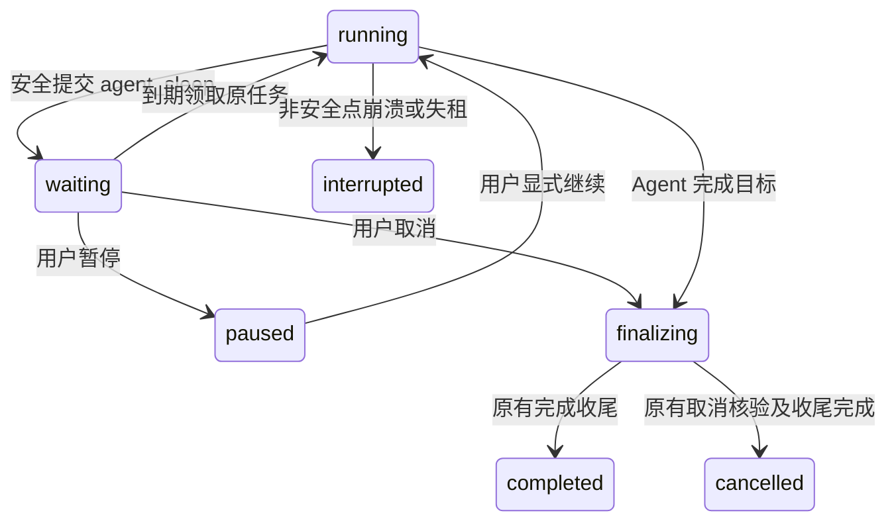

# AgentRunner 通用持久化休眠与自动唤醒设计

2026-10-26最新master整合兼容补记：master增量迁移已推进到10月26日，原10月22日sleep/BIGINT/history索引块在存量环境会被单一last_datetime跳过；保留历史不改，追加17:00同结构幂等补齐块，正常启动/强制重放均须保持已有用量及积分行。fresh init结构不变，不修改迁移框架。实际验证、未提交合并状态及新旧Runner语义处理统一见[WeCom整合计划](../plans/plan-wecom-cli-group-chat-experiment.md#最新master与runtime核查2026-10-26用户追问后补核)，不能用全新库通过代替master水位升级证明。

> 日期：2026-10-22；状态：本地开发、独立测试及CodeReview完成，master已整合；尚未提交或部署。最新修复、独立验证及历史Windows环境问题处理见开发计划第17节，未宣称真实企微多天验收通过。
>
> 依据：[Runner 现行架构](agent-application-architecture-design.md)、[共同集成契约](runner-desktop-runtime-integration-contract.md)；实施进度唯一记录于[开发计划](../plans/plan-agent-runner-durable-sleep.md)。
>
> 用户确认的方向：Agent 主动调用业务工具，自主决定休眠时长，醒来后继续同一任务；能力通用于所有受支持工具，不为 wecom 建专用监控器。

> 交付工作区：用户指定`C:/repos/aid-work-agent-wecom`（当前`feature/ask-user-question-card`），与Runtime+wecom CLI一同开发和联调；定期合入最新master已提交版本，先从特性分支发布agent2验收，再按用户指示整合master。部署、提交仍分别需要明确授权；详见计划第12节及[agent2分支发布计划](../plans/plan-agent2-branch-deploy.md)。

## 1. 目标、假设与范围

示例行为：Agent 读取数据、判断是否行动，调用 `agent_sleep(seconds=10)`；Runner 持久保存等待，到期恢复原任务，Agent 再主动读取数据。CLI 不需要知道调用者之后何时醒来，也不需要新增向 Runner 推送的能力。

本设计区分两类执行：

- 普通任务：沿既有无模式参数的接单方式；新任务默认最多50个业务执行轮次，成功的纯sleep轮次不占该计数，休眠不重置已经使用的业务轮次。
- 持续任务 `continuous`：无默认任务结束时间或任务总积分预算，由用户判断是否继续；一次持续忙循环仍有50个业务轮次的防失控保护，合法休眠后继续下一段。累计实际模型轮次和积分始终保留。对于“直到我说停”的任务，一段回复或一轮无新内容不等于整个任务完成；用户停止或其明确指定的结束条件命中才正常终结。

首版包含 Web 创建/控制闭环、MASTER/STANDALONE 及其受管子执行中的休眠。Agent 不必委派子智能体才能休眠；子执行复用同一能力。渠道协议、本地 Provider 业务接口、通用父子消息邮箱、独立监听服务、cron 周期任务转换均不在本批范围。纯云端工具可独立验收；某本地工具尚未接入 Runtime 不阻塞本能力，但不能据此声称该工具的完整业务已支持。

实现假设与取舍：

1. PostgreSQL 是时间、任务状态和唤醒的权威。首版在现有 Runner worker 的领取循环扫描到期等待，不引入新进程、APScheduler job 或每任务内存定时器。
2. 唤醒是“到期后获得执行资格”，不是精确实时保证；负载、执行并发和数据库可用性会影响实际延迟。
3. 直接使用接单时已有会话，不强制新建后台会话、自动分叉或增加任务创建中心。需要多条独立长期任务时，沿现有新建会话流程分别提交；本批不实现同一会话内多个独立活跃 Runner。
4. 普通/持续任务休眠均保留原 session claim。休眠释放执行资源，不等于释放任务/会话归属；当前会话后续输入针对原任务走 controls，其他普通任务仍按原规则排队。不同会话可各有自己的长期任务，共用设备操作按既有invocation队列与桌面锁协调；单个任务也可跟踪多个目标。首版不宣称“同一会话可以同时自由聊天”。
5. 本轮只形成文档。下述工具名、字段、错误码及版本均为实施候选，不表示现有接口已支持。

## 2. 已有事实与需要增加的能力

| 位置 | 当前实现 | 本批增量 |
|---|---|---|
| `src/core/agent_engine/contracts.py`、`engine.py` | ExecutionState schema 1；工具可返回 wait；有总 iteration/max_iterations | timer 等待类型、可恢复的 sleep 工具结果与持续执行的激活额度 |
| `src/tools/control_set.py`、`runtime/controls.py`、`runtime/tools.py`、`runtime/tool_catalog.py` | 控制工具定义、普通/本地工具与恢复分离 | 云端控制工具 agent_sleep；工具可见性及专用恢复分支 |
| `durable_control.py`、`execution_repository.py` | checkpoint、park、释放 attempt/lease；保留会话 claim | 原子提交 timer+checkpoint+等待状态，并证明整棵执行树可停稳 |
| `worker.py`、`recovery_repository.py`、`recovery.py` | queued 领取、显式 controls 续接；失租 running 置 interrupted | 到期扫描、timer 专用恢复与幂等领取；不将普通 interrupted 一概自动恢复 |
| `runtime/child.py`、`child_recovery.py` | 子执行在父树保存，等待沿 child_wait 上抛 | 定位睡眠叶、按原子树恢复；不重新委派或增加本地 Agent loop |
| `finalizer.py`、`transaction_repository.py` | 终态及迟到用量以稳定 record 做累计差额结算；终态写历史并释放 claim | 活跃持续任务增量结算，独立于终态历史写入和 claim 释放 |
| `src/api/agent_runner_web.py`、Web Runner client | 持久接单、查询、订阅及 pause/resume/reply/cancel | 持续模式协商、定时等待展示、立即继续与停止 |
| `src/local_tools/repository.py:claim_next`、Runtime `legacy/pollLoop.ts` / `invocationRunner.ts` | 已有持久invocation队列、标准领取循环串行执行、共享桌面锁 | 验证多Runner共设备的公平/取消/等待边界，不再为每种CLI创建一层执行队列 |

`waiting` 当前不等于通用 timer，恢复候选需要 resume_control_id；不能仅增加 `asyncio.sleep()` 或在 CLI 启动一个长循环就宣称完成。现有 Web/Runtime 对已接单任务的观察关系继续保持。

## 3. Agent 工具与任务模式

### 3.1 候选工具 `agent_sleep`

| 参数 | 规则 |
|---|---|
| `seconds` | 必填整数，单位秒；建议默认允许 1～604800 秒，配置可调整；非法值明确返回，不静默截断 |
| `reason` | 可选简短说明，最多 200 字符，按现有规则脱敏；不参与授权 |

任务生命期不由单次 sleep 的上限决定。seconds 的校验、每次执行的轮次限制以及用量准入分别处理，禁止通过压低 `max_tokens` 控制长期预算。

工具仅在支持本特性的 durable 执行环境中提供；首版限定 source=chat、session.kind=web 的根及其受管子执行。未适配渠道、旧同步/CLI 调试环境隐藏；若直接调用则明确 `DURABLE_SLEEP_UNSUPPORTED`，不退化成长时间阻塞。通用指对业务工具无依赖，不等于自动改变所有渠道的等待/发送协议。工具参数不接受 runner_id、tenant_id、设备、脚本、任意回调或执行模式；这些只能来自当前可信上下文。

Agent 选择休眠时长，平台仅校验允许范围。每次醒来按原上下文继续模型和工具循环，不自动替 Agent 调业务工具，不默认“无消息跳过模型判断”。睡眠无模型 token 费用；醒来判断及工具内部模型仍按实际用量收费。提示词明确：普通助手的最终回答会结束当前执行，持续跟进需要在适当位置调用 sleep；无需每次轮询向用户发送进度消息。

### 3.2 持续模式与澄清确认

公开创建候选只增加可选 `execution_mode: "continuous"`，普通任务不传该字段；不再公开bounded值。字段缺省时保持旧请求字节/不可变摘要，显式continuous进入原接单摘要；同请求键更改创建意图仍拒绝。不强制增加模式选择页或新建会话流程。

用户已经明确要求持续运行至其停止时，入口可按该明确意图提交continuous并在会话显示状态，无需再次机械询问；无法确定是“一次检查”还是“长期跟进”时，Agent复用ask_user澄清。单纯调用sleep、普通问答中的“是”或模型自行判断都不能授予持续模式。

澄清与原input不可变性采用以下接线，不改写历史创建请求：

1. ask_user增加候选用途 `purpose=confirm_continuous`，仅表示请求澄清，不表示授权。控制层生成含固定语义选项的标准表单（“持续跟进，直到我停止”/“只做本次”），将用途、目标runner、form_id、wait_id及确认选项键绑定到私有checkpoint；不通过识别提问文字或任意prompt字符串授予模式。
2. 复用已有reply/form/answers与owner校验，不另造审批API或公共表单协议。用户确认持续选项后，在原reply消费事务中持久保存 `continuous.enabled=true`、来源control_id与策略revision；状态更新与澄清消费原子提交，重试不重复启用，不修改原input/digest、runner_id或会话。
3. 这是一项有用户回复证明的执行策略变更，替代旧稿“接单后模式永远冻结”的规则。确认只适用于其绑定任务，不授予新设备/工具权限；子执行发起的确认必须明确作用于整个根任务，不能悄悄改变兄弟任务。
4. 否定、跳过或未答不启用持续；普通clarification的reply不改变模式。与取消/暂停并发沿原control事务顺序，已取消任务不得被迟到确认复活。未消费的reply保持原恢复语义；策略已提交后重启不反复询问。

普通任务在澄清前已经消耗的业务轮次和积分保留；确认后建立持续执行的当前段起点，不能把累计记录清零或通过重复答复反复获得新段。

首版Web支持上述入口；未适配渠道保持原行为，显式continuous明确拒绝为 `CONTINUOUS_SOURCE_UNSUPPORTED`。工具定义和私有用途在Phase 0冻结，仍使用原ask_user展示及reply，不引入第二套澄清UI。

### 3.3 PostgreSQL与Redis的选择

继续选PostgreSQL作为权威，主要因为任务状态、checkpoint、wake_at、controls和会话claim能在同一数据库事务提交，不需要解决PG已保存休眠但Redis没入队、Redis已消费而PG尚未取得执行权的双写恢复。首版已有worker查询到期索引即可；5个或同类小规模任务不足以单独构成引入另一套调度存储的理由，容量应以实测判断。

Redis也可持久化，并非重启一定丢数据；RDB/AOF配置有不同可靠性与延迟权衡。PG同样需要正常WAL/fsync/同步提交及持久卷，不把“用了数据库”当作免运维保证。技术依据：[Redis持久化说明](https://redis.io/docs/latest/operate/oss_and_stack/management/persistence/)、[PostgreSQL同步/异步提交说明](https://www.postgresql.org/docs/current/wal-async-commit.html)。若后续实测确有调度瓶颈，Redis仅作为可丢失的唤醒提示/缓存，最终仍核对PG原状态并有到期扫描兜底；本批不增加Redis依赖。

## 4. 状态与持久模型

继续使用公开状态 `waiting`，以结构化原因 `kind=timer` 表达休眠，不新增顶层 sleeping 状态。模型内执行状态、公开快照和查询索引分别维护，事务确保一致。

### 4.1 最小字段与恢复布局

- 仅显式创建continuous时在不可变意图保存execution_mode；原runner_id、record_id、source、session、设备/授权语义保持。澄清后启用的当前持续策略另存私有checkpoint（来源control_id/策略revision），不得倒填原input；公开状态按当前已确认策略投影。
- checkpoint envelope 的 `durable_sleep` 使用独立 `version=1`，记录 wait_id、叶 execution_id、tool_call_id、seconds、reason、原deadline及最近消费凭据；激活计数只保存在对应execution.resources。叶 ExecutionState.waiting 为 timer；有父执行时保留原 child_wait 链。
- 首版每 runner 至多一个 timer，直接在已有 `agent_runners` 增加可空 `wake_at TIMESTAMPTZ`，用 `(wake_at, runner_id) WHERE status='waiting' AND wake_at IS NOT NULL` 索引；不另建 timer 表或重复存一套租户/owner。sleep 的 wait_id、叶定位、状态、原计划 deadline 和最近一次唤醒凭据保存在版本化 checkpoint。wait_id 复用 `owned_wait_id`，由原 execution_id/tool_call_id/kind 稳定生成，不另造等待代次服务。
- wake_at 是可索引的调度投影，checkpoint 是恢复事实，两者随原 runner 行同事务更新。暂停保留 deadline，但 pause_requested 会阻止领取；业务/权限阻断将 wake_at 置 NULL，checkpoint 保留 blocked 和原 deadline。消费、取消或终态清除 wake_at，不能清除尚有核验意义的原事实。
- 每次领取核对 checkpoint 的 wait_id、叶、工具调用和 deadline；失配明确阻断，不从零散 JSON 或进程内计时器重造调度事实。timer 历史复用现有事件，无须长期积累独立 timer 行。
- schema迁移纳入现有增量机制，已同步数据库系统表文档、标准/Nuodu初始化定义；实际部署与业务库迁移仍未执行。

复用现有ExecutionState.waiting/resources及envelope扩展点，首版不预设全局schema 2；durable_sleep.version=1独立声明新增语义，计数放对应execution.resources。扩展现有adapter契约支持与特性检查，不把“能解析schema 1”当作理解timer。旧数据缺字段沿原语义，不自动将旧在途任务改为持续；受支持版本中的绑定澄清消费按第3.2节显式记录策略变更。发布仍排除不支持新语义的worker。

### 4.2 安全休眠与原子 park

1. 复用 Engine 的 pending 工具序列，不强制 agent_sleep 必须最后一个调用。位于其后的工具只有在仍为 prepared、没有 invocation/已开始子执行或未知外部效果时才允许随 checkpoint 保存；唤醒后按原顺序、原调用身份和最新许可执行，不由调度器提前代调用。
2. 整棵执行树必须可停稳：当前 sleep 叶及其委派祖先可以 waiting，尾部仅保留未开始的 prepared 调用；无运行中兄弟、未完成外部 invocation、未知写效果或其他待核对等待。复用 safe_paused_tree/aggregate_tree 和现有本地、浏览器事实，仅补 timer 的叶识别和未决动作判定，不要求所有工具新实现一套“释放证明”接口。确有任务级资源锁/受管业务进程时按既有 adapter 核验，不能证明则返回 `SLEEP_UNSAFE_BOUNDARY`。
3. Agent 的工具结果先成为 timer 等待意图；真正“休眠已受理”以 park 事务提交为准。数据库事务用原 attempt/revision fencing 核验 owner、cancel/pause，再保存整树 checkpoint、timer、公开投影及事件，并释放 worker/lease。wake_at 基于提交该事务时数据库当前时间加 seconds 计算，只计算一次；重复保存不延后截止时间。
4. 若取消已落库，不能设置可领取的 wake_at；若暂停先落库，按原 pause 语义保留等待且禁止领取。Engine 先保存的 waiting 意图不等于已 armed；公开“已休眠”和 deadline 只在 park 提交后出现。事务失败不得显示已休眠，也不得丢失事实后继续模型。
5. park 之后原 attempt 按持久释放事实结束心跳；不保留该任务的 asyncio sleep、模型请求、子 Task、并发位或本地执行锁。共享 Provider 可保留空闲进程，但任务不能因“睡着”延长独占/调用许可。
6. 崩溃在 park 提交之前按现有 interrupted 规则处理；不得仅看内存输出或未封存的 timer 意图自动续跑。提交之后即使响应丢失，数据库仍能唤醒原任务，无需用户重新创建。

sleep 的时长描述业务等待；不改变 Runner lease、Device claim/permit 或单次工具 timeout，不能拿 sleep 充当长外部调用的续期机制。

## 5. 自动唤醒与崩溃边界

### 5.1 领取算法

复用 `RunnerWorker.run/_acquire_next` 和现有数据库连接，不另建本地/云端 Agent 循环：

1. 有空闲并发位时，按数据库时间扫描有限批 `status=waiting AND wake_at<=clock_timestamp()` 的 runner；需无有效 lease、无 cancel_requested/pause_requested、`resume_control_id IS NULL`，并核对原 session claim 和 timer 叶标识。已有受理的 resume/补充输入优先由 controls 恢复，自动到期不得抢走该等待。
2. 复用 RecoveryCoordinator 的身份、配置、资源和执行树验证，只分离 timer 触发来源与原 sleep 完成分支，不复制一套通用恢复器。sleep 是云端控制工具，无本地 invocation；其事实必须在进入通用 LocalRecoveryProof.can_restore 之前按原工具名、特性版本、wait_id 和叶定位核验并完成，否则现有代码会拒绝它。
3. 领取使用原 runner 行锁及 claim 锁顺序。短事务外准备的结果在锁内重新核对 revision、control_revision、deadline、wait_id、claim、执行许可、取消/暂停及 resume_control_id；不能仅靠 revision，因为现有控制受理主要改变 control_revision。竞争通过原行 CAS/条件更新选出唯一赢家。
4. 原子清除 wake_at、完成叶 sleep 的 ToolFact 并形成唯一结果、保存祖先子树更新、增加 attempt、设置新 worker/lease、清除 timer 等待、写唤醒事件；runner_id/record_id 不变。结果包含原 wake_at、实际 woke_at、timer/user_resume 触发来源。最近一次消费凭据与 checkpoint 一起保存，不创建用户 control 行来冒充自动唤醒。
5. **必须同时接入 Worker 的恢复入口**：现有 execute 只有 applied_control_id 才传 resume_state；新增受信 timer 恢复来源后也必须加载原 ExecutionState。不能只设置 running/lease，也不能简单“有 checkpoint 就恢复”（初次 queued 接单也有 checkpoint）。校验当前 attempt 与消费凭据，再显式选择恢复；否则可能重新装配原请求并重复已完成动作。
6. sleep 结果的消息配对只有一个写入者：领取准备只完成 ToolFact，保持 result_recorded=false，并保留该调用为 pending 首项；Engine 按既有 completed 分支追加原 tool_call_id 的工具结果并移除 pending。禁止领取事务和 Engine 各追加一次。祖先 delegate 事实保留原有恢复流程，不提前标成 completed；随后才按原序处理准备中的尾部工具。

到期仅执行一轮续接。停机一天后恢复一个已到期的 10 秒 sleep，不补跑一天内的历史间隔；下一次等待仍由 Agent 决定。UTC 数据库时间持久保存，UI 按用户时区显示；主机时间跳变不改变已保存的绝对 deadline，调度不承诺硬实时。

### 5.2 恢复分类

| 情形 | 处理 |
|---|---|
| armed timer 未到期，worker/服务重启 | 继续等待原 wake_at |
| sleep仅保存prepared/dispatching意图，park尚未提交 | 不猜测原deadline、不自动领取；显式恢复将可证明无外部效果的原sleep收敛为SLEEP_NOT_COMMITTED工具失败，交原Agent决定是否重新sleep，不因没有本地invocation永久卡在verification |
| armed timer 已到期，扫描前或领取事务中崩溃 | 事务未提交则仍可领取；不丢唤醒 |
| 领取已提交，但尚未进入新的模型/业务动作边界就崩溃 | 通过原 reap_expired 先变 interrupted；再由有界扫描找到最近 timer 消费凭据，核对本次激活没有新的 started/unknown 模型或工具事实，仅进行过原结果配对/确定性准备时，续接同一次激活；不再消费 timer或加额度 |
| 唤醒后已进入 before_model/before_tool，结果不完整或存在未知外部效果 | 原有 interrupted/verification 规则；不以 continuous 为由自动重放 |
| 数据库/连接等瞬态失败 | 有界退避，保留原 timer；无模型/工具动作，不形成反复授权收费循环 |
| 主体失效、权限撤销、积分不足、profile/adapter 不兼容或资源丢失 | wake_at=NULL，checkpoint 记 blocked 和原等待标识；仍具备读取/取消权限的主体沿原入口操作，不能绕过登录及归属校验。显式 resume 验证成功后才消费原 sleep；失败不删等待、不无限自动重试 |
| timer/checkpoint/claim 不一致 | 明确核验阻断并保留证据，不能重造 timer、换会话或跳过原工具事实 |

复用 Engine 已有 before_model/before_tool 和实际收据判断是否开始动作，不另建一套“执行已开始”状态机。最近消费凭据绑定原 pending 调用身份、相关执行累计 iteration/模型事实水位，供重启后比对；仅 sleep 原结果配对和确定性准备可改变 checkpoint，其他工具阶段推进、新模型调用或不完整基线都不满足自动续接证明。消费凭据最多保存最近一次；新的权限/配置阻断仍保持 interrupted/blocked，按原显式恢复处理。扫描同时覆盖到期 waiting 与这类“已消费、尚未动作”的 interrupted，不能只查 wake_at 而把事务提交后的崩溃遗漏掉。自动恢复不升级成所有失败自动重试。

“没有新动作”还须覆盖恢复装配、附件处理、摘要和工具内部的实际provider收据，不能仅因没有Engine before_model记录就认定没有模型调用。新started/unknown收据、恢复证明所需事实丢失或归属不明都禁止自动交接；已确认的原sleep消息配对不收费。

恢复准备和消费必须在取消路径之外：用户取消不依赖积分充足、附件仍有效或 profile 能重新装配模型。timer 是可撤销的云端等待事实，取消时以原身份/版本将其收敛为无外部副作用的停止结果，再沿既有 cancel-only/finalizer；真实本地未知效果仍按原核验规则，不能因 timer 被一并伪造完成。

调度将用户 controls、普通 queued 和到期 timer 分批轮转；到期项按 wake_at/runner_id 稳定排序，扫描保留批次游标并在一轮结束后回绕，避免最早几个阻断项遮住后续任务。瞬态退避不阻塞整批。睡眠不计执行并发；持久活跃任务数量仍受既有或实施时冻结的主体配额约束。验收必须证明大量到期任务不会饿死新聊天/取消，不能靠无限增大 worker concurrency 解决。

## 6. 暂停、立即继续、停止与用户输入

| 操作 | timer/额度语义 |
|---|---|
| 暂停休眠任务 | 同事务设置/保留 pause_requested；保留 deadline，自动领取必须排除该标记；沿现有 acknowledged_pause 立即确认，不强迫重写已有 waiting 为另一套 paused 状态 |
| 继续休眠任务 | 用户主动打断剩余等待，唯一消费该 sleep，立即恢复；这是同一次待唤醒激活 |
| 继续已暂停的 timer 任务 | 同上立即恢复；不自动等待原剩余时间，不重复补发 tool result |
| 继续并补充要求 | 先完成 sleep 的原工具配对，再按现有稳定 control 输入标识注入补充；不改原接单意图 |
| 停止/取消 | 先持久 cancel_requested 并使 timer 失效，沿既有取消/finalizer 路径收尾；发送前仍核验原许可 |
| 澄清回答 reply | 仅对应原 clarification 等待，不得用来伪造 timer 唤醒或工具结果 |

timer 上的 resume 复用现有可选 wait_id/target_execution_id 字段并要求匹配原睡眠叶；受理后将该身份冻结到 control，消费时再次核对。否则，旧页面的“立即继续”可能在任务已醒来并再次 sleep 后错误唤醒后一次等待。非 timer 的旧 resume 规则不变；旧 UI 缺少 timer 等待标识时明确提示更新，取消仍可用。

用户继续与自动到期竞争，只有一个消费结果/新 attempt。若 resume 已受理，自动到期必须跳过，输入不能丢；若 timer 已先消费，后来的旧 wait_id 控制明确拒绝，不排到下一次等待。补充输入在完成原 sleep 结果后沿现有 followup 顺序消费；已 prepared 的原尾部调用不被补充文本静默改写，每次派发仍核验最新取消/权限。取消与到期按同一 runner 行锁线性化，不能承诺撤销已经外发的动作。

Web 对 timer 明确显示“休眠中，预计于…继续”，提供暂停、立即继续、停止；当前会话普通输入转为针对原 runner/原 wait 的补充控制并保留原提交键。停止按钮直接沿现有 cancel，不依赖模型醒来。自然语言停止只有在入口已明确映射为当前任务取消指令时才走相同控制；本批不新增通用语义分类服务，也不宣称任意文本已经能即时取消。无法确定目标时不猜测；不增加跨会话关联卡片作为上线前置。

睡眠/唤醒不会每轮弹通知，也不冒充澄清问题。复用快照查询及 revision_changed 等现有通知语义；查询是权威，前端倒计时不能启动任务。真正的阻断/终态沿既有通知偏好处理。

## 7. 执行轮次、累计积分与容量

### 7.1 普通任务50轮，成功的纯sleep不计业务轮次

按用户决议，新普通任务缺省上限从20提高到50，已同步ExecutionState、ContextAssembler及SubagentConfig缺省。新接单checkpoint冻结business_round_policy.version=1/default_max_iterations=50；旧已接受但尚未装配的任务缺该标记时默认20，旧执行快照沿原max_iterations，已有显式profile配置继续优先。

ExecutionState.iteration保留原单调模型循环身份，用于model_calls匹配、恢复和审计，不直接清零、减一或拿它冒充积分。同一循环中的provider重试可能有多个真实调用，物理调用次数和费用仍按各自收据统计。新增持久业务轮次统计，按下表判断50轮执行保护：

| 一次模型响应及其执行结果 | 业务轮次 |
|---|---|
| 只调用agent_sleep，且确已成功提交安全休眠 | 不计；按原模型步骤身份最多豁免一次 |
| 读取/发送/其他业务工具，或业务工具与sleep混合 | 计1轮；一轮内5个读取调用也不是5轮 |
| 普通输出、澄清或其他非sleep操作 | 计1轮；用户等待时间本身不计 |
| sleep非法、未armed或安全边界失败后继续模型 | 不获豁免，避免无效sleep反复绕过保护 |
| timer扫描、等待秒数、睡眠结果配对、原模型响应恢复重放 | 不另计新业务轮次 |

计数先按模型步骤登记，成功纯sleep的豁免只在park同事务确认；失败/重启不能先拿豁免再丢失sleep事实。多个sleep调用属于同一模型响应时也只豁免这一轮，不按工具个数扣减。保存累计业务轮次、纯sleep豁免水位及当前段起点，裁剪model_calls后仍能证明已计/已豁免；实际provider重试与识别费用不因轮次口径改变而抹去。

普通任务的sleep不重置其已使用的50轮。continuous没有任务累计50轮上限，合法sleep消费后进入下一执行段，每段仍有50个业务轮次的防忙循环保护；进程重启、普通暂停恢复、重复控制/扫描都不自动开启新段。若持续任务在一段内一直不肯sleep并用完50轮，暂停并显示执行保护原因，交用户选择继续或停止，不伪装任务完成；只有用户明确继续该保护暂停，或一次新的合法sleep消费，才可开始下一段。

没有工具调用的一段回复不能自动终结“直到我说停”的continuous任务。该回复作为中间输出，Agent继续决定业务动作或sleep；若持续输出而不等待，受上述忙循环保护约束，不替Agent偷偷设置默认周期。用户指定结束条件确已命中、用户停止及不可恢复故障分别沿正常完成、取消或明确失败处理；暂时离线/低积分等可恢复阻断保留任务。

Engine及RecoveryCoordinator必须共用同一业务轮次口径，替代恢复路径对原始iteration的简单比较；包括第50轮纯sleep、mixed响应、带补充输入的立即唤醒及澄清启用continuous。子执行继承根的持续策略，但保留各自统计；仅原sleep执行及挂起祖先进入新段，已completed祖先不复活。上述保护限制忙循环，不是任务积分预算，不影响用户用累计积分决定任务寿命。

### 7.2 增量结算是 continuous 上线前置

用户已明确：会话显示累计已消耗积分，由用户决定继续或停止；不设置任务总预算、默认消耗上限、积分阈值自动暂停或费用预测审批。现有账户余额与执行权限检查仍正常生效，这是实际付费准入，不是另加任务预算。

当前终态结算不能直接套给永不结束的任务。应从现有累计成本/稳定 record/差额扣费中抽出非终态结算入口：

- continuous每次实际用量收据完成后可重试增量结算，下一次收费dispatch前及物理收据start边界先结清已知未应用收据并重新检查积分；park前同步实际结算，不能只按睡眠次数或最终结束结算。结算后再次核验原租约，锁等待不能授权过期owner。
- 复用原费用事实与稳定 record_id、累计计费快照、事务差额扣费及通知后处理；不重写已冻结价格、不重复计费。跨任务并发额度遵守已有租户计费语义，已产生的实际用量不能因取消或余额不足丢账。
- 非终态结算不调用 finalizer 的历史写入/释放 claim/terminal 事件逻辑；record 状态和持续时长要准确反映 active/waiting，候选状态须核对现有数据库/消费者再冻结。
- 迟到、unknown 和领域按份计费沿现有 owner/覆盖规则；归属不明不能补造成已知。余额不足挂起并保留任务；账本写失败停新动作并明确故障。
- 终态仍沿原 finalizer 结算剩余差额、写唯一历史并释放 claim。实际压测与故障注入必须验证活跃结算和终态/迟到结算竞争时无双扣或漏扣。

只读的安全 checkpoint/park、取消与查询不应因为最新余额不足而失去出口。若上一笔用量结算后余额不足，完成已发生事实的持久化，将等待置 blocked/清除自动 wake_at，不再派发下一笔收费动作；不能在睡眠前抛成普通业务失败并丢掉原等待。真实账本/存储故障则保留最近已提交 checkpoint，沿原 interrupted 规则明确阻断。下一次收费 dispatch 的积分检查须进入实际 authorize_dispatch/provider 边界；当前只有接单/恢复时检查并不足够。

### 7.3 持久状态须有界

现有消息压缩不等于 checkpoint 全部有界：tools/model_calls/children、presentation、公开快照、Trace 和用量聚合都需要覆盖。

- 安全sleep/暂停保存不发起新付费摘要，只保存原文及实际结算。下一次已授权收费dispatch前，或根恢复且尚未启动任何child时，完成摘要、幂等归档再裁剪；未知/在途事实不可删除。摘要失败/截断时不删原文、不启动后续动作，低余额仍保留安全park出口。
- 已闭合模型/工具/子树可从恢复 checkpoint 移出，但需先完成对应历史/审计落点并证明不再被恢复或业务游标引用；不新建通用归档平台。优先复用既有 chat_messages、事件、调用结果与费用收据。
- 裁剪同步处理指向原call的plan_tasks、local_invocations及领域阶段/子树引用，不能留下“引用存在、ToolFact已删”的半棵树。未知/在途事实和取消核对所需的引用不得裁剪；已终结引用的归档/移出须有原owner事实，不能仅靠effect字段猜测。
- 展示进度/verbose/下载项做有界窗口，详细历史走既有事件/结果及其保留策略；空轮不无限追加用户消息或通知。
- 用量收据仍是权威；优先利用稳定 chat_records 的已结算累计值及 applied=false 的实际收据做幂等增量聚合，核对 frozen price/领域覆盖计费，不能按计数水位跳过迟到事实。原终态可沿全事实核算剩余差额，不要求首版增加新的费用归档/聚合表或删除历史收据，也不能每次唤醒都锁定全部已应用收据。
- 活跃任务 checkpoint/timer 不能按普通终态保留期清理；已结算审计按既有政策归档。达到真实容量或资源限制明确阻断，不能宣称数学意义的无限存储。

现有 `write_history()` 在终态按结果数组位置生成 `runner_id:message:index`，不能在每次 sleep 对裁剪后的数组直接调用它。continuous 须在裁剪前将已闭合消息按一次分配、重试稳定的序号/现有 call_id/control_id 幂等写入原消息表，保存历史提交水位；终态只补剩余消息和最终回复，不能重编号覆盖或再次补写已提交片段。普通任务保持既有终态历史语义。具体ID分配及 finalizer 分支在 Phase 0 冻结，这是“可以裁剪”的前提，不以保存摘要冒充完整已接受输入历史。

`attempt_durations_ms` 当前逐 attempt 增长，需将已封存 attempt 时长并入累计基数，仅保留当前/必要未决 attempt；活跃执行时长不计休眠墙钟，任务存活时长另用 accepted_at 与当前/finished_at 显示。Trace 当前每 attempt 重建却共用 `tr_<runner_id>`，旧 attempt 在 park 后的 finally 可能迟到写入；需做 attempt/revision 条件投影或复用唯一汇总写入者，保留累计摘要，不能让旧收尾覆盖新激活。所有性能与容量验证须包含这些字段，而不只看 messages。

### 7.4 会话中的累计积分展示

- 持续任务卡片展示“本任务累计消耗X积分”；同会话还有其他历史任务时，另显示“本会话累计消耗Y积分”，不要混淆任务与会话，也不混入其他会话/租户。
- 数值来自已持久化的实际费用及原归属关系，父/子执行只计一次；工具独立计费沿既有唯一归属合并，不能将record、收据和估算token费用相加而双计。
- 已发生但尚待确认/应用的用量明确显示“部分用量待结算”与更新时间；unknown不是0，积分展示不能伪装精确实时。
- 增量结算更新公开白名单、view_revision及现有查询/事件投影，会话重新打开仍能找回累计值。不用每轮聊天气泡/通知播报积分，不增加定时弹窗。
- 继续/暂停/停止沿原任务控制；用户不需要先设置预算或每消费固定积分重新授权。只读积分展示不授予执行权限，也不阻断低余额时保存事实/取消。

## 8. 子执行、工具边界与兼容

### 8.0 多会话、多目标与Runtime串行执行

两种场景均在设计范围内，不把“每runner一个timer”误解为“每设备只能一个长期任务”或“每任务只能一个目标”：

| 场景 | 任务与状态归属 | 设备执行 |
|---|---|---|
| 5个会话分别跟进5个群 | 5个runner各有原会话claim、timer、积分、游标和控制 | 各自提交短invocation，共用同设备既有队列和锁，不为每个runner启动独占CLI/watch循环 |
| 1个任务跟进5个群 | 1个runner保存5组目标身份/游标/处理结果；一轮可逐目标或使用真实支持的批量读 | 操作仍按工具实际能力逐次领取/执行；检查完本轮目标后Agent决定sleep，不强制拆成5个子智能体 |

现有事实来自主Runner/Runtime代码及用户指定的 `C:/repos/aid-work-agent-wecom` worktree：

- 服务端 `local_tool_invocations` 已持久排队；claim_next 按设备/provider/lane筛选并以SKIP LOCKED领取，当前主要按created_at排序。Runtime标准pollLoop等待当前runInvocation完成后才取下一项；不能把它描述为尚不存在队列。
- Runtime的桌面资源锁协调冲突操作，wecom当前共享同一桌面独占范围；CLI还提供进程内单飞/跨进程互斥，冲突返回BUSY。锁是并发保护，未承诺严格FIFO；不应再往CLI内部塞一层不可见业务队列。
- 排队单位是一次操作/已受权确定性动作链，不是整个多天任务。一条CLI操作内部的定位与发送按既有原子边界持锁；模型推理、云端休眠和两次独立操作之间释放任务资源，不长占桌面锁。独立文件/云端工具不因企微忙而无条件串行。
- 实施先验证已有队列/锁在多runner下的有限等待与公平性；若确有饿死，改既有仲裁入口。队列等待和实际执行阶段分别显示，遵守现有调用超时/续租；未开始时BUSY可按已有规则保留/退避，已经可能执行的写不能因排队超时自动重发。
- 取消等待操作仍核对原invocation和owner；设备断线时保留云端任务，不为每条排队项另建本地持久队列。重连后不一次性补跑全部错过周期；开始实际操作前重新核对原目标及消息时效。

单任务多目标在业务checkpoint中逐目标保存稳定身份、读取/已处理水位与实际结果，不能只存一个全局“最后消息”。一个目标暂不可读不抹掉其他目标已完成事实；在用户允许独立处理的范围内继续其余目标，并明确报告部分阻断。多个目标不同检查间隔时，一棵树仍可用一个timer，由Agent根据最近待检查时刻选择sleep；无需先引入每群timer表。

跨runner的消费进度不能放进CLI一个共享全局watch水位后就当已可靠消费；同群被两个任务关注时，一个任务读过不应让另一个任务漏消息。读取/处理游标按任务和目标隔离，设备/账号/源库代际参与校验，GUI锁只防同时操作，不等于消息去重。多个任务若获准自动回复同一群，需要显式告知可能重复回复并选择单一回复责任；首版不另建跨任务消息协商总线。

wecom worktree 的focus多目标读取是可利用的CLI事实，不代表云端已可直接调用watch_poll：它仍不在Runtime受信面，公开读取入口的cursor/目标映射也需另行兼容核对。通用sleep本身不扩大受信工具清单。本批可用支持游标的测试工具验收多目标；真实wecom多群场景必须待读取/调用接线验证后才能宣称可用。

### 8.1 子执行

睡眠叶可为根或受管子执行；ChildControl 保存到原父树，公开 timer 投影携带可验证的叶定位。首版每棵 runner 树仅一个有效 timer，其他兄弟必须停稳/完成；不实现多个独立子 timer 或通用消息总线。

唤醒只完成原叶 sleep，再用 ChildRecoveryAdapter 恢复其原执行和委派祖先；保持 execution_id、任务记录、父工具 call_id 和计费归属。现有子执行 7200 秒结果等待是活跃执行的 timeout，不能把休眠墙钟计入该等待：子执行进入 timer 时应返回并 park 父树，睡眠期间无父/子等待 Task 存活。unknown 子动作或未结束兄弟不能因 timer 被隐藏。

必须调整 Worker._drain_children 的 timer 停稳分支：当前 active Task 加未完成子树会触发 control.interrupt 和 stop=True，即使子执行已返回 waiting、只剩任务记录收尾。对已证明仅为timer等待及确定性收尾的owned Task，等待其正常结束再park，不把timer child_tree_finished强行改为true；有真实运行兄弟、超时或不明动作仍走原中断。仅扩展ChildRecoveryAdapter而遗漏此入口，子执行休眠会在park前被取消。

### 8.2 公共接口与版本候选

| 面 | 拟议变更 | 兼容要求 |
|---|---|---|
| Runner/Web 创建 | 仅可选 execution_mode="continuous"；普通任务省略 | 旧请求字节/摘要保持；不再公开bounded值；旧服务不支持时明确拒绝，不偷偷降级 |
| 澄清启用持续 | 复用ask_user/reply及私有purpose绑定 | 仅消费绑定的肯定选项才更改原任务策略；普通reply/跳过不启用，input/digest不变 |
| capabilities | durable_sleep_v1、continuous_execution_v1 | 缺失即不支持；来自实际可消费的 API/worker 组合，不能只读配置就宣布 ready |
| 公开快照 | 可选continuous状态、timer（version/wake_at/seconds/reason/wait_id/target_execution_id）、业务/实际累计轮次、累计积分/待结算标记及允许操作 | public_view白名单和事件比较显式接入；显示原睡眠叶；积分按原费用归属，旧UI可取消 |
| 公开 controls | 保持 pause/resume/reply，不加公共 timer_complete | timer resume 要求原 wait_id/target_execution_id，消费时再次校验；普通等待语义不变；旧 UI 无标识可取消但不盲目继续 |
| 内部恢复 | typed timer trigger + 消费凭据 | 只能由当前 Runner 服务根据数据库 armed timer 创建；不接收客户端或工具自报到期证明 |
| ExecutionState/checkpoint | 复用 schema 1 的 waiting/resources/envelope，新增 durable_sleep version 1 | 原 adapter 契约声明支持范围；不因能解析旧结构就忽略新语义，未知特性版本明确阻断 |
| Device API / Host / Provider | 无新增 sleep wire | 睡眠工具在云端；本地调用仍走原 invocation，固定任务设备和原在途 release 不改 |

连续任务下一次本地 invocation 的版本选择按已验证 binding/安装策略；已经接受的 invocation 固定原 release/digest。不因几个月运行而静默热换原调用，不借此修补尚未交付的 H2/H4。

发布先做增量迁移和新版服务暗态部署，确认所有可能领取任务的 worker 理解 durable_sleep 后，才开放能力/工具/continuous 创建；由发布顺序及能力开关保证，不新建 worker 注册发现平台。旧 worker 当前不具备新特性隔离领取保证，不得同池混跑并启用 timer。回退先关闭新建能力，已有新特性任务仍由支持版本处理；即便它们已 paused，旧 worker 仍可能通过 cancel-only 路径领取，因此“先暂停即可回退旧 worker”不成立。回退至旧执行器必须先安全结束相关任务，或保持旧 worker 无法接触该任务池；保留 checkpoint/wake_at，不能删除或自动取消其持续策略。

现有 configuration_fingerprint 包含整个 settings.agent/settings.llm 及全部 src/prompts 文件散列。新增全局 Agent 配置或提示词会使旧任务恢复被严格拒绝，即使它们没用 sleep。新增开关优先放 agent_runner 范围、工具说明沿现有控制工具定义；若确需修改被散列内容，必须先给出可核验的兼容版本/迁移方案，不能关闭校验或自动刷新旧任务 fingerprint。持续任务遇实际配置/附件/资源失效仍可能阻断，这是恢复限制，不宣称跨任意升级无缝运行。

RuntimeFactory 目前恢复时仍会解析原上传附件，可能依赖短期上传元数据。首版需区分“已消费并在 checkpoint/摘要保留必要内容的附件”和“后续动作仍需原文件”：前者不应仅因临时元数据过期被重复解析阻断，后者必须保留可信、归属明确的任务资源引用或明确报告过期；不能自行延长 token、偷换文件或重新上传为另一份输入。用隔离过期引用验证，不把它扩成通用文件生命周期重构。

## 9. 成功标准与实施前检查点

1. 同一 runner 主动读任意测试工具、sleep 10 秒、恢复再读，跨 worker/服务重启仍成立；睡眠期间不占任务并发位、不调用模型、不依赖 Web 连接。
2. 双 worker、重复扫描、自动/手动同时唤醒、取消/暂停竞争下，一个 sleep 只完成一次，没有错误对象、重复工具结果或额外额度。
3. 原调用结果和业务游标保留；未知写、失权、配置变化或不兼容 checkpoint 不自动执行；活跃段崩溃仍诚实区分安全/不安全恢复。
4. 新普通任务默认可执行50个业务轮次，成功纯sleep不占计数且不重置已用业务轮次；continuous不受任务总轮次/总积分预算限制，一段失控忙循环可暂停，累计实际模型轮次与费用不丢失。
5. ROOT 与至少一层 CHILD 都通过相同计时语义；另一兄弟在执行时明确拒绝 sleep，不挂后台子 Task。
6. 隔离加速循环覆盖未裁剪对照样本会超过当前 checkpoint 上限的规模，证明 checkpoint/展示/attempt 时长有界、历史无冲突、用量正确；另做真实数据库时间、多进程及短周期端到端，不把固定次数的全栈模型调用或加速模拟当多天实证。长时间 soak 据实报告持续时长和成本，未跑多天不得宣称已验证多天。
7. 普通消息不被大量到期任务饿死；Web 可看见真实 deadline、阻断和累计用量，关闭后重开找回任务；明确停止后不会被旧 timer 复活。
8. 5个会话各自操作同一设备、单个任务跟进5个目标均覆盖；队列只串行冲突操作，游标/取消/积分不串任务；不把CLI互斥误当完整队列或消费确认。
9. 普通创建无新参数仍兼容；绑定的澄清肯定答复能原子启用continuous，否定/跳过/重复/取消竞态不误启用；普通reply不改变模式。累计积分在会话内可见，由用户继续/停止，无默认积分阈值自动暂停。

开工前必须完成：冻结 wake_at/checkpoint 的原子边界、Worker 受信恢复入口、timer/controls 唯一消费、激活计数、历史稳定ID与增量结算布局、非终态账单状态、特性版本/公开投影及混部回退策略。不以新会话系统、timer 表、全局 schema 升级或通用归档平台作为前置。检查点完成只代表设计可实施；独立测试、CR、实库验证、产品验收与部署分别登记，不互相代替。

## 10. 整体复审修正（2026-10-22）

本节细化原恢复、计费与有界状态要求；六项缺陷和修复状态统一见[开发计划第16～17节](../plans/plan-agent-runner-durable-sleep.md#16-整体独立codereview复审2026-10-22)，本地修复、独立测试及CR已通过，仍未提交或部署。

- 已消费timer后、Runtime装配前再遇余额或权限阻断，保留原树/claim及唯一sleep结果；可处理阻断不能被通用RunnerError分支永久finalize。显式继续重新验证，不重新arm旧timer或重放未知动作。
- 唯一计费record保存长期累计值，其tokens、迭代次数及活跃毫秒等累计计量采用BIGINT；标准/Nuodu初始化、已有表幂等迁移一致，结算幂等和原冻结价格保持。
- 裁剪ToolFact后，模型可能复用历史提供商call ID；新feature调用需按持久模型调用身份区分代次，timer和本地invocation消费同一稳定内部ToolCall身份。旧pending、旧已接受invocation及同一次恢复不重命名，不以无限历史ID集合维持唯一性。
- 精确业务游标在原始结构化工具结果仍有归属证明时提取并保存，不能依赖展示消息反解析；大结果截断和摘要预处理不得消灭唯一进度事实。
- 活动snapshot中的images和downloadableFiles只保留有限窗口；旧产物先沿原历史表metadata归档并验证消费入口，不能为通过容量测试直接丢弃下载引用。归档重试和checkpoint回滚仍按稳定身份幂等。
- 退休完成child前须处理原owner的workspace、reply_workspaces、image_artifacts；仍被业务或归档引用的资源先核对生命周期，清理失败保留可重试的所有权事实，不能删除子树后才发现无从清理。复用现有归属/路径校验，不新增通用清理平台。

本批检查点登记共同契约2.8 §5.6：Device/Host wire和公开API major 1保持，snapshot加性可选history_revision为非负单调历史投影水位，供在线Web在归档窗口退休时读取既有历史。每会话单在途刷新，成功才推进已读取水位，失败允许下一事件重试；认证/generation变化丢弃旧结果，按messageId合并且不覆盖瞬态输入。旧端忽略、旧服务缺字段沿原行为；必须验证生产/消费与并发边界。

历史窗口读取细化：history_revision不能以原接口最近100条原始行就确认归档已覆盖，更不能自动将全部历史回填浏览器。沿同一messages接口加可选runner_id/before_id有界读取，cursor为十进制字符串、0取最新、正数取更早；按原session与runner直接读PG并在SQL先过滤可展示行，limit1～100。旧无参数入口与缓存保持，不新增历史服务。活动child图片也按原execution归档到根历史后裁窗，不等child退休。完整字段、授权和兼容见共同契约2.8 §5.6；尚未发布的after/through中间模式已取消。

原消息区保留最近100条归档及当前任务/乐观输入；更早页替换窗口，返回最新重取，浏览旧页不被live冲走。UI水位只表示窗口已更新，不代表全部历史已加载。当前assistant按稳定投影ID选择，不能误读首条归档assistant。旧call真实首次结果配对时补来源顺序并持久保存，身份保持。升级时已经result_recorded但缺来源顺序的旧结果，只有当前未被摘要覆盖消息中存在完整assistant调用声明与tool结果配对，才按本段消息顺序采纳原fact.result中的精确游标；只允许更新没有可信来源顺序的旧目标，不覆盖有versioned来源的新进度。孤立残留旧fact仅填缺省目标，不得让已保存游标回退；不猜测旧iteration、不新增永久ID集合。
