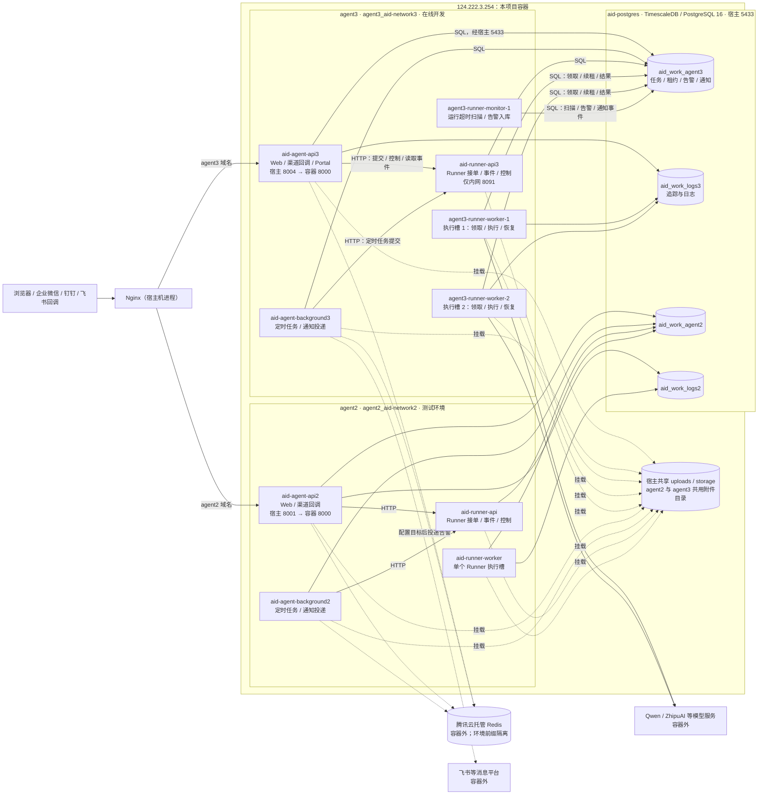

# agent3 当前容器结构（2026-11-06）

本图记录旧服务器 `124.222.3.254` 上本项目的**实际运行拓扑**。agent3 当前分支 `codex/runner-slot-phase2`、仓库提交 `e9d73c9f`（功能代码提交 `8508a972`）；agent3 的 6 个容器、agent2 的 4 个容器及共用的 PostgreSQL 容器均在运行。agent3 的两个 Runner Worker 各限 1 CPU、1 GiB 内存。agent2 是同机测试环境，不是 agent3 的任务执行槽。

## 容器职责

| 容器 | 所属环境 | 作用 |
|---|---|---|
| `aid-agent-api3` | agent3 | 对外 Web API、Portal 与渠道回调入口；通过内网 HTTP 调用 Runner API。 |
| `aid-agent-background3` | agent3 | 执行本环境定时任务并处理通知投递；可向 Runner API 提交任务。 |
| `aid-runner-api3` | agent3 | 接收 Runner 任务、控制命令并提供事件接口；不执行任务。 |
| `agent3-runner-worker-1` | agent3 | 单并发执行槽 1；容器内 supervisor 监督 Worker 子进程，负责领取、续租、执行与恢复核验。 |
| `agent3-runner-worker-2` | agent3 | 单并发执行槽 2；与槽 1 独立，职责相同。 |
| `agent3-runner-monitor-1` | agent3 | 定期扫描执行时长，在业务库写入告警、通知事件和扫描状态；不发送飞书消息。 |
| `aid-agent-api2` | agent2 | 测试环境的 Web API 与渠道入口。 |
| `aid-agent-background2` | agent2 | 测试环境的定时任务与通知投递。 |
| `aid-runner-api` | agent2 | 测试环境的 Runner HTTP 入口。 |
| `aid-runner-worker` | agent2 | 测试环境当前单个 Runner 执行槽。 |
| `aid-postgres` | 共享基础设施 | 一个 TimescaleDB/PostgreSQL 容器，承载 agent2、agent3 各自独立的业务库与日志库。 |

## 通信与隔离边界

1. **入口**：宿主机 Nginx 按域名分别转发到 agent3 的宿主端口 `8004` 或 agent2 的 `8001`。Runner API 的 `8091` 不发布到宿主机；主 API 和 background 在各自 Docker 网络中按服务名调用它。
   agent3 当前 `AGENT_RUNNER_WEB_ENABLED=true`，普通 Web 对话可走图中的 Web→Runner API 链路；[端到端实验](../research/agent3-runner-end-to-end-load-test-20261106.md)已验证该路径。
2. **执行**：Runner API 只写入/读取本环境业务库。Worker 自行从业务库领取任务和续租，不通过 Runner API 领取，也不与另一槽通过 HTTP 通信；Compose `depends_on` 只规定启动顺序。monitor 通过业务库观察任务并写告警，background 的通知 dispatcher 从通知事件中投递。
3. **数据库**：`aid-postgres` 位于独立 Docker 网络，agent2 与 agent3 通过宿主发布的 `5433` 端口访问；两环境分别使用 `aid_work_agent2`/`aid_work_logs2` 与 `aid_work_agent3`/`aid_work_logs3`。同容器不等于同数据库，Runner 租约不会跨库领取。
4. **缓存与文件**：Redis 是容器外的托管服务，两环境以不同前缀隔离。两环境仍共用宿主 `agent2_uploads`、`agent2_storage` 附件目录；agent3 的主 API、background、Runner API 和两个 Worker 都挂载这些目录，monitor 不挂载附件目录。
5. **外部调用**：Worker 可调用模型提供商及工具目标。agent3 当前没有活动的平台飞书告警目标，图中的告警投递箭头表示代码能力，尚无实际投递验收。

宿主机另有 `aid-api-1`、`labor-cloud-api`、`c_qba` 三个运行容器，属于其他项目，不参与本系统通信。Nginx、腾讯云托管 Redis、模型与消息平台都不是本宿主机的本项目 Docker 容器。容器健康与基本拓扑已经核对；真实双槽业务阻塞、容量和已交付旧客户端组合仍按[开发计划](../plans/plan-runner-execution-slot-isolation-and-alerts.md)的 Phase 4 验收。
