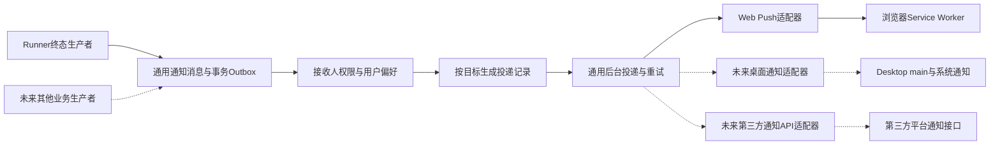

# 统一通知基础设施设计

> 日期：2026-10-10；版本：v0.2；状态：通知核心及 Web 适配开发、独立测试与内外部 CR 完成，真实到达待环境验收。
> 用户要求：基础设施覆盖 Web、桌面客户端和有独立通知接口的第三方渠道；本次仅实现 Web 推送。
> 首期方案：[Web 任务完成通知](web-task-push-notification-design.md)；[开发计划](../plans/plan-web-task-push-notification.md)。

## 1. 共同目标与范围

建立平台级通知核心，将业务事件、接收人、接收目标、用户偏好、内容与投递分开。业务生产者只提交“发生了什么、通知谁、关联什么资源”，不判断浏览器是否开着，不直接调用浏览器、桌面或第三方发送接口。

本次交付通用基础设施以及 Web Push 适配器和 Web 客户端。桌面与第三方只定义扩展边界，不实现未使用的协议、SDK或设置页面。今后新增渠道主要增加适配器、目标登记/验证及客户端展示，不再复制业务终态判断、通知账本和重试调度。

业务来源与通知渠道是两个维度。例如 Web 发起的任务可根据已授权的偏好投递到浏览器、桌面或第三方账户。任务来源不能隐式授权跨渠道发送，也不能简单广播到用户所有已连接渠道。

## 2. 现有事实与职责

- AgentRunner 已有持久任务、公开状态事件与终态事务，是执行结果的唯一权威。
- `src/services/notification_service.py` 已有发送器注册机制，默认注册 EMAIL 和 WEBHOOK；WECHAT/DINGTALK 枚举并不代表这些发送器已经实现。当前接口没有持久意图、目标、偏好或投递账本。
- `src/session_tasks/notifications.py` 是另一业务场景的站内通知，不是本次通用通知系统；不能直接当全平台投递队列。
- Web 已有查询/SSE和会话未读完成标记；Desktop沿用 `source=chat/session.kind=web`，不能靠这些字段区分前端产品。Runtime管理状态通知、Runner失效事件和用户通知各有职责，不能混用。

建议在 `src/notifications/` 内集中核心契约、数据库仓储、策略、后台dispatcher、公共API和渠道注册表；具体路径为候选，实施时按仓库规范核定。

现有 NotificationService 的发送器思路复用，新核心可以通过 adapter 调用现有 EMAIL/WEBHOOK。旧 `send(message)->bool` 保持兼容与原调用行为，本次不自动将历史业务调用改成持久队列，也不静默改变原日志和返回含义。Web Push 不另建第二个只服务 Web 的重试平台。

## 3. 架构

通用核心负责业务幂等、主体/租户隔离、目标和偏好、投递展开/领取/重试/过期、状态与可观测性。适配器负责目标格式和凭据引用、渠道能力、内容格式、传输及供应商错误归类。客户端负责展示和用户操作，不执行云端任务。

共同边界遵守 [Runner / Desktop / Runtime 契约](runner-desktop-runtime-integration-contract.md)。本次不修改 Runner公开wire、Runtime管理/Device协议、执行设备binding或设备授权。将来桌面通知若需要新增主进程IPC或公共协议，按桌面责任边界另行登记版本与兼容，不在通知设计中宣称已经实现。

## 4. 通用契约

### 4.1 通知消息

每条消息对应一个已核验接收主体，保存下列逻辑字段：

| 字段 | 语义 |
|---|---|
| notification_id / notification_ref | 随机内部ID及公开引用；引用不授予资源访问权限 |
| schema_version | 通知语义和内容版本，与Runner及Runtime版本分开 |
| producer / event_type / event_key | 可信生产模块、语义事件与稳定业务幂等键 |
| scope_key / tenant_id / recipient_user_id | 接收主体；全局主体需显式核验，不以空租户绕过隔离 |
| resource_ref | 类型化业务引用，例如runner_result及其ID，不是客户端任意URL |
| template_key / template_version / parameters | 可验证内容快照；首期包括会话名称和终态 |
| occurred_at / accepted_at / expires_at | 业务发生、任务接单与通知有效期；accepted_at是首期任务策略依据，非所有事件必填 |
| category / priority / policy_key | 偏好匹配、队列优先级与该类事件的投递政策 |
| expansion_state / route_snapshot | 是否已生成投递记录及当次确定的渠道路由，不随重试重新广播 |

幂等范围为 `(scope_key, recipient_user_id, producer, event_key)`。同一业务事件即使被多个客户端观察，也只为该接收人生成一条消息；一次事件通知多个人时各自授权、各自一条消息。不得用每次重试新UUID代替业务幂等键。

事件类型首期实现 `task.completed`、`task.failed`，生产者为runner；预留类型注册与参数校验扩展点，其他事件没有生产代码前不宣传为已支持。首期模板固定为 `${会话名称}相关任务已完成` / `${会话名称}相关任务执行失败`，中间进度不产生用户通知。

### 4.2 接收目标与用户偏好

接收目标表示“通过什么渠道通知哪个已验证客户端/账户”，与任务执行设备分别建模：

- target_id、主体、channel、provider、客户端installation_ref或外部账户绑定引用；
- 已保护的渠道配置/凭据引用、绑定版本、能力、enabled/active/revoked/invalid状态；
- verified_at、enabled_since、创建/更新时间。Web订阅刷新不重置原启用边界。

channel候选为web_push、desktop、third_party；provider区分具体实现，例如第三方应用通知API。本次编码仅注册web_push，其余不可登记为可用目标。类型结构经适配器严格验证，不能把任意JSON或URL当有效接收地址。Web目标保存endpoint及订阅密钥；桌面目标将来登记客户端实例；第三方目标使用可信账户/租户应用授权映射，不能将任意聊天ID当接收人。

用户偏好按主体、category和channel/provider设置开启/关闭、事件类型及多目标投递规则，核心支持多渠道并行；首期UI仅提供Web开启/关闭。首次登记目标默认不订阅未经用户启用的事件。任务接单前已经启用的目标才纳入本次终态通知，默认不补发历史；未来其他事件可定义自己的有效期和历史策略。

首期默认所有符合偏好的Web目标分别投递，不依赖页面在线状态。未来桌面/Web前台抑制、渠道优先级或fallback作为显式路由策略扩展，不写死在Runner中；本次不实现在线感知、免打扰时段或跨渠道fallback。

## 5. 通用持久化

以下均为候选系统表，不带Web前缀。实施时显式迁移、版本门及索引，并登记系统数据库文档：

| 表 | 内容与唯一性 |
|---|---|
| notification_messages | 上述接收人通知消息及事务意图；业务幂等键唯一 |
| notification_targets | 主体、channel/provider、类型化保护配置/凭据引用、绑定版本、状态及启用边界；适配器定义provider范围内目标唯一性 |
| notification_preferences | 主体、category、channel/provider的开启状态与政策，按主体及政策作用域唯一 |
| notification_deliveries | notification_id、target_id、目标版本与渲染快照、attempts、next_attempt_at、owner/lease、状态、错误分类、供应商接纳/回执时间；`(notification_id, target_id)`唯一 |

一条消息可产生多个目标投递，每条独立重试和结案。绑定版本变化使旧delivery失效，不能简单创建新版本delivery重发旧通知；显式重发操作如后续需要，另行定义授权和审计。偏好变化不向新增目标重新展开旧消息，撤销则阻止尚未发出的投递。

Web订阅字段以已验证的Web目标配置保存，VAPID key_id属于该provider配置，通用表不要求所有渠道具备endpoint、p256dh/auth、VAPID或浏览器permission。复杂provider将来可有扩展表，但不复制通用投递表。

## 6. 事务与可靠投递

1. 生产者在业务权威状态事务中登记通知消息。首期在Runner根terminal事件外层事务尾登记completed/failed和会话名称快照；覆盖所有终态路径，settlement_changed不重复生成。
2. 通知意图写入失败使同事务回滚，由原收尾重试处理，不重放已完成副作用。网络发送从不进入业务事务；功能未启用时不访问新增表。
3. 后台有限批次按当前权限/偏好、事件政策和目标启用边界展开delivery，展开与生成同事务幂等提交。记录展开完成，即使零目标也不能将来补发。
4. `FOR UPDATE SKIP LOCKED`配合领取owner、租约和版本；网络请求前提交领取，不跨网络持有数据库锁。调度器属于background_runner平台生命周期，不放进Gunicorn请求进程。
5. 发出前复核当前主体、原资源读取权限、偏好、目标状态及版本。任务积分不足不等于无权读取结果。客户端关页不撤销订阅；登出与解绑按目标类型处理。
6. 统一处理超时、有限指数退避/抖动、Retry-After、速率限额、TTL及终止错误。建议首期24小时有效期、最多6次尝试，允许事件/provider配置；一渠道故障不阻塞其他目标。
7. 外部接纳后本地记账前崩溃存在重复发送窗口。通用系统提供持久、至少一次投递尝试；有供应商幂等键则使用，没有则尽量在客户端去重，不承诺全渠道恰好一次。
8. 过期与清理只作用于通知账本，不删除业务历史；已失效目标不无限重试。后台start/stop/drain有有界并发与超时。

delivery状态至少区分pending、sending、accepted、expired、skipped、failed；支持provider有真实回执时推进delivered/displayed/read。accepted仅表示推送服务/客户端传输接纳。没有回执能力不得自动声称展示或已读，消息整体状态也不能用一个sent布尔值覆盖多目标结果。

## 7. 渠道适配与配置

适配器声明target_schema_version、notification_schema_versions、支持内容/action、TTL/批量/回执/供应商幂等能力，以及payload上限、速率限制和授权撤销方式。核心调用目标校验、内容渲染及send，send返回规范化结果：accepted/retryable/permanent_failure/target_invalid，加供应商接纳ID和受限诊断分类，不返回泄露凭据的原始错误。

- **Web本次实现**：VAPID/Web Push、浏览器订阅校验、加密payload、404/410失效、Service Worker展示与点击。
- **Desktop后续**：由桌面云端通知客户端接收、Electron main显示OS通知，Renderer经受控adapter使用；通知installation_ref不复用Runtime执行设备binding。其通知流使用通用通知身份、持久游标/补读及幂等接纳，不能将Runner状态失效SSE直接当用户通知或由每个窗口自行重复产生通知。普通在线连接不能保证桌面完全退出后到达，后台驻留/系统推送由后续实际选定transport和能力协商明确。
- **第三方后续**：接独立应用通知接口，复用已授权租户应用配置/账户映射；其配额、内容限制、回执和幂等按API实测。通知发送与原聊天回复各自有用途，不能因接入新adapter重复发送聊天答案。

平台配置分为核心开关、有效期/重试/并发/清理及provider启用/凭据引用/出站策略；租户策略决定允许渠道，用户偏好决定实际启用目标，事件政策决定此次路由。VAPID仅是Web provider设置，不作为全平台push配置。未配置adapter或凭据时明确不可用，UI只展示已经支持的渠道。

## 8. 通用API与安全边界

公开 API（schema v1，本次实现）：

| 操作 | 入口及约束 |
|---|---|
| 能力 | GET /api/notifications/capabilities；返回本次可用channel/provider及能力；Web公钥/key_id在Web能力节点 |
| 目标登记/撤销 | POST /api/notifications/targets、DELETE /api/notifications/targets/{id}；当前仅接收严格Web target DTO |
| 偏好 | GET/PUT /api/notifications/preferences；仅当前主体及实际支持渠道 |
| 测试投递 | POST /api/notifications/test；携本人 target_id/binding_version，限频且经过相同投递安全边界 |
| 点击定位 | GET /api/notifications/messages/{notification_ref}；认证后检查主体和resource读取权限，返回类型化资源定位 |

业务publish接口仅供可信服务内部使用，不提供客户端任意发送入口；将来外部provider回执通过独立验证签名/防重放入口，不能复用普通用户API冒充回执。

所有操作核验scope、tenant、user及目标归属；空租户不授予全局权限。订阅密钥、endpoint、VAPID私钥、第三方token沿既有加密/秘密管理规范，不存原登录bearer，不记录原始payload、会话名称或完整供应商响应。日志只写ID、channel、错误类别和计数。

每类adapter分别限制出站目标、防SSRF、校验重定向和连接解析。通知权限不授予任务、文件或Device执行权限。内容由模板与验证参数形成；点击使用resource_ref，Web固定同源入口、Desktop后续受控deep link、第三方经过配置的合法链接，不接受任意跳转URL。

账号切换、解绑、注销和租户停用撤销对应目标并使待投递失效；一个账号登出某客户端不自动撤销其他客户端/第三方的授权。离线注销与已在途通知无法保证立刻追回，含会话名称的通知详情仍需重新认证读取原资源。

## 9. 本次与后续验收

本次验证通用消息幂等、单消息多目标、目标/偏好撤销、版本变化、租户隔离、并发领取、崩溃重试、过期、核心/provider禁用和兼容原调用。多目标用不同真实Web订阅验证；adapter扩展以独立fake验证核心不依赖浏览器字段，不能声称fake就是Desktop/第三方实现。

Web真浏览器验收关全部站点tab后完成/失败通知、名称展示和点击恢复。桌面与第三方上线前分别追加真实生产/消费和授权/回执验收，本次不运行未实现渠道的真实测试。编码按高风险流程保留独立测试与独立CodeReview；部署需用户当场指示。
