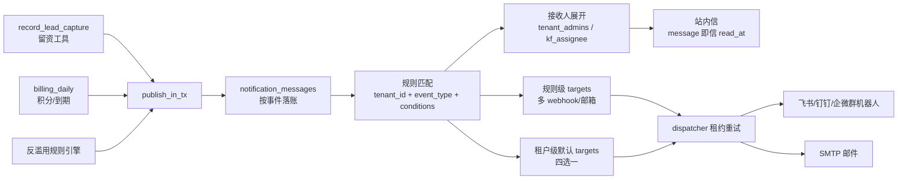

# 通知规则引擎设计（留资业务通知 + 通知配置统一）

> 日期：2026-10-28；版本：v0.3；状态：📋 设计完成，待评审
> v0.3：移除转人工通知（企微已有即时触达，不再做超时升级兜底）；留资通知明确**两层配置**——渠道配置层（wecom_kf 渠道级，该渠道产生的留资都走该规则）与客服账号层（单账号级，该账号产生的留资都走该规则），同一留资两层都有规则时**都通知**；渠道配置页与客服账号弹框分别提供规则引擎深链。
> 上游基础设施：[统一通知基础设施设计](notification-infrastructure-design.md)（核心 + Web Push 已合入）
> 演进对象：[租户管理员通知设计](tenant-admin-notification-design.md)（Phase 1 已开发未部署，本设计将其"管理员展开 + 租户级四选一目标"收编为规则引擎的预置默认规则）
> 关联实现：`src/tools/lead_capture/record_lead_capture.py`（留资工具已上线，含旧邮件单发通知，本设计收编）

## 1. 背景与目标

wecom_kf 渠道对话中，微信侧客户留手机号 / 要求加顾问微信，是高价值业务事件，销售/客服需要在第一时间感知并跟进。当前只有留资场景有一条**硬编码的邮件单发通知**（发给线索归属员工，走旧 `notification_service`）。

产品诉求：

- 留资发生后，通过外发渠道（飞书群机器人 / 钉钉群机器人 / 企微群机器人 / 邮件）通知**业务负责人**，及时对接；
- 通知规则支持**两层配置**：渠道配置层（wecom_kf 渠道级，该渠道对话产生的留资都走该规则）与客服账号层（单客服账号级，该账号对话产生的留资都走该规则）；同一留资对应的客服账号和渠道都有通知规则时，**都通知**；
- 不同客服账号可配置**不同的群机器人**（如每个销售的客服账号留资推到各自的销售群）；
- 同一事件可能需要**多路通知**（如同时推销售群 + 客服主管群）。

这与现有"租户管理员通知"场景存在显著差异，不能在其配置结构上扩字段，而是抽一层通用**通知规则引擎**：

| 维度 | 管理员通知（现有） | 业务通知（本设计） |
|---|---|---|
| 接收人 | 租户管理员（固定展开规则） | 业务负责人（线索归属员工）或规则配置的群 |
| 外发目标 | 租户级四选一（单 target） | 规则级多选多（N 个 webhook/邮箱） |
| 匹配条件 | 无（租户全量） | 两层：渠道层 / 客服账号层（可叠加） |
| 事件频率 | 低频告警 | 业务高频事件 |

## 2. 总体方案

在通知核心（`src/notifications/`）的消息/目标/投递三层之上引入**规则层**：事件发布方只提交"发生了什么"，展开阶段按租户的**通知规则**匹配事件 → 按规则展开接收人（站内信）→ 按规则的外发目标生成投递记录（群机器人/邮件）。

- **规则表**（`notification_rules`，新表）：租户级配置，定义"哪类事件 + 什么层级/条件 + 通知谁 + 发到哪"；
- **预置默认规则**：管理员通知三事件（billing/abuse）与留资事件各有一条预置规则，已实现的"管理员展开 + 租户级四选一外发"成为默认规则的两个属性（接收人模式 + 租户级目标），行为不回退；
- **规则级外发目标**：`notification_targets` 增加 `rule_id` 关联，规则可挂多个 webhook/邮箱，与租户级目标（`rule_id IS NULL`）共存；
- **配置页面**：新建「通知规则」页面，通知配置整体从「企业设置」迁出（§9）。



## 3. 数据模型

### 3.1 新表 `notification_rules`

```sql
CREATE TABLE IF NOT EXISTS notification_rules (
    rule_id TEXT PRIMARY KEY,
    tenant_id TEXT NOT NULL,
    event_type TEXT NOT NULL,
    name TEXT NOT NULL,
    enabled BOOLEAN NOT NULL DEFAULT TRUE,
    is_system BOOLEAN NOT NULL DEFAULT FALSE,   -- 预置规则：不可删除，可编辑目标/停用
    conditions JSONB NOT NULL DEFAULT '{}',     -- {"kf_config_ids": [...]}；空对象 = 全部
    recipient_mode TEXT NOT NULL CHECK (recipient_mode IN ('tenant_admins', 'kf_assignee')),
    created_by TEXT,
    created_at TIMESTAMP DEFAULT CURRENT_TIMESTAMP,
    updated_at TIMESTAMP DEFAULT CURRENT_TIMESTAMP,
    UNIQUE(tenant_id, event_type, name)
);
CREATE INDEX IF NOT EXISTS idx_notification_rules_lookup
    ON notification_rules(tenant_id, event_type) WHERE enabled;
```

- `conditions.scope`：留资规则的**层级**，仅 `lead.captured` 事件使用：
  - `channel`：渠道层规则，对该渠道（wecom_kf）产生的**全部**留资生效，不限定客服账号；
  - `kf_config`：客服账号层规则，配合 `conditions.kf_config_ids` 指定生效的客服账号列表。
  - billing/abuse 事件 conditions 为空对象（无条件，租户全量）。
- `conditions.kf_config_ids`：客服账号层规则的命中账号（kf_config）列表，仅 `scope=kf_config` 时使用；渠道配置页已有客服账号列表作为数据源。
- `recipient_mode`：
  - `tenant_admins`：展开为租户全部 role=admin 用户（既有管理员展开语义）；
  - `kf_assignee`：展开为事件的归属员工（发布时解析好放进事件参数，见 §5），留资 = 线索 `assigned_to`。
- 同一 `(tenant_id, event_type)` 允许多条规则（渠道层 + 账号层、按客服账号分流的不同规则），每条独立展开、独立投递；两层同时命中时**都通知**（§6）。

### 3.2 `notification_targets` 增加 `rule_id`

```sql
ALTER TABLE notification_targets ADD COLUMN IF NOT EXISTS rule_id TEXT;
CREATE INDEX IF NOT EXISTS idx_notification_target_rule
    ON notification_targets(rule_id, state);
```

- `rule_id IS NULL`：租户级目标（现状，服务默认规则的"四选一"外发），同租户同 provider 至多一个 active 的既有约束**仅适用于此**；
- `rule_id` 非空：规则专属目标，**同 provider 允许多个**（多路 webhook）；规则删除时级联置 `revoked`，在途投递按既有"目标失效"机制终止；
- 站内信不产生 target/delivery（既有口径不变）。

其余三张通用表（messages/deliveries/preferences）不变；preferences 本设计不使用（沿用"规则即偏好"口径，接收人开关后续有真实诉求再引入）。

## 4. 预置默认规则

租户首次产生对应事件时（或迁移脚本一次性）插入 `is_system=TRUE` 规则，行为与现状对齐：

| rule | event_type | 层级/条件 | recipient_mode | 外发目标 | 对应现状 |
|---|---|---|---|---|---|
| 积分提醒 | `billing.credit_low` | 无条件 | `tenant_admins` | 租户级默认渠道（四选一） | 已实现路径 |
| 到期提醒 | `billing.tenant_expiry` | 无条件 | `tenant_admins` | 同上 | 已实现路径 |
| 滥用告警 | `abuse.rule_triggered` | 无条件 | `tenant_admins` | 同上 | 已实现路径 |
| 留资通知 | `lead.captured` | 渠道层（scope=channel） | `kf_assignee` | 租户级默认渠道 | 收编旧邮件单发 |

预置规则不可删除（`is_system`），可停用、可改外发目标。业务租户在此基础上**新建自定义规则**（如"客服账号 A 的留资 → 销售群 A 的 webhook + 主管群 webhook"的账号层规则），自定义规则与预置规则并存，各自独立展开投递；渠道层与账号层同时命中时都通知。

## 5. 事件定义

### 5.1 `lead.captured`（收编留资通知）

| 项 | 值 |
|---|---|
| producer | `lead_capture`（record_lead_capture 工具） |
| event_key | `lead:{tenant_id}:{lead_id}`（lead_id 唯一，天然防发布重放；客户重复留资每次新 lead_id，天然多条，符合"不防重"业务口径） |
| category / priority | `lead` / 高 |
| resource_ref | `{"type": "lead_capture_lead", "id": lead_id}` |

事件参数（StrictDTO 严格校验，参照 `leadgen.reply_intent` 注册模式）：

`lead_id`、`contact_method`（phone/landline/email，2026-10-29 起客户索要顾问二维码不再算留资，qr 为历史值）、`contact_summary`（发布方由 phone/landline/email 非空项拼接的联系方式串，如「手机号 138xxxx、邮箱 a@b.com」——客户可同时留多种联系方式，全量拼接不做单值截断；明文，见 §7）、`contact_name`、`demand_summary`、`kf_config_id`（事件所属客服账号，账号层规则匹配依据）、`kf_account_name`、`assignee_user_id`（= 线索 `assigned_to`，`kf_assignee` 展开依据）、`assignee_name`、`previous_captured_at`（回头客场景，可空）。

模板 `lead_captured`：`微信客户「{contact_name}」通过{contact_summary}留资（客服账号 {kf_account_name}），需求摘要：{demand_summary}，请及时跟进。`（留资时间不单独入模板——通知落账/投递时间与留资时间仅差秒级；`previous_captured_at` 非空追加"该客户此前已于 X 留资"；非工作时间追加"当前为非工作时间，请于下一个工作日跟进"——沿用现有通知侧按服务器时间判断的逻辑，迁入模板渲染）。

### 5.2 发布点

- `record_lead_capture`：现有 `_notify_lead_capture()`（旧 notification_service 邮件单发）整体移除，改为落库成功后 `publish_in_tx(lead.captured)`；旧通路下线，收编后行为由规则决定（默认规则含租户级邮件渠道，邮件通知能力不丢失）。
- billing/abuse 生产者保持现调用不变（事件照发，展开交给规则）。

## 6. 规则匹配与展开

在 dispatcher 展开阶段（`expansion_state=pending` → `expanded`）插入规则匹配：

1. 查 `notification_rules WHERE tenant_id AND event_type AND enabled`，按 `conditions` 分层匹配：
   - **渠道层规则**（`scope=channel`）：`lead.captured` 事件全部命中（留资仅产生于 wecom_kf 渠道，渠道层不限定客服账号）；
   - **客服账号层规则**（`scope=kf_config`）：事件参数 `kf_config_id` ∈ `conditions.kf_config_ids` 才命中，否则跳过；
   - billing/abuse 事件无条件，全量命中；
2. **两层叠加**：同一留资同时命中渠道层与账号层规则时，各条规则**都独立展开投递**（都通知），不做合并去重——业务口径是"怕丢线索不怕重复"；
3. **无命中规则**：不产生任何 message/delivery（事件已落账为 expanded、route_snapshot 空，与既有"展开完成零目标不补发"口径一致）。预置默认规则保证未做自定义配置的租户行为不回退；
4. 每条命中规则独立展开：
   - 按 `recipient_mode` 解析接收人（`tenant_admins` 查租户管理员列表；`kf_assignee` 读事件参数 `assignee_user_id`，空则跳过站内信）→ 每人一条 message（幂等键含 recipient，既有唯一约束保证）；收件人无外发目标时消息不滞留 pending（既有特例逻辑覆盖）；
   - 规则级外发目标：`notification_targets WHERE rule_id=... AND state='active'` → 每 target 一条 delivery；可选叠加租户级默认渠道（规则上 `include_default_target` 开关，默认关，避免管理员通知与业务通知重复轰炸同一群）；
   - 规则匹配与 delivery 展开同事务幂等提交，route_snapshot 记录命中规则与目标快照，不随重试重新匹配。

多规则命中同一事件时各自独立投递（幂等键含规则区分：`event_key` 追加规则维度由展开器内部处理，对发布方透明）。

## 7. 内容与联系方式明文口径

留资通知必须携带**完整联系方式**（销售要打电话/发邮件），与本系统"敏感信息不明文返回"原则存在表面冲突，显式声明豁免口径：

- **豁免范围**：仅 `lead.captured` 事件的 `contact_summary` 参数（含完整手机号/固话/邮箱），经模板渲染后投递到**租户管理员配置的内部目标**（自有群机器人 webhook / 自有邮箱），属业务必需的内部对接，非向外部第三方披露；
- **不变的部分**：参数落库走 `parameters_encrypted` 加密（既有机制）；日志不落明文手机号（仅 lead_id/tenant_id/分类，既有口径）；不进 LLM 上下文（通知是纯模板渲染，无模型调用）；`notification_ref` 不授予资源访问权限（既有口径）；
- **投递边界**：目标只能是通知系统登记的 target（严格校验的 webhook/邮箱，防 SSRF 既有机制覆盖），不接受任意 URL。

## 8. 防轰炸策略（修订）

留资设计明确**业务口径不防重**（怕丢线索不怕重复），因此不做业务级去重与静默抑制：

- 发布重放防护：event_key 幂等（既有唯一约束）；
- 两层叠加多路投递：渠道层 + 账号层各条规则独立投递，属预期行为不做抑制（怕丢线索不怕重复）；
- 群机器人限流（如钉钉 20 条/分钟）：dispatcher 归类 `retryable` + Retry-After 重试（既有机制）；
- 非工作时间：正文提示次日跟进，**不抑制投递**（销售场景宁可打扰不可漏单）；
- 频控预留：`notification_rules` 后续可加静默时段列，当前无真实诉求不做。

## 9. 前端页面

### 9.1 新页面「通知规则」（从企业设置迁出）

- 路由 `/t/:tenant_id/notification-rules`，`configs/page_metadata.yaml` 注册（domain 归入现有 `settings` 域，实施时核定）；
- 页面结构（按列表页规范 + 详情弹框规范）：
  - **默认外发渠道区**：从企业设置迁来的租户级四选一配置 + 测试投递 + 帮助弹框（原 §7.1 内容整体迁移）；
  - **规则列表**：规则名、事件类型、条件（客服账号）、接收人、外发目标数、启用状态、操作（编辑/停用/删除，`is_system` 无删除）；
  - **规则编辑弹框**：事件类型（下拉，仅已注册事件）、层级/条件——事件类型为 `lead.captured` 时选择规则层级（**渠道层**：不选账号，对该渠道全部留资生效；**客服账号层**：客服账号多选，数据源为渠道配置已有客服账号列表）、接收人模式、外发目标管理（规则专属 webhook/邮箱列表增删 + 单目标测试发送）、叠加默认渠道开关；
- 企业设置原通知区块替换为入口卡片，链接到新页面。

### 9.2 渠道配置页深链（渠道层）

渠道配置编辑页针对 **wecom_kf 渠道**提供「通知规则」深链入口，跳转 `?event_type=lead.captured&scope=channel`，规则页按参数预过滤到该渠道的渠道层规则——该渠道对话产生的留资都走该层规则。其他渠道（企业微信应用 / 钉钉 / 飞书）面向内部员工，没有留资概念，**不提供入口**。

### 9.3 客服账号弹框深链（账号层）

渠道配置编辑页客服账号弹框（`ChannelConfig.vue`）增加「通知规则」按钮/链接，跳转 `?event_type=lead.captured&kf_config=<id>`，规则页按参数预过滤到该客服账号的账号层规则——该客服账号对话产生的留资都走该层规则。弹框内**只做跳转不做内嵌配置**，避免规则编辑逻辑复制两份。

## 10. API 设计

在 `/api/notifications/*` 上扩展（权限：租户管理员）：

| 操作 | 入口 |
|---|---|
| 规则列表/新建/编辑/停用/删除 | `GET/POST/PUT/DELETE /api/notifications/rules` |
| 规则级目标登记/撤销 | 复用 target 登记接口，DTO 增加 `rule_id` 字段 |
| 规则目标测试投递 | 复用 `POST /api/notifications/tenant-test`，扩展 `rule_id`/`target_id` 参数 |
| 客服账号选项 | 复用渠道配置既有客服账号列表接口，不新建 |

事件发布接口仍仅供可信服务内部使用（`publish_in_tx`）。租户停用时既有"目标撤销 + 待投递失效"机制覆盖规则级目标。

## 11. 安全边界

- webhook/邮箱 `configuration_encrypted` 加密存储、回显脱敏（既有机制）；
- 规则 CRUD 仅租户管理员；`conditions.kf_config_ids` 校验归属本租户（防跨租户账号 ID 注入）；
- `kf_assignee` 接收人必须与事件租户一致（`assignee_user_id` 归属校验，防参数伪造跨租户通知）；
- im_webhook 出站 https only + 内网地址拒绝（既有防 SSRF）；
- 手机号口径见 §7；
- 本设计自身无新增 LLM/Embedding/ASR 调用点（纯模板渲染），无计费审计项。

## 12. 验收要点

- [ ] 规则匹配（两层）：渠道层规则对全部留资命中；账号层规则按 `kf_config_id` 过滤命中/跳过；渠道层 + 账号层同时命中时各自独立投递（都通知）；无规则命中零投递且消息不滞留 pending
- [ ] 预置规则：billing/abuse/留资四条行为与现状对齐，`is_system` 不可删、可停用
- [ ] 留资通知收编：旧邮件单发路径移除；默认规则下邮件通知等价可达；webhook 渠道按规则投递；回头客/非工作时间文案正确
- [ ] 规则级多目标：同 provider 多 webhook 并行投递；删除规则级联撤销目标、在途投递终止
- [ ] 深链：渠道配置页（仅 wecom_kf 有入口）跳转预过滤到渠道层规则；客服账号弹框跳转预过滤到该账号的账号层规则
- [ ] 租户隔离：规则/目标/消息跨租户不可见；conditions 与 assignee 归属校验生效
- [ ] 手机号：参数加密落库、日志无明文、仅投递到登记目标
- [ ] 企业设置迁移：原通知区块移除、入口卡片跳转、默认渠道配置在新页可用且测试投递通过

## 13. 实施计划

| 阶段 | 内容 | 依赖 |
|---|---|---|
| Phase 1 | `notification_rules` 表 + targets 加 `rule_id` + db_update/init-postgres 登记；规则匹配展开器（含两层匹配）；`lead.captured` 事件注册与发布（收编旧邮件单发）；预置规则迁移脚本 | 通知核心已合入 |
| Phase 2 | 「通知规则」页面 + 企业设置迁移 + 渠道配置页/客服账号弹框深链；规则级目标 CRUD 与测试投递 | Phase 1 |
| Phase 3（可选） | 静默时段/频控列；接收人开关（preferences 接入）；其他业务事件（如 AI获客有意向回复）接入规则层 | 真实诉求 |

风险与待定项：

- 已开发未部署的管理员通知 Phase 1 代码需按 §6 调整发布/展开衔接（producer 现直接指定管理员收件人，改为统一走规则展开），改动面集中在展开函数，Phase 1 评审后确认；
- `leadgen.reply_intent` 等已注册事件是否迁入规则层，待 AI获客真机验证后评估，本设计不阻塞；
- 页面 domain 归属与菜单位置按 frontend-design 流程在开发期核定。

## 14. 实施备注（2026-10-29 Phase 1/2 落地定版）

实现中把设计文档的含糊处定版如下，与正文不一致处以本节为准：

1. **停用预置 billing/abuse 规则只停租户级外发**（对 §5.2 的定版偏差）：billing/abuse 事件的 producer 调用保持现状（仍按管理员逐人发布站内信，policy_key='tenant_admin_event'），规则门控落在展开阶段——路由租户级外发目标前查该 (租户, 事件) 是否有 enabled 规则，无则跳过租户级 target 投递。即停用预置规则 = 不再外发 webhook/邮件，管理员站内信保留。平台级 global 兜底副本（X-Tenant-Id 代租户事件）解析不出租户时保持现状路由。
2. **预置留资规则 include_default_target=TRUE**：依据 §5.2「默认规则含租户级邮件渠道，邮件能力不丢失」——收编旧邮件单发后，租户已配置的默认邮箱渠道在留资通知中继续生效；§6「自定义规则默认关」仅指租户新建规则的该开关默认值。
3. **事件级消息幂等**：`lead.captured` 发布 recipient_user_id=NULL 的事件消息，幂等靠新增部分唯一索引 `notification_event_identity(scope_key, producer, event_key) WHERE recipient_user_id IS NULL`（NULL 不参与完整唯一约束）。
4. **kf_config 条件的取值**：conditions.kf_config_ids 存 `tenant_channel_configs.config_id`（渠道配置行），登记接口逐个校验归属本租户；非 lead 事件 conditions 必须为空对象。
5. **规则级目标登记**：installation_ref 服务端生成为 `rule_{rule_id}_{hex8}`（允许同 provider 多个 active）；同配置摘要（identity_digest）已被租户级或其他规则 active 目标占用时返回 409 NOTIFICATION_TARGET_OWNED；规则删除级联撤销其 active 目标并跳过在途投递。
6. **预置规则惰性补插**：该 (租户, 事件) 已存在任意规则行（含停用）时不补插，避免覆盖管理员停用事实；新租户由展开阶段首次触达时按预置清单补插（ON CONFLICT DO NOTHING）。

