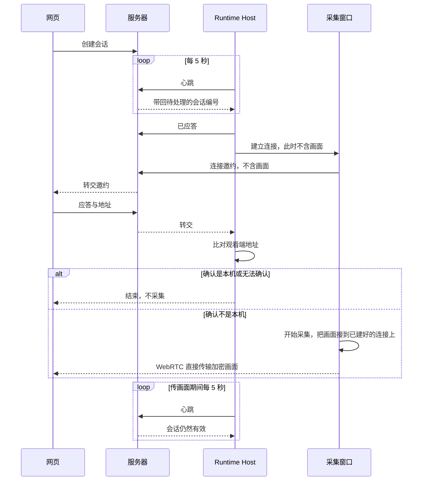

# Runtime 桌面实时画面设计

2026-11-23 初稿 · 2026-11-24 修订（第一轮评审四条：只做点对点、同机判定改为建连后比对地址、画面租约；第二轮评审三条：画面这一路不拖累设备心跳、任务优先于观看、同机判定只用明文可见的证据；决策 1～10 已全部确认，设计定稿；双机、跨网络与并行情形待验证）· 2026-11-25 修订（资源不足时先降低画质继续观看，降低后仍然不够才停止观看；补充与插件工具并行的单机实测；把「同机浏览器单独走另一条出口」写成验收里的例外；整机断网和只断画面信令分成两条验收；去掉服务端的出口比对，改由 Runtime 比较候选地址；补全会话超时的起算点、心跳带会话的条件和信令上限）

本文定义「客户在网页上查看某台 Runtime 电脑实时桌面画面」的技术设计。可行性依据见[调研报告](../research/runtime-screen-stream-feasibility-research.md)，界面交互见[交互原型](../design/prototypes/runtime-screen-stream-prototype.html)，实施步骤见[开发计划](../plans/plan-runtime-screen-stream.md)。

## 1. 目标与范围

用户在网页的「本地工具」设备列表里点「实时画面」，几秒后在弹框里看到那台 Runtime 电脑的主屏幕画面。

| 需求 | 本设计的落实 |
| --- | --- |
| 技术可行、明确用什么技术 | WebRTC 传画面，服务器只转交建连信令；Runtime 用独立隐藏窗口采集 |
| 只做点对点 | 画面只在两端之间直连。连不上就是一个明确的结果「当前网络无法直连」，不经服务器转发 |
| 客户在网页发起才建立连接 | 无会话时不采集、不建连；会话只能由网页创建 |
| 同一台电脑不可用 | 先建立不含画面的连接，Runtime 比对观看端地址；确认不是本机才开始采集，无法确认也不采集。浏览器单独走另一条出口时有一个例外，见 4.2 |
| 720p | 1280×720、15 帧、码率上限 2.5 Mbps，见 6.1 |
| 嗅探局域网并直连 | 由 WebRTC 自己探测，以实际连接结果为准。跨网段的内网直连 2026-11-27 实测通过：Runtime 接受观看端的连接探测，不依赖 mDNS。见 4.1；恢复为设计目标待用户确认（第 13 节第 11 项） |
| 信令断开后要停 | Runtime 连续 30 秒收不到服务器的确认就自己关闭采集。见 4.3 |
| 观看与任务并行 | 观看不改任务领取、许可、回执和设备心跳，也不传键盘鼠标；资源不足时先降低画质继续观看，降低后仍然不够才停观看。见 4.4、4.5 |

不在本期范围：服务器中转（TURN，是否做另行立项）、远程控制（键鼠）、录屏或截图保存、多路同时观看、多显示器切换、完整 Desktop 客户端接入。

## 2. 总体结构


- **服务器**只做三件事：鉴权、记录会话、在两端之间转交握手消息，并通过心跳给 Runtime 的画面续期。画面不经过服务器。
- **Runtime Host** 持有设备凭据，负责与服务端通信、管理会话状态、判定观看端是不是本机、执行画面租约。它不采集画面。
- **隐藏采集窗口**只在会话期间存在，负责建立连接、确认观看设备之后才采集主屏幕、编码并把画面发给网页。窗口关闭即停止一切。
- **网页**发起请求、完成握手、播放画面。

## 3. 一次查看的流程



会话状态由服务器判定，两端以此为准。

| 状态 | 含义 | 自动结束条件 |
| --- | --- | --- |
| pending | 网页已请求，等待 Runtime 应答 | 30 秒内未应答，记为 `device_offline` |
| prepared | Runtime 已应答，等待网页准备好 | 60 秒内未开始，记为 `viewer_closed` |
| connecting | 正在建立不含画面的连接 | 30 秒内未连上，记为 `connect_failed` |
| verifying | 已连上，Runtime 在确认观看设备 | 15 秒内没有结论，记为 `machine_check_unknown` |
| streaming | 画面传输中 | 设备心跳超时记为 `runtime_offline`；网页 30 秒未轮询记为 `viewer_closed`；Runtime 连续 30 秒没有从心跳拿到「会话仍然有效」，自行关闭采集，记为 `renewal_timeout` |
| ended | 已结束，保留结束原因 | 无 |

结束原因：`viewer_closed`（网页关闭或点结束）、`runtime_stopped`（Runtime 端停止）、`runtime_rejected`（Runtime 端拒绝）、`same_machine`（确认是本机，未采集）、`machine_check_unknown`（无法确认，未采集）、`connect_failed`（当前网络无法直连，未采集）、`renewal_timeout`、`resource_busy`（这台电脑正在执行任务，降低画质后资源仍然不足，画面让位于任务）、`device_offline`、`runtime_offline`。

建连的 30 秒超时必须由会话自己计时：单机实测两端完全没有可用地址时，ICE 自己不会报失败。

服务端的超时在读取会话时顺带判定，不设后台任务。时限从等待的那一方最后一次访问会话算起：`pending` 等 Runtime 应答，从 `created_at` 算；`prepared` 等网页发 `start`，从 `viewer_seen_at` 算；`connecting` 和 `verifying` 等 Runtime 的结果，从 `runtime_seen_at` 算；`streaming` 两边都看，网页超过 30 秒没有访问记为 `viewer_closed`，设备超过 30 秒没有心跳记为 `runtime_offline`。

时间预期（单机实测，Chrome 158 观看）：建连不含画面 0.1～0.6 秒，确认观看设备 0.15～1.6 秒，采集约 0.6 秒，首帧再 0.3～1 秒，从点击到出画面 1.7～2.7 秒（不含等待心跳）。加上等待心跳最长 5 秒，跨网络再加往返延迟，预计 5～10 秒。

## 4. 三个专门设计

### 4.1 连接线路

只有直连，按先成功者选路。采集窗口连上后从自身的连接统计得出实际线路，报告给服务器并记入会话。

| 线路 | 识别方法 | 需要的部署条件 |
| --- | --- | --- |
| 局域网直连 | 两端选中的都是内网地址 | 无。同网段即可 |
| 点对点直连 | 选中的是双方的公网映射地址 | 一个自建 STUN 服务。流量极小，可放在主服务器 |

两条都不通就是「当前网络无法直连」：Runtime 关闭连接，全程不采集，网页提示原因。STUN 只帮两端发现自己的公网出口，不转发画面；有些网络组合本来就打不通，产品把这个当作正常结果之一。

**地址与防火墙**（单机验证后的补充）：

- Runtime 的采集窗口拿到屏幕采集权限后，公布的是真实内网地址；浏览器页面出于隐私只公布一个 mDNS 名字。所以浏览器不需要 mDNS 就能连到 Runtime，而 Runtime 要主动连到浏览器，必须先解析这个名字，或者等浏览器的探测包先进来。
- Windows 防火墙默认拦截未签名程序的入站连接。首次监听时的提示如果被取消，会写入入站阻止规则。Chrome 和 Edge 的安装程序会给自己加一条只放行 UDP 5353 的「mDNS-In」规则。
- 内网直连（含跨网段）靠 Runtime 接受观看端的连接探测，见下面的适用范围：安装器在可提权时为 Runtime 程序添加放行入站 UDP 的规则；不可提权时，界面提示在防火墙提示里点「允许访问」。Runtime Host 解析浏览器的 mDNS 名字只用于同机判定（4.2），不再是连上的前提。
- 跨网络的点对点不受这条影响：两端的出站流量会在各自防火墙上打开回包通道，不需要入站规则。
- 「两端公网出口是否相同」由 Runtime 自己得出：比较自己的公网映射地址和网页经信令转交来的公网映射地址，两者都是明文候选。不同时 Runtime 不把内网地址候选发给服务器，避免把客户内网地址送到不需要的地方。它不参与同机判定，服务端不做这个比对，也不保存任何来源地址。

**适用范围（2026-11-27 用两台电脑实测后修订）**：

- 企业网络里跨网段的内网直连可行，2026-11-27 实测通过（两台 Windows 电脑在不同 VLAN，连续传了 29 分钟）。条件有两个：观看端到 Runtime 的 UDP 在网络层可达；Runtime 所在电脑的防火墙放行 Runtime 的入站 UDP。不依赖 mDNS：浏览器本来就会向 Runtime 公布的真实内网地址发连接探测，Runtime 接受并回应即可建立连接（ICE 的对端自反候选）。
- 同一个公网出口后面的两台电脑，经公网地址直连需要出口设备支持 NAT 回环。实测的出口不支持，两边同时打洞也不通。所以同一出口里的跨网段直连只有内网这一条路，入站放行是关键。
- 跨网络点对点需要两端的出口设备对点对点友好（锥形 NAT）。实测的出口是对称型：同一个本地端口向 5 个公网 STUN 服务器查询，得到 5 个不同的公网端口。从外面打洞进来预计很难成功，没有从外部网络实测。打不通时产品给出「当前网络无法直连」；要不要为这种网络增加独立的中转服务，见第 13 节第 12 项。
- 排查某个网络能不能直连，用验证程序目录的 `net-check.cjs`：在任意一端运行，另一端用浏览器打开它的检测页。

### 4.2 同一台电脑的识别

判定结果有三种，只有「确认不是本机」才开始采集：

| 结果 | 含义 | 处理 |
| --- | --- | --- |
| 确认同机 | 观看端就是 Runtime 所在的这台电脑 | 关闭连接，不采集。网页提示「同一台电脑无法使用此功能」 |
| 确认非同机 | 观看端在另一台电脑上，同网段、跨网段或另一个网络 | 开始采集 |
| 无法确认 | 手里的证据不足以区分这两种情况 | 关闭连接，不采集。网页提示换一台设备或换个浏览器再试 |

做法：

1. Runtime 先建立一条**不含画面**的连接。视频通道协商好，但不接轨道，所以此时没有任何画面可以传出。
2. Runtime Host 取本机全部网卡地址，采集窗口取自己经 STUN 得到的公网映射地址。拿到网页的地址候选后逐个看：是明文地址就直接用；是 mDNS 名字就用系统解析器解析之后再用。

**证据有四样**：三样来自地址候选，一样来自连接建立后的端口。

| 证据 | 来源 | 什么时候拿不到 |
| --- | --- | --- |
| 网页内网候选的地址 | 浏览器公布的是一个 mDNS 名字，由 Runtime 的系统解析器解析 | 系统解析器解析不出这个名字（跨网段时就是这样） |
| 网页的公网映射地址 | 浏览器经 STUN 得到，是明文，服务器原样转交 | 网页连不上 STUN |
| Runtime 自己的公网映射地址 | 采集窗口经 STUN 得到，是明文 | 采集窗口连不上 STUN |
| 对端连入用的端口 | 连接建立后，采集窗口从连接统计里取每个成功的候选对里对端候选的端口（统计不给对端地址，但给端口）；Runtime Host 查本机端口表，看它是不是本机的套接字 | 连接还没建立，还没有成功的候选对，或者端口表查不到 |

3. 按规则下结论，先判同机（规则 1、5），再判非同机（规则 2、3、6），最后才是无法确认：

| 规则 | 条件 | 结论 |
| --- | --- | --- |
| 1 | 网页任一候选的地址是本机网卡地址 | 确认同机 |
| 2 | 网页的内网候选解析出的地址不是本机网卡地址 | 确认非同机，同网段的另一台电脑 |
| 3 | 网页的公网映射地址与本机的公网映射地址可以比较（同一种地址族，且本机拿到了），并且网页的有不在本机里的 | 确认非同机，另一个网络的电脑 |
| 5 | 连接已建立，所有成功的候选对里对端的端口都是本机的套接字（2026-11-27 新增） | 确认同机 |
| 6 | 连接已建立，成功的候选对里有对端端口不是本机的套接字（2026-11-27 新增） | 确认非同机，内网的另一台电脑 |
| 4 | 以上都不满足，包括查不到对端端口 | 无法确认 |

规则 5、6 是 2026-11-27 用两台电脑实测后加的。名字解析不出来时（跨网段就是这样），原来只能落到无法确认；现在由它们接着判：对端和 Runtime 在同一台电脑上，它连入用的端口就是本机的套接字；在另一台电脑上就不是。两端的公网映射地址相同时也一样能区分。查不到对端端口时仍然落到规则 4：**没有证据就是无法确认，不会放行**。

对端在另一台电脑上时，它的端口偶尔会与本机某个套接字的端口号相同（实测本机有 263 个 UDP 端口，按临时端口范围约 16000 个估算，概率约 1%～2%）。撞上时会判成同机，这一次不采集，网页提示后重试即可，方向是安全的。查本机端口表用 `netstat -ano -p udp` 和 `-p tcp` 各查一次，只看本机地址一列，实测约 30 毫秒。

4. 确认非同机之后才调用屏幕采集，用 `replaceTrack` 把画面接到已经建好的连接上，不需要重新协商。

**判定不用对端的地址。** 浏览器不提供对端的实际地址（统计里对端候选没有地址字段），但给端口；判定只看端口是不是本机的套接字，不取、也取不到对端地址。连接统计另外用来报告实际走了哪条线路。

三种情形分别靠什么放行：

| 情形 | 靠什么 | 验证状态 |
| --- | --- | --- |
| 同一台电脑 | 规则 1 或规则 5 判为同机 | 单机实测通过（Chrome 158，连接后 0.1～1.2 秒出结论，采集始终没有开始）；2026-11-27 关闭名字解析后 5 次都由规则 5 判为同机，没有采集 |
| 内网的另一台电脑 | 同网段靠规则 2（前提是 Runtime 的系统解析器能解析另一台电脑上浏览器注册的 mDNS 名字）；跨网段名字解析不出，靠规则 6 | 跨网段：**2026-11-27 实测通过**（两台电脑在不同 VLAN，规则 6 放行后连续传了 29 分钟）。同网段的规则 2 仍**没有真实证据** |
| 另一个网络的电脑 | 只有规则 3 | **没有真实证据。** 规则逻辑已单测，需要真实跨网络验证；实测的出口是对称型 NAT，预计很难打洞 |

单机上的开关模拟（清空本机地址表、关闭名字解析）只验证了判定之后的动作：规则 2 放行后正常采集，规则 4 拒绝后不采集。规则本身用构造的地址单测了 21 种组合，其中包括「本机没有公网映射地址时不能放行」这种会误判的情况。

已知局限：

- **接受的例外：同一台电脑上的浏览器单独走另一条出口。** 浏览器用了专用的 VPN 或代理（且支持 UDP），名字又解析不出本机地址时，规则 3 会把它当成另一台电脑并开始采集。后果只是本机能看到自己的画面，没有额外暴露；Runtime 的窗口和托盘照常显示「正在被远程查看」，本机可以立即停止。名字能解析出本机地址时仍然判同机。只用地址候选分不出「同机走另一条出口」和「另一个网络的电脑」：要堵上它，只能不再单凭公网映射地址放行（跨网络就看不了），或者重新依赖浏览器权限做回环探测（已放弃，见下文）。所以验收里把它作为例外如实记录，不当作不通过。用户已确认接受这个例外（第 13 节第 10 项），规则 3 不改。
- 系统解析器对 mDNS 名字给出错误地址时（例如路由器劫持域名解析），规则 2 会误放行，后果同上。

原先的回环探测方案已放弃：它依赖浏览器对「公网页面访问本机回环地址」的权限，用户拒绝时就读不到应答。比对两端公网出口只用来决定是否隐藏内网候选，不参与同机判定。

### 4.3 画面租约

画面走点对点，服务器重启或 Runtime 暂时连不上服务器时，媒体仍会继续传。所以由 Runtime 自己限时停止：

- 传画面期间，Runtime 每 5 秒一次的心跳，响应里都带着「会话仍然有效」。
- 连续 30 秒没有拿到（服务器失联、网络中断、会话已被服务端结束），Runtime 关闭采集窗口并结束会话，原因 `renewal_timeout`。
- Runtime 端的横幅显示已经多少秒没有收到确认，到点自动停止；本机用户随时可以手动停止。
- 这只管实时画面，不影响这台电脑上其他 Agent 任务，它们各自有租约。停止的范围见 4.4。

服务端通知仍然是主要途径，租约是它失效时的兜底。连接状态只作第二层兜底：单机实测对端消失后，连接状态要十几秒才报告失败，而且服务器失联时连接本身是正常的。

### 4.4 画面这一路出问题，不能拖累设备心跳和任务

现状（代码事实）：服务端的心跳处理是一个整体，任何一步出错都返回 500；Runtime 只在心跳成功之后才补传旧回执，心跳失败就标记离线并退避重试。画面会话的通知和续期挂在心跳上，所以必须和心跳隔离开：

| 位置 | 规则 |
| --- | --- |
| 服务端心跳 | 先按现状更新设备，这一步成功就一定返回成功。之后再单独查一次画面会话，限时 0.5 秒；出错或超时只记一条告警，响应里不带会话通知（`screen_session`），表示服务端支持的 `screen_stream` 标记照常返回 |
| Runtime Host | 画面会话是 Host 里一段独立的异步流程：取信令、解析地址、计时、关窗口。它只读取心跳响应里的可选字段，在心跳成败判定之外被调用；不参与成败判断，不改退避，不把设备标成离线，也不挡回执补传 |
| 字段缺失或类型不对 | 按没有这次通知处理，唯一的后果是这一次不给画面续期 |
| 异常 | 全部在画面模块内部消化，不向主循环抛出；定时器不阻止进程退出 |
| 画面路径占用数据库连接的时间 | 在数据库层设等待上限。心跳里的画面查询，锁等待和单条语句都不超过 400 毫秒；创建、读取、追加信令的锁等待不超过 1 秒，超时返回 503（`SCREEN_STREAM_BUSY`），调用方下次轮询重试；多个请求同时等锁时，个别请求可能要到约 2 秒才返回。等锁的语句由 PostgreSQL 取消，连接立即归还。画面连接池只有几个连接，一条被占住画面就明显变慢，所以这个上限仍然要有 |
| 画面请求占用连接的数量 | 画面请求不使用业务连接池：鉴权、画面事务、心跳里的画面查询都走一个专用的小连接池，每个服务进程最多 `SCREEN_DB_POOL_MAX` 个（缺省 3 个）。连接池在第一次用到画面时才创建并一次建满，之后一直复用。占用名额等于这个上限，由挂在最外层的占用闸（租户中间件之前）控制，名额覆盖整个请求。拿不到名额立即让出，不排队、不做鉴权、不碰数据库：返回 503（`SCREEN_STREAM_BUSY`）。挂在租户中间件之前，是因为它对每个带凭据的请求都要查一次库：放行的请求连同这次查库一起走画面连接池，被拒的请求不进租户中间件。心跳里的画面查询自己过闸，拿不到名额这一次不带会话通知；不支持画面的设备不查，也就不占名额。有没有人看画面，业务连接池的容量都完全一样 |

所以画面查询连续出问题时，心跳照常成功，任务领取、租约和回执补传照常；只是画面连续 30 秒得不到续期，按画面租约自动停止。

连接占用这一条必须有数据库层的上限，只靠应用层的 0.5 秒不够：应用放弃等待之后，线程里的 SQL 仍在等行锁，连接要等到 30 秒语句超时才归还。业务连接池是所有设备共用的，心跳、接单、回执都走它（第一次复审时画面查询也走它）；画面会话行被长期占住时，画面查询会先把池占满，再让别的设备报错。Phase 1 复审时在真实 PostgreSQL 上复现过：锁住一条画面会话行后发起 20 次画面查询，14 个连接一直被占，另一台设备的心跳报连接池耗尽。修复后的回归要求：画面会话行被锁住期间，其他设备的心跳、接单、回执照常完成。

等待上限管的是「一个连接被占多久」，占用闸管的是「同时借多少个」，两层缺一不可。第二次复审时又复现了另一面：10 场建连同时开始，两端轮询同步成批，每 500 毫秒一批 20 个请求同时借连接，连接池上限 10，另一台设备 12 次心跳里 3 次返回 500。回归要求：画面轮询与另一台设备的心跳、接单、回执同时进行时，核心请求全部成功，画面轮询只返回 200 或 503。

第三次复审又复现了第三面：占用闸允许画面请求借走一半业务连接。连接池上限 10，8 台旧 Runtime 同时心跳，没有画面轮询时 96 次全部成功；有人看画面时就有心跳返回 500。共享一个连接池时，限流只能让画面「少占」，做不到「不占」，核心请求本来能处理的并发就会少一截。所以画面请求改用专用连接池，不再从业务连接池借任何连接。回归要求：多台旧 Runtime 同时跑心跳、接单、回执，有无画面轮询的结果一致；画面轮询期间，业务连接池的每一次借出都不发生在画面请求里。

代价是每个 API 进程最多多占 `SCREEN_DB_POOL_MAX` 个数据库连接（见 5.6）。画面连接池很小，闸又不排队：请求同步成批到达时，一批里只有拿到名额的能通过，多场同时建连时握手推进偏慢，两端客户端必须把 503 当作重试。

停止的范围：`screen.stop`、采集窗口崩溃、连接失败或断开、租约到期、任务优先（4.5），都只关闭画面会话和采集窗口。它们不触碰插件进程、任务租约和结果补传，这些与画面没有共享状态。只有设备凭据失效和 Host 退出这两条路径会停掉全部流程，那是原有行为，画面也在其中。

### 4.5 与 Agent 任务并行

原则：**任务优先于观看，但观看就是为了看任务执行，所以能降画质就不停观看。** 观看不占桌面锁，不改任务领取、许可、回执；任务运行也不暂停观看。两边争资源时分三步处理，任务一侧不做任何让步。

- **各走各的。** 画面会话在 Host 里是独立流程（4.4），采集在独立窗口和独立进程里。插件进程、任务租约、结果补传与画面没有共享状态。远程查看只读，不传键盘鼠标，不和命令行工具抢前台窗口和输入。
- **第一步，编码器自动降载。** Chromium 的编码器在 CPU 跟不上时会自己降低帧率（画质策略设为保持分辨率，所以先降帧）。这一层不需要自研。
- **第二步，任务运行中降低画质，继续观看。** 采集窗口每 5 秒向 Host 报告编码器是否因 CPU 受限（连接统计里发送方向的 `qualityLimitationReason` 为 `cpu`）。这台电脑正在执行 Agent 任务（串行或并行）且连续 10 秒受限（连续两次报告）时，Host 让采集页把帧率上限降到 5 帧、分辨率降到 480p。观看不中断，网页在画面上提示「对方电脑正在执行任务，已降低画质」。没有任务在跑时不做这一步，让编码器自己降载。
- **第三步，降低画质后仍然受限才停观看。** 降低画质之后仍然连续 10 秒受限，Host 结束观看，原因 `resource_busy`。网页提示对方电脑资源不足、已优先保证任务，任务结束后可以重新查看。
- **任务结束后恢复。** 这台电脑不再有任务在执行时，Host 让采集页恢复 15 帧和 720p，网页的提示消失。同一次查看里任务再次开始并持续受限时，再按上面的步骤走一遍。
- **影响范围。** 降低画质只改采集页的编码参数；结束观看只关画面（4.4）。两者都不触碰插件进程、任务租约和结果补传。

2026-11-25 单机实测，用验证程序的本机自测模式提供采集负载（采集和解码在同一台电脑，比实际略重），工具取已安装的微信插件 0.1.3 群聊总结在本机读微信窗口的那一步：不开采集 4 次平均 19.1 秒；开采集 8 次（硬编码、软编码、硬编码加画面持续变化）平均 19.6 秒，按条件平均慢 0.3～1.1 秒；12 次全部完成；编码器全程没有因 CPU 受限，帧率保持约 15 帧。所以在这一类配置的电脑上，第二步和第三步都不会触发。数据见调研报告 6.1 节。还没有验证的：降低画质的接口和实际效果（Phase 2 单机验证）；性能弱、没有硬件编码的机器，会操作鼠标键盘的插件任务，以及经过 Runtime 的完整任务链路（Phase 4 用真实任务验证）。

## 5. 接口与数据

### 5.1 能力与协商

Runtime 在心跳的能力体里增加两项：

```json
{
  "capabilities": ["local_v2", "screen_stream_v1"],
  "screen_stream": { "version": 1 }
}
```

只有带采集窗口能力的 Runtime 产品形态才上报，命令行方式启动的 Host 不上报。没有上报这项能力的设备不可能有画面会话（创建会话时就被拒绝），所以服务端不为它查询会话，心跳响应里只有 `screen_stream` 标记。判定看这次心跳上报的能力体，这次没上报时看已保存的能力。服务器在心跳响应里回 `screen_stream: {"version": 1}` 表示自己支持，并带上可选的 `screen_session: {"id": "...", "state": "..."}`：有待处理的新会话时为 `pending`；传画面期间每次心跳都带上，这就是 Runtime 的续期；会话已结束而 Runtime 可能还在传时为 `ended`。Runtime 用它和自己掌握的会话对比，决定开始、继续或停止。服务端只在两种情况下带 `screen_session`：有待应答的 `pending` 会话（`state` 为 `pending`）；会话在开始传画面之后结束的 30 秒内（`state` 为 `ended`，让 Runtime 收到结束）。传画面期间每次心跳都带当前会话（`state` 为 `streaming`），同时刷新 `runtime_seen_at`，这就是续期。超时收敛恰好发生在某次心跳查询里的会话，那一次也带回 `ended`，Runtime 对不认识的会话编号直接忽略。`screen_session` 可能缺失：服务端查询画面会话失败时心跳仍然成功（4.4）。缺失只表示这一次不续期；字段类型不对时也按缺失处理。

设备列表接口 `GET /api/local-tools/devices` 每项增加 `screen_stream: true|false`，由服务端根据能力计算。不下发能力原始内容，保持现有约定。

### 5.2 网页侧接口（登录态，校验设备归属）

| 方法和路径 | 请求 | 响应与错误 |
| --- | --- | --- |
| `POST /api/local-tools/devices/{id}/screen-sessions` | 空 | `session`（编号、状态、STUN 服务器列表）。409 带 `code`：`DEVICE_OFFLINE`、`SCREEN_STREAM_UNSUPPORTED`、`SCREEN_SESSION_ACTIVE` |
| `GET /api/local-tools/devices/{id}/screen-sessions/{sid}?after_seq=N` | 无 | `session`（状态、结束原因）和编号大于 N 的 Runtime 信令 |
| `POST /api/local-tools/devices/{id}/screen-sessions/{sid}/signals` | `{type, payload}` | 追加一条网页信令 |
| `POST /api/local-tools/devices/{id}/screen-sessions/{sid}/end` | `{reason}` | 结束会话 |

`SCREEN_STREAM_UNSUPPORTED` 表示该设备的 Runtime 版本不支持，网页入口平时就按不可用显示，这里只是并发保护。

### 5.3 设备侧接口（设备 Bearer 令牌）

| 方法和路径 | 请求 | 响应 |
| --- | --- | --- |
| `POST /api/local-tools/runtime/screen/session` | `{session_id, after_seq}` | `session`（编号、状态、结束原因、STUN 服务器列表）和编号大于 `after_seq` 的网页信令 |
| `POST /api/local-tools/runtime/screen/signal` | `{session_id, type, payload}` | 追加一条 Runtime 信令 |

Runtime 只处理服务器通过设备通道告知的会话，不接收网页直连。服务端不比对、不保存两端的来源地址；两端公网出口是否相同由 Runtime 比较双方的公网映射候选得出（见 4.1）。

信令的约束：每个会话最多 128 条，单条 `payload` 不超过 16 KB，超出即拒绝。上限按整个会话计，传画面期间的锁屏、降画质等状态信令也计数；达到上限后新的状态信令被拒绝，`end` 不受影响，画面本身不受影响。`type` 按方向限定为 5.4 表里的几种，其余拒绝。服务器只转交和保存 `payload`，不解析其内容，也不写进日志。

顺序要求：网页必须收到 `prepared` 之后才发 `start`。心跳只通知 `pending` 状态的会话，提前发 `start` 会让会话在建连阶段等不到 Runtime，30 秒后按超时结束。

### 5.4 信令消息

信令按到达顺序编号，存放在会话行的一个 JSON 列里，会话结束时清空。

| 方向 | type | payload | 含义 |
| --- | --- | --- | --- |
| Runtime → 网页 | `prepared` | 空 | Runtime 已应答 |
| Runtime → 网页 | `offer` | `{sdp}` | 连接邀约，不含画面。等地址收集完成再发，最多等 3 秒 |
| Runtime → 网页 | `candidate` | `{candidate, sdp_mid, sdp_mline_index}` | 后续收集到的地址 |
| Runtime → 网页 | `status` | `{state: connected / streaming / locked / unlocked / degraded / restored, path}` | 连接已建立（仍无画面）；开始出画面及实际线路（`lan` 或 `p2p`）；本机锁屏与解锁；任务运行中资源不足、已降低画质（4.5）；任务结束、已恢复 |
| Runtime → 网页 | `end` | `{reason}` | Runtime 侧结束，包括确认同机、无法确认、无法直连、租约到期 |
| 网页 → Runtime | `start` | 空 | 网页已准备好，Runtime 开始建立连接 |
| 网页 → Runtime | `answer` | `{sdp}` | 应答 |
| 网页 → Runtime | `candidate` | 同上 | 网页侧地址 |
| 网页 → Runtime | `end` | `{reason}` | 网页侧结束 |

轮询节奏：未出画面前两端每 500 毫秒一次；出画面后网页每 5 秒一次（兼作存活证明），Runtime 不再轮询，靠心跳续期并获知结束。

信令接口（网页的 `…/signals` 和设备的 `/runtime/screen/signal`）成功时返回 `{"success": true, "seq": <新信令的序号>}`。`end` 例外：它不占信令存储，返回的 `seq` 为空；信令达到上限时 `end` 仍然成功；对已结束的会话再发 `end` 也返回成功。请求或状态不合法时：会话不存在或无权访问返回 404，错误码 `SCREEN_SESSION_NOT_FOUND`；会话已结束后再发其他信令返回 409，`SCREEN_SESSION_ENDED`；信令达到上限返回 409，`SCREEN_SIGNAL_LIMIT`；拿不到占用名额或等锁超过 1 秒都返回 503，`SCREEN_STREAM_BUSY`，按可重试处理；功能未启用返回 503，`SCREEN_STREAM_DISABLED`。鉴权先于功能开关，未登录或没有设备令牌的调用方得到 401。唯一的例外是画面繁忙：占用闸排在鉴权之前，闸满时得到 503 `SCREEN_STREAM_BUSY`，这只说明服务繁忙，不泄露其他信息。

### 5.5 会话表

新增系统表 `local_tool_screen_sessions`：`id`、`tenant_id`、`user_id`、`device_id`、`state`、`end_reason`、`verdict`（同机判定结果）、`path`、`signals`（JSON）、`created_at`、`connected_at`、`started_at`、`ended_at`、`viewer_seen_at`、`runtime_seen_at`。索引 `(device_id, created_at)`。不建外键，除主键外不加非空约束。这张表同时是审计记录：谁在何时查看了哪台电脑、判定结果、走哪条线路、何时因何结束。不保存任何画面内容。

`verdict` 由服务端根据 Runtime 的信令得出：报告 `streaming` 记为 `other`；以 `same_machine` 结束记为 `same`；以 `machine_check_unknown` 结束记为 `unknown`；其余情况为空。

按数据库规范同步修改 `deploy/init-postgres.sql`、`deploy/db_update.yaml` 和 `docs/system/database_system_table.md`。

### 5.6 配置

`configs/config.yaml` 与 `src/config/settings.py` 新增 `screen_stream` 节：

```yaml
screen_stream:
  enabled: true
  stun_urls:
    - stun:<服务器地址>:3478
```

只配置 STUN，不配置 TURN。`stun_urls` 只接受 `stun:` 和 `stuns:` 开头的地址，其他条目（包括 `turn:`）不下发，启动时记一条告警，只记条数不记地址。配置错误只影响画面功能，不影响服务启动。`stun_urls` 留空或写 `[]` 都表示只有局域网直连可用。这一节里留空的值一律按缺省处理：整个节留空、`enabled:` 留空、`stun_urls:` 留空，服务都照常启动。`enabled: false` 时接口返回 503，入口隐藏。

画面专用连接池的大小由环境变量 `SCREEN_DB_POOL_MAX` 设置（缺省 3），与业务连接池的 `DB_POOL_MAX` 一样属于部署参数，不写在这一节里。每个进程在首次使用画面功能时创建画面池，随后复用其中的连接。画面连接在借出后由借用方检查。一次借用的检查尝试上限是画面池容量加一，使池中旧连接全部失效、数据库已恢复时，可以逐条丢弃坏连接并尝试新建连接。部署时要把它算进 PostgreSQL 的连接数预算：原有预算加上「API 进程数 × `SCREEN_DB_POOL_MAX`」。

网页请求的租户中间件同步借连接。TCP 半开时，探活可能阻塞所在 API 进程的事件循环。实际网络条件下的影响还未验证。

## 6. 三端设计

### 6.1 Runtime

**Host（`clients/agent-tool-runtime`，纯逻辑放共享 core）**

- 会话管理：从心跳响应得知新会话 → 回 `prepared` → 等网页 `start` → 通知壳建立连接 → 在窗口与服务器之间转交信令 → 把窗口的判定和状态回传服务器。
- 同机判定：取本机全部网卡地址；收到网页的地址候选后逐个处理，mDNS 名字交给系统解析器；连同采集窗口报告的本机公网映射地址，按 4.2 的规则 1～3 下结论，并把结论和解析出的地址交给采集窗口。名字解析不出时（跨网段），连接建立后由采集窗口报上每个成功候选对里对端候选的端口，Host 查本机端口表，按规则 5、6 下结论，再把结论交给采集窗口。不用对端地址；证据不足就是无法确认。
- 画面租约：每次心跳响应带有本会话就刷新续期时间；传画面期间连续 30 秒没有刷新，关闭采集窗口。
- 锁屏检测：会话期间每 2 秒调用现有的 `OpenInputDesktop` 检测，变化时发 `status`。
- 停止时机：心跳或信令告知会话已结束、租约到期、连接失败或断开、采集窗口崩溃、本机用户停止、判定为本机或无法确认、任务优先（4.5）、Host 停止执行或退出、设备凭据失效。停止总是先关窗口，不等其他流程。除最后两项外，停止只关画面会话，不触碰插件进程、任务租约和结果补传。
- 能力上报：在 Host 包装心跳能力的位置追加 `screen_stream_v1` 和 `screen_stream` 对象，条件是壳在启动参数里声明支持采集窗口。
- 与现有流程隔离：见 4.4。画面会话的异步入口挂在心跳成败判定之外，模块内的异常全部自行消化，不改变在线离线状态和退避，不挡回执补传。
- 任务优先：见 4.5。有任务在执行且采集窗口连续两次报告编码器受 CPU 限制时，让采集页降低画质（5 帧、480p）并向网页发 `status: degraded`；降低后仍然连续两次受限，结束观看，原因 `resource_busy`。没有任务在执行时让采集页恢复，并发 `status: restored`。

**壳（`clients/agent-desktop/electron`）**

- 新增隐藏采集窗口：`show: false`、关闭后台节流、独立的内存会话分区，加载随包发布的采集页。会话结束即销毁。采集窗口崩溃（渲染进程异常退出）时只销毁这一个窗口并通知 Host 结束画面会话，主窗口和其他窗口不受影响。（实测保持默认的后台节流 90 秒内也不降速，关闭节流是为了页面里的定时逻辑在窗口不可见时不被拉长。）
- 权限只对这一个会话分区放开，且只放开屏幕采集。Electron 43 里屏幕采集申请的权限名是 `media`，不是文档里的 `display-capture`：放行条件限定为请求页面地址等于采集页，摄像头和麦克风的请求一律拒绝。必须注册 `setDisplayMediaRequestHandler` 并在其中直接指定主显示器，否则 `getDisplayMedia` 立即报不支持；不弹系统选择框。旧式 `chromeMediaSource` 写法在 Electron 43 里已不可用。主窗口现有的「一律拒绝」不变。
- 安装器在可提权时为 Runtime 程序添加两条入站规则：放行任意端口的 UDP（内网直连的关键条件，2026-11-27 实测：浏览器要主动连 Runtime 的内网地址，跨网段也一样），以及 UDP 5353（供系统解析器解析 mDNS 名字，与 Chrome、Edge 的安装程序做法一致）。提不了权时管理界面提示在 Windows 的防火墙提示里点「允许访问」。
- 新增两类私有 IPC：壳与 Host 之间带类型的消息（建窗、停止、信令、状态、地址判定、降低画质与恢复），采集页与壳之间的专用通道。发送方校验限定到采集窗口本身。不改动现有管理通道的 4096 字符限制。
- 托盘提示文字随会话变化。

**采集页（新增一个小页面及其 preload）**

先建连接，后采集：

1. 创建 `RTCPeerConnection`，加一条不带轨道的视频通道，生成邀约。此时没有画面。
2. 连接建立后，等 Host 给出同机判定。只有「确认非同机」才继续。
3. 调用 `getDisplayMedia`（宽不超过 1280、高不超过 720、15 帧），用 `replaceTrack` 把画面接到已协商好的通道上。必须把 H.264 排到编码首选，否则 Chromium 默认选 VP8 软编码（单机实测：软编码渲染进程约占 6% 单核，英伟达硬编码约 2.5%）；码率上限 2.5 Mbps，画质策略为保持分辨率，CPU 跟不上时先降帧。
4. 连上后读取自身的连接统计得出线路，报告给 Host。连接失败或断开时关闭采集并报告。
5. 每 5 秒把「编码器是否因 CPU 受限」报告给 Host。Host 决定降低画质、恢复还是结束观看（4.5）。降低画质指帧率上限 5 帧、分辨率 480p；用发送端编码参数还是采集轨道的约束来实现，在 Phase 2 单机验证后定。

preload 只暴露收信令、发信令、停止三个方法。页面不访问网络。

单机实测的占用（硬编码、720p、15 帧、画面有变化）：整个程序约占 0.3 个核心，其中采集与缩放所在的主进程约 24%，GPU 约 2%。

**Runtime 管理界面**

Host 状态增加可选字段 `screen`（会话编号、connecting / verifying / streaming / locked / renewing、是否已降低画质、开始时间、多少秒没有收到服务器确认），变化时按现有机制触发界面刷新。界面在连接卡片里显示横幅：

- 收到请求或正在建立连接时：「收到远程查看请求」或「正在建立连接」，说明此时还没有采集画面，提供「拒绝」。
- 传画面时：「正在远程查看本机画面」、开始时间和时长，提供「停止查看」。锁屏时补充说明。
- 收不到服务器确认时：「已 N 秒没有收到服务器确认，超过 30 秒会自动停止」，并说明自动停止的只是画面，不会去动这台电脑上的任务。
- 任务运行中降低画质时：标题带「已降低画质」，说明本机正在执行任务、资源不足，已降低画面画质，任务不受影响。
- 因资源不足停止时：短暂提示「这台电脑正在执行任务，资源不足，已停止远程查看，任务不受影响」。

停止通过新增的管理方法 `screen.stop`，参数为会话编号，可重复调用。

### 6.2 服务端

- 新增路由与服务模块承载 5.2、5.3 的接口，挂到现有 `/api/local-tools` 路由下，复用 `_require_device` 和 `_current_user_and_tenant`。
- 心跳接口先按现状更新设备，再单独查询该设备是否需要通知的会话，有则写入响应。传画面期间每次心跳都带上，作为 Runtime 的续期。查询走 `(device_id, created_at)` 索引，应用层限时 0.5 秒，数据库层的锁等待和单条语句时限 400 毫秒（4.4）；出错或超时只记告警，心跳照样成功。
- 同一设备同一时间只允许一个未结束的会话，创建时在同一事务内加锁判断。
- 超时和离线判定在读取会话时顺带完成，不新增后台清扫任务。
- 只下发 STUN 服务器地址（配置里协议不是 `stun` 或 `stuns` 的条目被忽略），不签发任何中转凭据。
- 日志只记会话编号、设备编号、状态变化、判定结果和结束原因，不记信令内容和来源地址。

### 6.3 网页

- 入口：「本地工具」页设备行操作列新增「实时画面」。设备离线或 Runtime 不支持时禁用并说明原因。页面容器由 `max-w-4xl` 放宽到 `max-w-6xl` 容纳新按钮，窄屏沿用表格横向滚动。
- 观看弹框：`BaseModal` 的 `xl` 尺寸，开启键盘可达（Esc 结束）。三段式：顶部标题与线路徽标，中部画面或状态，底部缩放切换、隐私说明和「结束查看」。
- 连接逻辑独立为一个组合函数：状态机、`RTCPeerConnection`、信令轮询。弹框关闭、Esc、点结束都立即结束会话。
- **不预先添加通道，直接用 `ontrack` 给的轨道。** 单机验证踩到过：预先加的只收通道在协商时没有被复用，画面落在了另一条通道上，结果帧在解码、画面却出不来。
- 线路徽标由 `getStats()` 里选中的地址对得出：两端都是内网地址为「局域网直连」，其余为「点对点直连」。
- 降低画质的提示：收到 Runtime 的 `status` 为 `degraded` 时，在画面左上角显示「对方电脑正在执行任务，已降低画质」；收到 `restored` 或观看结束时移除。不遮挡画面，不需要用户操作（4.5）。
- 公网页面连接内网地址时，浏览器可能弹「本地网络访问」。观看页在建连前用 Permissions API 查询该权限（Chrome 157、Edge 156 认 `local-network-access` 及其拆分名），状态为「提示」时先显示一句说明再发起，不让弹窗凭空出现。
- 关闭弹框时若在传画面，先结束会话再关，不弹确认，因为结束不造成任何损失。

## 7. 安全与隐私

| 方面 | 设计 |
| --- | --- |
| 谁能看 | 只有配对该设备的账号本人。租户、用户、设备全部取自服务端记录，请求不能自报 |
| 加密 | WebRTC 强制端到端加密。服务器只见到握手描述，其中含有本次连接的密钥指纹，只下发给该会话的双方，会话结束即清空 |
| 同机判定 | 采集只在「确认不是本机」之后开始；确认是本机、无法确认、无法直连时全程不采集。同机浏览器单独走另一条出口的例外见 4.2 |
| 画面租约 | Runtime 连续 30 秒收不到服务器确认就关闭采集，不依赖服务器能不能通知到它 |
| 本机知情与控制 | Runtime 窗口和托盘持续显示「正在远程查看」；本机可拒绝或随时停止 |
| 最小能力 | 采集页没有网络访问，收不到任何输入指令；只读，不能控制 |
| 浏览器权限 | 公网页面连接内网地址时可能弹「本地网络访问」，界面在建连前说明用途；不允许时同一网络下通常就连不上，提示无法直连。回环地址和内网地址打开的页面不涉及（Chrome 157、Edge 156 实测） |
| 内网地址 | 采集窗口会把 Runtime 的内网地址放进握手描述。两端公网出口不同时不发送内网候选，服务器和网页都看不到 |
| 对现有任务的影响 | 不占用桌面锁，不创建工具调用，不计费，不改变任务领取、许可、回执和恢复；画面这一路出错或停止只关画面，不改心跳结果，不动插件进程、任务租约和结果补传（4.4）；资源不足时先降低画质继续观看，降低后仍然不够才停止观看（4.5） |
| 审计 | 会话表记录发起人、设备、判定结果、线路、起止时间和结束原因 |

## 8. 兼容矩阵

| 组合 | 行为 |
| --- | --- |
| 旧 Runtime + 新服务端 | 不上报能力，设备列表 `screen_stream: false`，入口禁用并提示升级 Runtime。心跳响应的新字段被忽略。原有工具、任务恢复、回执和计费不变 |
| 新 Runtime + 旧服务端 | 能力照常上报并被原样存储；心跳响应没有会话通知，永远不会进入会话 |
| 旧网页 + 新服务端 | 忽略新字段 |
| 新网页 + 旧服务端 | 设备列表没有 `screen_stream` 字段，视为不支持，不显示入口 |
| 只升级插件、Runtime 不升级 | 与第一行相同 |
| 未部署 STUN | 只有局域网直连可用；跨网络时提示「当前网络无法直连」 |

## 9. 共同契约检查点

2026-11-25 已登记到[共同契约](runner-desktop-runtime-integration-contract.md)，编号 2.25，全部为加性，编码前约定、未实施。初稿拟的 2.23 在登记时已被 master 上的其他检查点占用。要点如下，以契约文档为准：

- **能力**：设备心跳 `capabilities` 新增 `screen_stream_v1`，能力体新增可选 `screen_stream: {version: 1}`。生产端为带采集窗口的 Runtime Host，消费端为服务端设备列表与建会话接口。旧 Runtime 不上报，功能对其不可用。
- **心跳响应**：新增可选 `screen_stream: {version: 1}` 与 `screen_session: {id, state}`；传画面期间每次心跳都带有当前会话，作为 Runtime 画面租约的续期。生产端为服务端，消费端为新版 Runtime；旧 Runtime 忽略。该字段可能缺失（服务端查询画面会话失败时心跳仍然成功），消费端按缺失处理，不影响心跳成败。
- **Device API**：新增 5.3 的两个设备接口与 5.2 的四个用户接口。不改 claim、permit、result、write-authorize 的任何字段。
- **Host 管理接口**：`host-state` 新增可选 `screen`（含可选的「是否已降低画质」），只在有画面会话时出现；管理方法新增 `screen.stop`。现有 `contracts/runtime-host/v1` 的 schema 顶层不允许未知字段、管理方法是固定枚举，所以必须升 wire 候选版本，同批更新 schema、样例、消费 fake 和消费测试。旧界面连接新 Host 且恰逢画面会话时的表现，Phase 2 验证后登记。信令 `status` 的 `state` 按设计 5.4 增加取值，同属加性。
- **共享入口的写入者**：本批要改公共壳和服务端公共模型，文件范围与唯一写入者登记在契约 2.25 和开发计划的「进入开发前的条件」里，同一批里其他会话不并行写这些文件。
- **唯一写入者**：服务端接口与表由服务端开发角色维护；Host、壳、采集页由 Runtime 开发角色维护；网页由 Web 开发角色维护；契约与 schema 由主控维护。独立测试与代码审查只读。

## 10. 界面交互

完整交互见[交互原型](../design/prototypes/runtime-screen-stream-prototype.html)，用浏览器直接打开。原型左侧是网页观看端，右侧是 Runtime 端和演示控制台，可切换十三种场景。主要状态与文案：

| 状态 | 界面 |
| --- | --- |
| 连接中 | 三步进度：唤醒 Runtime → 建立直连 → 确认观看设备。当前步骤有转圈提示和一句说明（建立连接时说明这一步还没有画面），可取消 |
| 观看中 | 顶部：绿点、「实时画面」、设备名、线路徽标（局域网直连或点对点直连）、「仅查看」。画面右上角：时长、分辨率与帧率、码率、延迟。底部：适应窗口或原始大小、加密说明、「结束查看」 |
| 目标电脑锁屏 | 画面暂停，覆盖提示「目标电脑已锁屏，解锁后自动恢复」，可结束查看 |
| 同一台电脑 | 「同一台电脑无法使用此功能」，说明请在另一台电脑或手机上打开 |
| 无法确认观看设备 | 「无法确认是否为同一台电脑」，说明没有开始采集，可换设备或浏览器再试 |
| 无法直连 | 「当前网络无法直连」，说明只做点对点、画面不经过服务器；浏览器没放行本地网络时附一句怎么放行。可重试 |
| Runtime 不在线 | 「Runtime 电脑不在线」，说明开机和运行条件，可重试 |
| 已有窗口在查看 | 「已有窗口正在查看这台电脑」，可重试 |
| 对方停止或拒绝 | 「对方已停止画面共享」或「对方拒绝了本次查看」，可重新查看 |
| Runtime 中途掉线 | 「Runtime 连接已断开」，可重新查看 |
| 画面自动停止 | 「画面已自动停止」，说明 Runtime 连续 30 秒没有收到服务器确认，按规则自动停止了共享；停的只是画面，不会去动这台电脑上的任务 |
| 对方电脑执行任务、资源不足 | 画面继续。画面左上角出现提示「对方电脑正在执行任务，已降低画质」，右上角的分辨率和帧率随之变小；任务结束后提示消失 |
| 降低画质后仍然资源不足 | 「画面已停止」，说明对方电脑正在执行任务、资源不足，已降低画质仍然不够，所以优先保证任务；任务本身不受影响，结束后可以重新查看 |

Runtime 端：收到请求或建立连接时显示可拒绝的横幅并说明尚未采集；传画面时红色横幅显示开始时间和时长，提供「停止查看」；收不到服务器确认时横幅变成黄色并显示已经多少秒、超过 30 秒自动停止；任务运行中降低画质时标题带「已降低画质」，并说明任务不受影响；托盘文字变为「正在被远程查看」；结束后短暂提示原因（本机用户停止、资源不足停止、租约到期）。

## 11. 决策记录

| 编号 | 决策 | 理由 |
| --- | --- | --- |
| D1 | 用 WebRTC，不用服务器转图片帧或直播协议 | 唯一同时满足点对点、低延迟、浏览器原生、强制加密的方案；服务器带宽也承载不了转发 |
| D2 | Runtime 用隐藏窗口采集，不做 Node 原生采集 | 不引入原生依赖；单机 10 分钟验证稳定 |
| D3 | 信令用 HTTP 轮询加会话表，不用 WebSocket | 消息极少；复用现有通道；无需跨进程发布订阅和断线处理 |
| D4 | 只做点对点，不做服务器中转 | STUN 只帮两端发现公网出口，不转发画面；有些网络组合打不通，产品把「无法直连」当作明确结果。中转需要独立带宽，另立项 |
| D5 | 同机判定改为先建不含画面的连接，再比对观看端地址 | 回环探测依赖浏览器权限，被拒绝时下不了结论；比对实际地址不依赖权限，且能做到「无法确认就不采集」 |
| D6 | Runtime 端默认无需确认，但持续可见、可停止 | 专用 Runtime 电脑通常无人值守，要求确认会让功能无法使用 |
| D7 | 只读，不控制 | 需求只要求显示；控制涉及输入注入和误操作风险，另立设计 |
| D8 | 查看不占桌面锁、不计费 | 采集是只读行为，与写操作互斥无关；不产生模型或工具调用 |
| D9 | 会话与信令存 PostgreSQL，不用 Redis | Redis 可被关闭，PostgreSQL 是必备依赖；数据量极小 |
| D10 | 唤醒依赖 5 秒心跳 | 不改动任务领取这条核心链路；提速方案列为后续可选项 |
| D11 | 首版只采主显示器、15 帧 | 满足观看用途，采集端占用低；多屏和更高帧率按需追加 |
| D12 | 页面容器放宽到 `max-w-6xl` | 现有宽度放不下第四个操作按钮；比新增下拉菜单组件改动小 |
| D13 | 采集窗口的权限名按 `media` 处理，并限定请求页面地址 | Electron 43 实测：屏幕采集申请的是 `media`；放行范围用请求页面地址来收窄 |
| D14 | 内网直连（含跨网段）靠 Runtime 接受浏览器的连接探测：安装器添加放行入站 UDP 的规则，提不了权时提示用户在防火墙提示里点「允许访问」（2026-11-27 修订） | Runtime 默认被 Windows 防火墙拦截入站。浏览器只公布 mDNS 名字不影响连接：浏览器会主动连 Runtime 公布的内网地址，不需要 Runtime 解析浏览器的名字（两台电脑跨网段实测）。系统解析器只用于同机判定 |
| D15 | 不同公网出口时不发内网地址候选 | 这些候选对跨网络无用，不下发可以少暴露客户内网地址 |
| D16 | 画面租约 30 秒，由 Runtime 自己停 | 画面走点对点，服务器失联时媒体仍会继续传，只靠通知停不住 |
| D17 | 网页观看端用 `ontrack` 给的轨道，不预先加通道 | 单机验证中预先加的通道没有被协商复用，画面落在了另一条通道上 |
| D18 | 两端公网出口是否相同由 Runtime 比较公网映射候选得出，服务端不比对、不保存来源地址 | HTTP 来源在浏览器走代理时与实际 UDP 路径不一致；双方的映射地址都是明文候选，Runtime 直接可比。它只决定是否隐藏内网候选，不参与判定（D19） |
| D19 | 同机判定用明文可见的证据：地址候选里解析出的内网地址、两端可比的公网映射地址；名字解析不出时再用连接建立后对端连入用的端口（2026-11-27 修订）；证据不足一律无法确认 | 浏览器不提供对端的实际地址，但连接统计里有对端的端口，Runtime 对照本机端口表就能分出同机与另一台电脑（4.2 规则 5、6）。规则 2、规则 3 分别是同网段和跨网络的放行证据，规则 6 是名字解析不出时的放行证据；证据不足时保持不采集 |
| D20 | 画面查询与设备心跳隔离：查询失败不影响心跳成功，画面流程的异常不进入主循环 | 心跳失败会让 Runtime 标记离线并停止补传回执；画面这一路出错不能有这种连带后果 |
| D21 | 任务优先，但能降画质就不停观看（2026-11-25 修订）：资源不足时先由编码器自动降载；有任务在跑且持续受 CPU 限制时降低画质继续观看，降低后仍然受限才停止观看；任务结束后恢复 | Agent 任务是这台电脑的本职，不能让步；远程查看的用途就是看任务执行，一受限就停止等于在最需要的时候用不上。原先「持续受限就停止观看」容易被理解成执行任务时不能看。单机实测（4.5）里开着采集执行工具并没有让编码器受限 |
| D22 | 画面繁忙时由画面请求退让：画面请求用专用的小连接池，不占业务连接池；占用闸挂在最外层，拿不到名额立即返回 503，不排队（2026-11-26 第三次复审后修订） | 连接池是所有设备共用的，画面是附加功能，不能让看画面挤掉任何一台设备的心跳、接单和回执。共享连接池时，限流只能让画面少占、做不到不占：第一次修订把画面限制在业务连接池的一半，复审仍然复现了 8 台旧 Runtime 同时心跳在有人看画面时失败。专用连接池的代价是每个 API 进程最多多占 3 个数据库连接，没有压测过多人同时观看时 3 个名额够不够 |

## 12. 风险与应对

| 风险 | 应对 |
| --- | --- |
| 隐藏窗口采集不稳定或被节流 | 单机 10 分钟验证通过；跨机与长时间无人值守场景在 Phase 4 继续观察；万一不稳定则评估原生采集备选 |
| 同网段另一台电脑的 mDNS 名字解析不出来 | 不影响连接，只影响判定（2026-11-27 跨网段实测：浏览器主动连 Runtime 公布的内网地址）。解析不出来时按对端端口判定（4.2 规则 5、6）：对端端口不属于本机就是另一台电脑，是本机的就是同机；查不到才落到「无法确认」。同网段时名字能否解析（规则 2）仍待两台电脑实测 |
| 跨网络的放行证据没有实测 | 规则 3 只有单测。任一方的 STUN 不通，或者两个网络共用同一个公网出口，都会落到「无法确认」。Phase 0 跨网络组验证后给出成功率 |
| 同机上的浏览器单独走另一条出口 | 规则 3 会把它当成另一台电脑并开始采集；只影响「同一台电脑提示」这一条，没有额外暴露。按接受的例外处理，验收里如实记录（4.2）；用户已确认接受（第 13 节第 10 项） |
| 与任务并行时资源不足 | 编码器自动降载；任务运行中持续受限时降低画质，降低后仍然受限才停止观看（4.5）。单机实测（采集与微信插件工具并行）没有出现受限；阈值在性能弱的机器上用真实任务校准（Phase 4） |
| 画面会话查询拖慢心跳，或画面请求挤占业务连接池 | 应用层限时 0.5 秒，数据库层设锁等待和语句时限，等锁的语句由数据库取消、连接立即归还；失败不影响心跳成功。画面请求走专用连接池，不占业务连接池；占用闸超出名额立即 503。真实数据库回归：画面会话行被锁住期间，其他设备的心跳、接单、回执照常完成；多台旧 Runtime 同时心跳、接单、回执，有无画面轮询结果一致 |
| 画面专用连接池挤占 PostgreSQL 的连接数 | 每个 API 进程最多多占 `SCREEN_DB_POOL_MAX` 个（缺省 3），不用时不占。部署前核对 `max_connections`（5.6）；预算紧张的环境调小它。按部署配置文件估算：主环境 API 6 个进程，共加 18 个连接，PostgreSQL 上限 200；各环境的实际预算在部署前核对 |
| 多人同时观看时握手偏慢（名额少，闸不排队） | 两端轮询带随机抖动，把 503 当作重试；Phase 4 用多场同时建连实测推进速度，不够用时先核对连接数预算再调大 `SCREEN_DB_POOL_MAX` |
| 企业网络跨网段 | 2026-11-27 实测通过：两台电脑在不同 VLAN，Runtime 接受观看端的连接探测后走内网直连，连续 29 分钟。前提是 Runtime 的入站 UDP 被放行；没有放行时按「当前网络无法直连」处理。产品安装包的两种放行方式在 Phase 2 验证 |
| 同一个公网出口的两台电脑经公网地址直连 | 需要出口设备支持 NAT 回环，实测的出口不支持。同一出口里只有内网直连这一条路 |
| Runtime 被 Windows 防火墙拦截入站 | 入站放行是内网直连的关键条件。已在本机确认：未签名的测试程序会触发 Windows 防火墙提示，取消会留下入站阻止规则。安装器在可提权时添加放行入站 UDP 的规则；不可提权时界面提示在防火墙提示里点「允许访问」；仍然连不上就提示无法直连。安装器能否提权、两种放行方式的实测在 Phase 2 确认 |
| 企业网络拦截 mDNS 组播 | 只影响同网段时的规则 2，不影响连接，也不影响跨网段时的同机判定（规则 5、6 不依赖 mDNS）；同网段的验证放在 Phase 4 |
| 跨网络点对点打不通 | 产品允许这个结果：提示「当前网络无法直连」，Runtime 不采集。2026-11-27 实测的出口是对称型 NAT，从外面打洞进来预计很难成功；纯点对点只适用于两端都是锥形 NAT 的网络。真实成功率未验证，Phase 0 跨网络组测试后给出数字；要不要加独立的中转兜底见第 13 节第 12 项 |
| 公网页面的本地网络权限被阻止 | 回环和内网来源的页面不涉及，公网页面在测试环境验证。被阻止时同一网络下通常连不上，提示无法直连 |
| Runtime 电脑没有硬件编码 | 单机实测软编码时渲染进程约占 6% 单核，720p、15 帧仍可接受；性能弱的机器在 Phase 4 观察；任务运行中受限时按 4.5 自动降低画质 |
| Chrome 以后对 WebRTC 内网连接加权限门控 | 官方状态页仍为提案；界面已有权限说明；不允许时提示无法直连 |
| 服务器重启或 Runtime 断网时画面继续传 | 画面租约：Runtime 连续 30 秒收不到确认就关闭采集 |
| 信令到达顺序 | 连接请求和地址候选是分开的请求，到达两端的先后没有保证；候选先到时，浏览器因为没有远端描述而拒绝加入。2026-11-27 验证程序踩过：前 3 条候选先于请求到达并被丢弃，新打开的页面因此连不上。Runtime 按顺序发信令，请求先于候选；网页把早到的候选缓存到连接请求处理完。已写进 Phase 2、Phase 3 的约束 |

## 13. 确认记录

2026-11-25 更新：第 1～10 项已全部确认，设计定稿。第 1～7 项于 2026-11-24 确认按默认值执行，并明确只做点对点；第 8 项和第 10 项于 2026-11-25 确认。

1. 首版只做点对点，不做服务器中转画面。**已确认。中转是否做另行立项。**
2. 点击后最长等 5 秒唤起 Runtime。**已确认。**
3. Runtime 端默认无需人工确认，仅显示横幅并可停止或拒绝。**已确认。**
4. 只有配对账号本人可以查看，租户管理员不额外开放。**已确认。**
5. 首版主显示器、15 帧。**已确认。**
6. 查看不计费。**已确认。**
7. 浏览器范围以电脑端 Chrome、Edge 为主。**已确认。**
8. 交互原型是否符合预期（入口位置、弹框大小、文案、Runtime 横幅）？**已确认（2026-11-25）。**
9. 资源不足时先降低画质继续观看（5 帧、480p），降低后仍然不够才停止观看，任务结束后恢复。**已确认（2026-11-25）。**
10. 同一台电脑上的浏览器单独走另一条出口时，会被当成另一台电脑并开始采集（只是自己看到自己的画面，没有额外暴露）。接受这个例外，还是把它定为必须做到？定为必须做到的代价：跨网络不能再单凭公网映射地址放行，而目前没有别的证据，等于跨网络看不了。**已确认接受这个例外（2026-11-25），规则 3 不改。**
11. （2026-11-27 用户决定）服务器只中转信令、不中转媒体流量的原则不变，应用服务器的带宽有限，不能被这个功能占用；先找通用的直连方法并用验证程序做实验，实验通了再改代码。当时同时决定不再考虑内网直连，依据是「VLAN 之间 UDP 只通一个方向」的测试结果。同日复查确认那是测试环境造成的假象，内网 UDP 双向可达，跨网段直连随后实测通过。**是否把内网直连（含跨网段）恢复为设计目标，待用户确认**；4.1、4.2 已按实测结果更新。
12. （待用户决定）纯点对点在对称型 NAT、同一出口不支持回环这类网络里打不通，而内网直连已不再是目标。对这类网络怎么办：接受「当前网络无法直连」，把适用范围限定在网络条件友好的客户；或者增加一台独立的中转服务器（TURN）作为直连失败时的兜底，应用服务器仍然只中转信令。代价是中转服务器的带宽：720p 一路约 2～3 Mbps，一小时约 1 GB。

验证还需要用户提供：同网段的第二台电脑（补规则 2 的证据）、跨网络测试环境（另一网络上的电脑、两端都能访问的信令入口、STUN），以及一个公网 HTTPS 测试页，见调研报告第 7 节。
