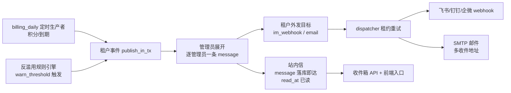

# 租户管理员通知设计（计费提醒 / 反滥用告警）

> 日期：2026-10-10；版本：v0.2；状态：📋 设计完成，待评审
> v0.2 评审简化：删除租户级偏好模型（四选一由 active target 推导）、email 收敛为单收件地址、credit_low 改月度幂等键、钉钉首期不支持加签；新增渠道配置帮助弹框（§7.1）
> 上游基础设施：[统一通知基础设施设计](notification-infrastructure-design.md)（2026-10-10 已合入核心 + Web Push 适配器）
> 关联设计：[系统级防滥用与限额设计](saas/anti-abuse-policy-design.md)（滥用告警是其事件出口）

## 1. 背景与目标

平台需要主动通知**租户管理员**（普通用户暂不通知）三类事件：

| 场景 | 触发条件 | 价值 |
|---|---|---|
| 积分即将耗尽 | 按近 7 天滚动日均消耗推算，预计耗尽日不足 7 天 | 续费/充值提醒，减少服务中断 |
| 租户有效期即将到期 | 距到期日 30 / 7 / 1 天 | 续费提醒 |
| 滥用告警 | 反滥用规则 `warn_threshold` 触发（含观察模式） | 管理员及时感知异常消耗，为反滥用阈值校准提供闭环 |

通知渠道：

- **站内信**：默认恒有，登录租户前台自行查看，零配置兜底；
- **外发渠道**：飞书 / 企微 / 钉钉 / 邮件，由租户管理员自行配置渠道参数，**四选一**启用（产品口径；实现上站内信恒开，外发至多一个渠道生效，见 §6.2）。

## 2. 与现有通知基础设施的关系

复用 `src/notifications/` 通知核心，本设计只新增**生产者**与**适配器**，不复制消息账本、幂等、租约重试、偏好模型。已有能力直接沿用：

| 已有能力 | 复用方式 |
|---|---|
| `notification_messages`（业务幂等键唯一约束） | 三个场景各定义稳定 `event_key`，天然防重 |
| `notification_deliveries`（租约重试 / 状态机） | 外发渠道投递专用；站内信不走 delivery（§5.3） |
| `notification_targets` | 扩展为支持租户级目标（§5.2）；外发渠道四选一由当前 active target 推导，不引入租户级偏好 |
| dispatcher 租约重试 / TTL / 过期清理 | 外发渠道失败重试、 abuse 高优先级 |
| `EventRegistry` 事件注册 + 参数校验 | 注册三个新事件类型 |
| `/api/notifications/test` 测试投递 | 扩展支持租户外发渠道测试 |

需要补的缺口：

1. **站内信能力**：现有 Web Push ≠ 站内信（浏览器推送要求订阅且站点可达）。站内信不引入新渠道适配器——message 本身即站内信（§5.3），补收件箱列表 API + 已读状态 + 前端入口。
2. **租户级接收目标**：现有 target 全部绑定 `recipient_user_id`（user 级）。租户外发渠道（一个 webhook / 一个邮箱）是**租户级**配置，需允许 tenant scope 的 target（`recipient_user_id` 为空），见 §5.2。
3. **租户管理员展开**：现有生产者直接指定 `recipient_user_id`。租户事件需要"展开阶段查租户管理员列表，逐管理员一条消息"（与既有契约"一次事件通知多个人时各自授权、各自一条消息"一致），见 §5.1。

旧 `src/services/notification_service.py` 不承载本需求的投递路径；其 `_send_email` 逻辑作为 email 适配器的内部实现来源复用。

## 3. 架构总览

生产者只提交"发生了什么、通知哪个租户"，不判断渠道是否配置、不直接调用任何发送接口。未配置外发渠道时仅站内信可达；站内信恒发，不受四选一影响。

## 4. 事件定义

| event_type | producer | event_key（幂等） | category | priority | resource_ref |
|---|---|---|---|---|---|
| `billing.credit_low` | billing_daily | `credit_low:{tenant_id}:{year_month}` | billing | 普通 | `{"type": "tenant_credit", "id": tenant_id}` |
| `billing.tenant_expiry` | billing_daily | `tenant_expiry:{tenant_id}:{threshold}` | billing | 普通 | `{"type": "tenant_profile", "id": tenant_id}` |
| `abuse.rule_triggered` | anti_abuse | `abuse:{tenant_id}:{rule_id}:{subject}:{window_start}` | abuse | 高 | `{"type": "abuse_event", "id": 事件ID}` |

模板与参数（`EventRegistry` 注册，参数模型严格校验）：

| event_type | template_key | 参数 |
|---|---|---|
| `billing.credit_low` | `billing_credit_low` | `tenant_name`、`daily_avg_credits`、`estimated_days`（预计耗尽天数，向下取整）、`remaining_credits` |
| `billing.tenant_expiry` | `billing_tenant_expiry` | `tenant_name`、`expire_date`、`days_left` |
| `abuse.rule_triggered` | `abuse_rule_triggered` | `rule_name`、`subject_label`（用户显示名/渠道配置名）、`window_credits`、`threshold_credits`、`observe_mode` |

**防轰炸策略**（生产者侧判断，账本幂等键只防同日重复）：

- `credit_low`：预计耗尽日 < 7 天才触发；`event_key` 含年月，每月至多一条，无需额外的查询抑制逻辑。
- `tenant_expiry`：按 30 / 7 / 1 天三个阈值档各提醒一次，`event_key` 含档位，天然一次。
- `abuse.rule_triggered`：幂等键含规则窗口起点，同窗口内重复触发只通知一次；priority 高，跳过渠道抑制（§6.2）。

## 5. 接收主体与展开

### 5.1 管理员展开

生产者先查后发：在原事务内查 `users`（role=admin，未禁用）逐管理员调 `publish_in_tx`，每条 message 独立幂等键含 `recipient`——既有唯一约束 `(scope_key, recipient_user_id, producer, event_key)` 已保证每管理员一条。

- 通知租户**全部** role=admin 用户，首期不做收窄配置。
- 管理员列表为空（异常态）时记 `logger.warning` 并落一条 platform 级诊断日志，不投递。
- 新增管理员不补发历史消息（与既有"展开完成后零目标不补发"口径一致）。

### 5.2 租户级外发目标

扩展 `notification_targets` 支持 tenant scope target（`recipient_user_id` 为空、`scope_key='tenant:xxx'`）：

- 现有 scope CHECK 已允许；需放开/明确"tenant 级 target 允许 recipient_user_id 为 NULL"的唯一性语义（`UNIQUE(provider, identity_digest)` 已保证同 provider 同配置唯一）。
- 同一租户同一 provider 至多一个 active target（应用层约束，登记时校验）。
- target `configuration_encrypted` 存渠道凭据（webhook URL / 收件邮箱），加密规范沿用渠道配置加密。
- `identity_digest` 对配置内容做摘要，配置变更即新 target（binding_version 语义与既有版本失效机制一致）。

### 5.3 站内信：message 即信，无 target 无 delivery

站内信**不引入渠道适配器、不创建 target、不产生 delivery**。依据：管理员展开后每条 message 本就按人独立（唯一约束 `(scope_key, recipient_user_id, producer, event_key)` 保证一人一条），message 落库即站内信送达；已读状态是"接收人读了这条消息"，语义归属 message 而非某次投递。

- `notification_messages` 新增 `read_at TIMESTAMPTZ`（NULL = 未读），已读即更新该列；未读数 = count(read_at IS NULL)。
- 站内信不参与外发重试/租约/TTL 账本——它没有网络发送，delivery 状态机（pending/sending/accepted）对它是噪音，不为了形式统一而伪装成外发渠道。
- 核心展开逻辑需要一个小特例：接收人无任何启用的外发目标时，消息标记 `expanded`（route_snapshot 为空），不因"零 delivery"滞留 pending。
- 收件箱语义 = 当前用户名下（`recipient_user_id` = 本人）本设计三类事件的 message 列表，按 `created_at DESC`。

## 6. 渠道与适配器

站内信不是适配器（§5.3），本节仅覆盖外发渠道。

### 6.1 im_webhook 适配器（飞书 / 钉钉 / 企微）

三渠道优先实现**群机器人 webhook**形态（管理员自建群机器人贴 URL 即可，无需建应用/配凭据），三个 provider 共用一个适配器基类：

| provider | 配置 | 发送 |
|---|---|---|
| `feishu_bot` | webhook URL | `POST {"msg_type":"text","content":{"text":...}}` |
| `dingtalk_bot` | webhook URL | `POST {"msgtype":"text","text":{"content":...}}` |
| `wecom_bot` | webhook URL | `POST {"msgtype":"text","text":{"content":...}}` |

- send 返回规范化 `SendResult`；限流（如钉钉 20 条/分钟）归 `retryable` + Retry-After；URL 失效（404/410/errcode 目标失效类）归 `target_invalid`。
- 安全：仅允许 https；出站前做内网地址解析校验（防 SSRF），复用适配器层统一出站防护。
- 钉钉加签：首期不支持，要求机器人安全设置选择「自定义关键词」（通知文案天然含租户名/事件名即可命中），省掉加签计算与 secret 加密存储。
- 企微应用消息形态（走已接入的企微应用凭据）留作后续扩展 provider，不阻塞本期。

### 6.2 四选一与站内信兜底

**产品口径**：租户设置页展示为"外发渠道四选一（可不启用）"，站内信不出现开关（恒开）。

**实现口径**：

- 不引入租户级偏好模型：当前启用哪个外发渠道由**当前 active 的 tenant target 推导**——登记了某 provider 的 target 即视为启用该渠道；切渠道 = 撤销旧 target + 登记新 target（登记入口自身保证同租户至多一个 active target，见 §5.2），无需互斥校验逻辑。
- 每个 provider 至多一个 target、一份配置（email 为单收件地址，多地址待真实需求出现再扩展）。
- 站内信恒开：站内信不是渠道、无偏好行可关，滥用告警等高优先级事件因此始终有可达渠道——纯四选一在外发渠道静默失效（token 过期、机器人被删）时会让管理员什么都收不到，站内信兜底是刻意设计。
- abuse 类通知不做免打扰/抑制；billing 类首期也不做免打扰时段（每日任务触发频率本身低）。

### 6.3 email 适配器

- `channel=email, provider=smtp`；租户配置**一个收件邮箱地址**，即一个租户级 target（`identity_digest` 按地址摘要），发件走服务器统一 SMTP（复用现有 `SMTP_*` 配置与 `notification_service._send_email` 的实现逻辑）。
- 目标校验：基础格式校验；不发送验证邮件（首期），提供测试投递替代（测试投递发到全部已登记地址或指定地址）。

## 7. 租户设置页与帮助

租户设置页（管理员）仅提供**外发渠道配置**：四选一选择 + 参数填写 + 「发送测试」按钮（扩展 `/api/notifications/test` 支持租户级 target）+ 「帮助」入口。

接收人收窄、分类开关、最近投递状态展示为首期不做（当前无真实诉求），有需求时再增补。

### 7.1 渠道配置帮助弹框

群机器人 webhook 的获取路径对不熟悉飞书/钉钉/企微后台的管理员不直观，需要显式引导。交互：选择 im 渠道后，参数区旁提供「如何获取 webhook？」帮助入口，弹框按当前所选 provider 显示对应引导文案（纯前端静态文案，随 provider 切换，不新增后端接口）：

| provider | 帮助要点 |
|---|---|
| `feishu_bot` | 群聊设置 → 群机器人 → 添加机器人 → 自定义机器人 → 复制 webhook 地址；安全设置选「自定义关键词」，填 `通知` 或租户名（通知文案天然包含） |
| `dingtalk_bot` | 群设置 → 机器人 → 添加机器人 → 自定义（通过 Webhook 接入）→ 复制 webhook 地址；安全设置勾选「自定义关键词」，填 `通知` 或租户名 |
| `wecom_bot` | 群聊右上角「...」→ 群机器人 → 添加机器人 → 新创建一个机器人 → 复制 webhook 地址 |
| `smtp` | 填写接收通知的邮箱地址即可，无需任何配置（发件由平台统一 SMTP 发出）；提示注意垃圾邮件/订阅邮件分组 |

文案由前端维护（`frontend/web` 常量），渠道入口改版时只改前端文案；最终步骤措辞以实现时各渠道实际界面为准。

## 8. API 设计

在现有 `/api/notifications/*`（schema v1）上扩展：

| 操作 | 入口 | 权限 |
|---|---|---|
| 租户外发渠道登记/更新/撤销 | `POST/PUT/DELETE /api/notifications/tenant-targets` | 租户管理员 |
| 租户外发渠道测试投递 | `POST /api/notifications/tenant-test` | 租户管理员，限频 |
| 收件箱列表（含未读数） | `GET /api/notifications/inbox?unread_only=&limit=` | 当前用户 |
| 收件箱已读 | `POST /api/notifications/inbox/{notification_ref}/read` | 当前用户（校验 message 归属） |
| 点击定位 | 复用 `GET /api/notifications/messages/{notification_ref}` | 既有权限边界 |

事件发布接口仍仅供可信服务内部使用（`publish_in_tx`），不提供客户端任意发送入口。租户停用/暂停时既有"租户停用撤销目标并使待投递失效"机制覆盖。

## 9. 数据模型变更

| 表 | 变更 | 说明 |
|---|---|---|
| `notification_messages` | 加 `read_at TIMESTAMPTZ`（NULL = 未读）及部分索引 `(recipient_user_id, created_at) WHERE read_at IS NULL`（收件箱未读查询） | 站内信已读状态落在 message 上（§5.3），不走 delivery |
| `notification_targets` | 无 DDL；放开应用层校验允许 tenant scope target 的 `recipient_user_id` 为 NULL | 现有 scope CHECK 已兼容；迁移文件仅补注释级说明与索引核对（`idx_notification_target_recipient` 对 NULL recipient 的查询路径需确认，必要时补 `(scope_key, channel, provider, state)` 部分索引） |
| `deploy/db_update.yaml` / `deploy/init-postgres.sql` | 同步登记 | 遵循数据库变更规范，幂等 SQL |

不新建表：消息、目标、投递三张通用表全部复用（偏好表本设计不使用）；仅 `notification_messages` 加一列。

## 10. 生产者实现

### 10.1 billing_daily 定时任务（background_runner）

每日一次（低峰时段）：

1. 遍历 active 租户：聚合近 7 天 `chat_records.credit_cost` 得日均消耗；`remaining / daily_avg < 7` 时发布 `billing.credit_low`（幂等键含年月，每月至多一条）。
2. 计算租户有效期剩余天数，命中 30 / 7 / 1 阈值档时发布 `billing.tenant_expiry`。
3. 调度挂 background_runner 平台生命周期（与通知 dispatcher 同层），不进 Gunicorn 请求进程。
4. 功能开关：`settings.notifications` 增加租户通知开关与各场景开关，禁用时不访问新路径（沿用"核心/provider 默认关闭"口径）。

### 10.2 反滥用事件接入（Phase 2）

反滥用规则引擎（见 anti-abuse 设计 §5）在 `warn_threshold` 命中时（含观察模式）调用 `publish_in_tx` 发布 `abuse.rule_triggered`。观察模式事件是阈值校准的数据源，通知让管理员参与校准闭环。依赖反滥用主体实现，故排 Phase 2。

## 11. 安全边界

- webhook URL、邮箱一律 `configuration_encrypted` 加密存储，接口回显脱敏（尾 8 字符），日志不落原始配置与完整响应；
- 展开与投递全程租户隔离（scope_key 校验既有机制）；`notification_ref` 不授予资源访问权限（既有口径）；
- 滥用告警内容含用户行为摘要，仅投递给该租户管理员，不跨租户、不进平台级广播；
- im_webhook 出站防 SSRF（https only + 内网地址拒绝 + 重定向校验）；
- 通知参数走 `EventRegistry` 严格参数模型，模板渲染内容快照（`parameters_encrypted`），不拼接任意用户输入原文（滥用样本原文如需展示，走管理后台查询，不进通知）。

## 12. 验收要点

- [ ] 三个事件幂等：同 event_key 重放不产生第二条 message；credit_low 每月至多一条
- [ ] 多管理员展开：每管理员一条独立 message
- [ ] 站内信：message 落库即收件箱可见；已读/未读正确（read_at 仅本人可更新）；非本人 message 读取被拒；无外发目标时消息不滞留 pending
- [ ] 四选一（target 推导）：切换 provider 后旧 provider target 失效、不再投递；新配置经测试投递验证
- [ ] 帮助弹框：选择各 im 渠道时显示对应的 webhook 获取指引文案
- [ ] 外发失败分类：限流重试、URL 失效 target_invalid、最终 failed 状态与设置页可见
- [ ] 站内信兜底：外发渠道全部失效时 abuse/billing 通知仍站内可达
- [ ] 租户隔离：A 租户管理员不可见 B 租户消息/目标
- [ ] 租户停用：待投递失效、不再展开
- [ ] 计费：本功能自身不新增 LLM/Embedding/ASR 调用点（纯模板渲染），无计费审计项

## 13. 实施计划

| 阶段 | 内容 | 依赖 |
|---|---|---|
| Phase 1 | `notification_messages.read_at` 列 + 收件箱 API/前端入口；租户外发渠道设置页（四选一 + 测试投递）；billing_daily 生产者（积分/到期）；im_webhook / email 适配器 | 无（通知核心已合入） |
| Phase 2 | `abuse.rule_triggered` 事件接入；反滥用规则引擎实现后挂接发布点 | 反滥用策略实现 |

风险与待定项：

- 企微若客户实际需要**应用消息**而非群机器人，补 `wecom_app` provider（复用已接入企微应用凭据），接口契约不变；
- 收件箱前端入口位置（侧边栏铃铛 + 未读角标）遵循 frontend-design 流程另行细化。
